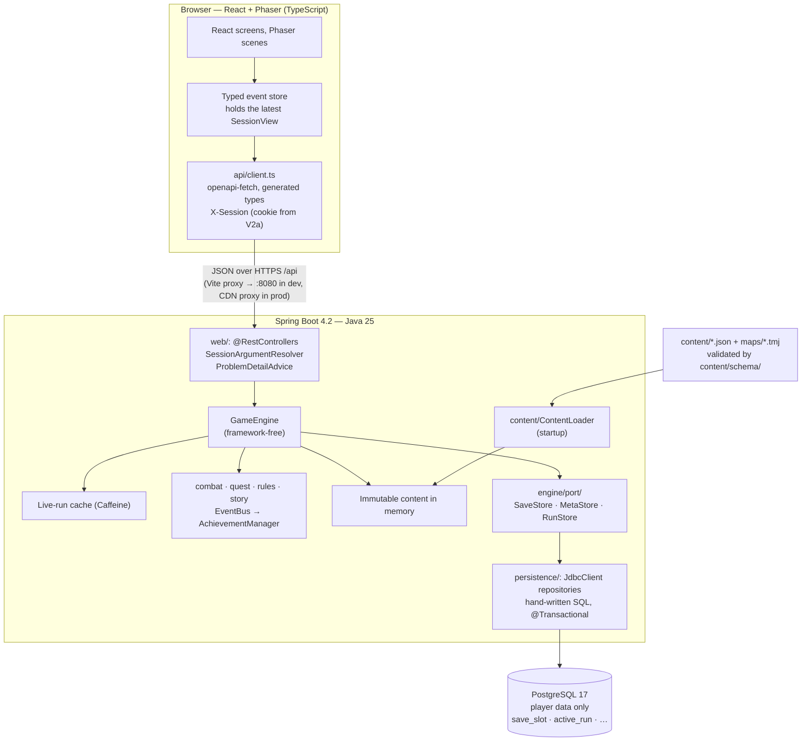
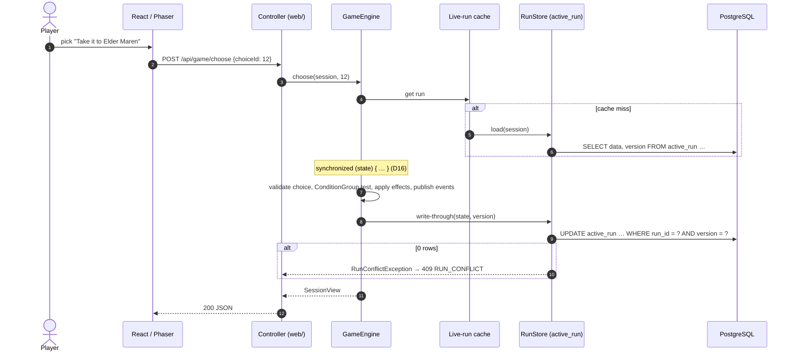

# Shardbound — Architecture

How the pieces fit together and how one player action travels from a click to the database and back.
Rules and formulas are in `V2_SPEC.md`; reasons are in `DECISIONS.md`.

---

## 1. Layers

### What lives where

| Concern | Java | Browser | PostgreSQL |
|---|---|---|---|
| Game rules (conditions, effects, damage, AI, quests, endings, world-event checks) | all of it | never | no |
| Content | immutable in-memory copy, loaded from JSON at startup | no | no |
| Live run | cached `GameState` | latest `SessionView` only | `active_run` (source of truth) |
| Saves | `SaveSnapshot` / `SaveUpgrader` | slot list | `save_slot` (JSONB + summary columns) |
| Achievements, endings, leaderboard | `AchievementManager`, `EndingResolver` | renders | rows + `v_leaderboard` view |
| Movement and presentation | validates events | moves freely, animates, themes | — |

---

## 2. Startup
1. Spring Boot starts with the active profile (`dev`, `test` or `prod`). In `dev`, Spring Boot's Docker Compose support starts PostgreSQL and Mailpit and wires the datasource.
2. Flyway applies `db/migration/V*__*.sql`.
3. `ContentLoader` validates every content file against its JSON Schema, then `JsonContentReader` → `ContentAssembler` → `prepareForPlay` (which builds the story graph and runs `QuestManager.topoOrder`). Any error stops startup with the file and location.
4. Controllers are registered; the dev-only Inspector and chapter select exist only in the `dev` profile.

Content is never re-read while the server runs; changing content means restarting it.

---

## 3. An action, end to end

- **The server re-checks everything.** The client sends only an id or a position; it cannot claim a choice is unlocked or that it reached a tile.
- **Every state-changing action is durable.** A restart or deploy loses nothing; the next request reloads the run from `active_run`.
- **World events** (`/api/world/exit`, `/interact`, `/encounter`) follow the same path, with reachability, speed and range checks first (V2_SPEC §4.11).

---

## 4. Saves
- A save writes one `save_slot` row: `data` (the `SaveSnapshot` as JSONB) plus `save_version`, `level`, `area_id` and `playtime_seconds`, in one UPSERT.
- A load reads the row, runs `SaveUpgrader` for every version above the stored one, and writes the upgraded document back in the same transaction.
- Saving is refused during battle, dialogue or cutscene (409).

---

## 5. Package map (backend)

| Package | Responsibility | Framework |
|---|---|---|
| `web`, `web.dev` | REST controllers, session resolution, `ProblemDetail` mapping; dev-only tools | Spring |
| `config` | `@ConfigurationProperties("shardbound")`, security config (V2a) | Spring |
| `persistence` | `JdbcClient` repositories implementing the engine ports | Spring |
| `engine`, `engine.port` | `GameEngine`, `GameState`, `EndingResolver`, `Mode`; `SaveStore`, `MetaStore`, `RunStore` | none |
| `view` | records sent to the client | none |
| `save` | `SaveSnapshot`, `CombatSnapshot`, `SaveUpgrader` | none |
| `content` | `ContentLoader`, readers (content, world, maps), assembler | none |
| `world` | maps, `CollisionGrid` (BFS), `MapValidator`, `WorldEventValidator`, the area graph | none |
| `dialogue`, `ds`, `rules`, `model`, `item`, `quest`, `combat`, `event`, `achievement`, `exception` | game rules and data | none |

ArchUnit fails the build if a framework-free package imports Spring, `jakarta.*` or `java.sql`. Class detail: `diagrams/class-diagram-v2.md`. Tables: `diagrams/er-diagram-v2.md`.

---

## 6. Errors

Every error is an RFC 9457 `ProblemDetail` (`application/problem+json`) with a stable `code`:

| Exception | HTTP | `code` |
|---|---|---|
| validation failure, `InvalidChoiceException` | 400 | `VALIDATION_FAILED`, `INVALID_CHOICE` |
| `LockedChoiceException` | 403 | `LOCKED_CHOICE` |
| `SaveNotFoundException` | 404 | `SAVE_NOT_FOUND` |
| `ActionNotAllowedException` | 409 | `ACTION_NOT_ALLOWED` |
| stale `active_run` version | 409 | `RUN_CONFLICT` |
| `SaveIncompatibleException` | 409 | `SAVE_INCOMPATIBLE` |
| rejected world event (V3) | 409 | `WORLD_EVENT_REJECTED` |
| `ContentValidationException` | — | startup only; never during play |

The client maps every `ProblemDetail` to an `ApiError`; on `RUN_CONFLICT` it refetches `/api/game`.
