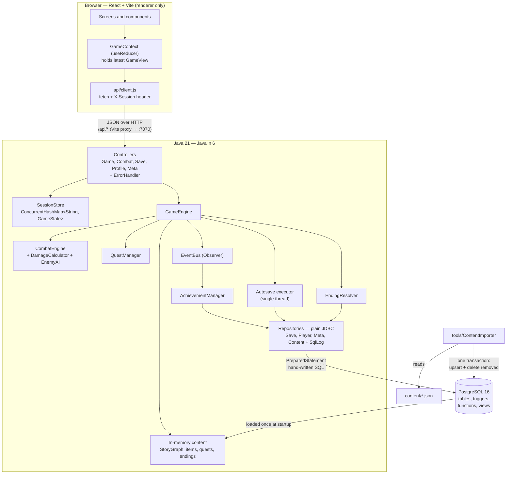
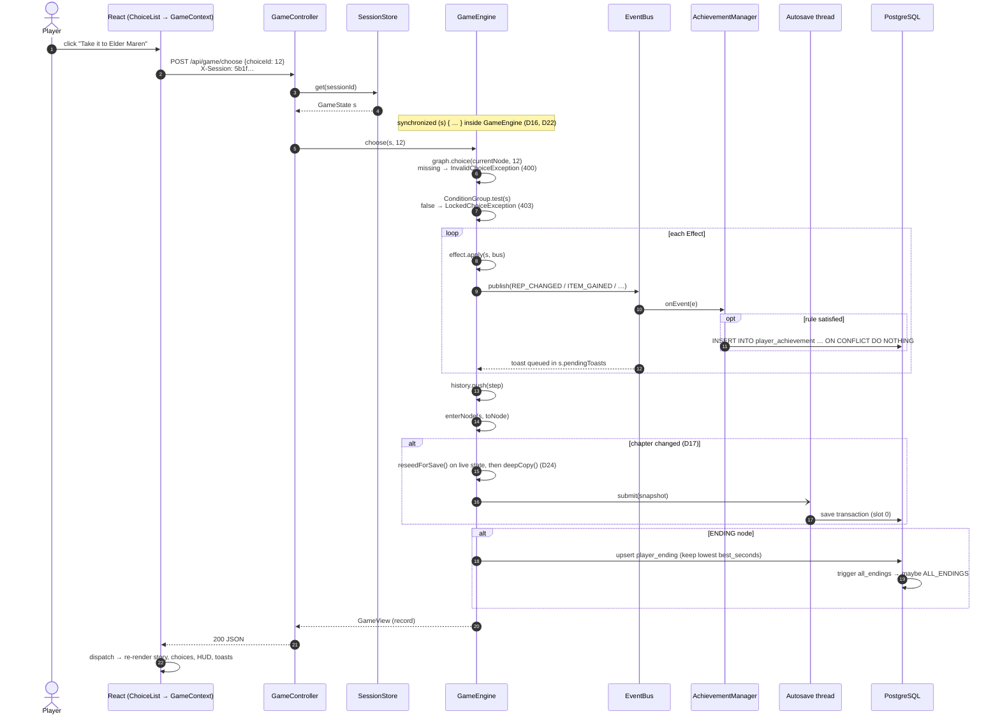
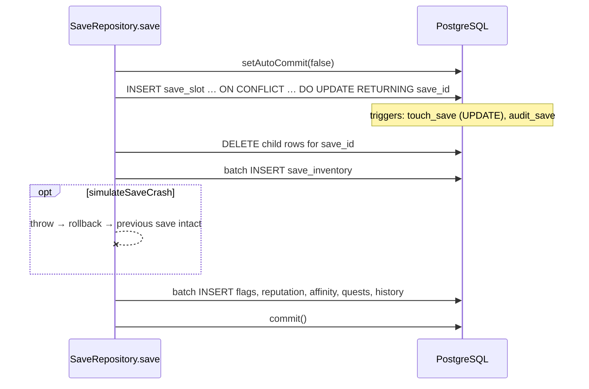
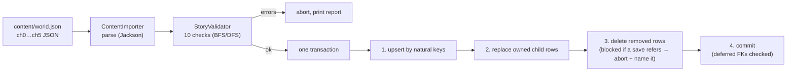

# Shardbound — Architecture

How the pieces fit together and how one player choice travels from a click to the database and back.
Details of each rule are in `PROJECT_SPEC.md`; reasons for changes are in `DECISIONS.md`.

---

## 1. Layers

### What lives where

| Concern | Java | React | PostgreSQL |
|---|---|---|---|
| Game rules (conditions, effects, damage, AI, quests, endings) | ✅ all of it | ❌ never | ❌ |
| Story content | in-memory copy (read-only) | ❌ | ✅ authoritative after import |
| Player progress | live `GameState` per session | latest `GameView` only | ✅ saves, achievements, endings |
| Aggregates and bookkeeping | | | ✅ triggers: `updated_at`, audit, `ALL_ENDINGS`; view: leaderboard |
| Presentation (themes, animation, typewriter) | supplies `region`, `location`, data | ✅ | |

---

## 2. Startup sequence

1. `App.main` reads `db.properties` (`AppConfig`) and opens the `Database`.
2. `ContentRepository` loads nodes, choices (with condition groups and effects), items, enemies, encounters, quests, endings and achievements.
3. `StoryGraph` builds the structural `Graph<String, String>` (D10). `QuestManager.topoOrder()` runs Kahn's algorithm and throws `ContentValidationException` on a cycle, so a broken quest DAG stops the server at startup, not mid-game.
4. Javalin registers routes and `ErrorHandler`, and starts on port 7070.

Content is never re-read while the server runs. Re-importing content means: run `ContentImporter`, then restart the server.

---

## 3. A choice, end to end

Key points for the viva:
- **The server re-checks everything.** The client sends only a `choiceId`; it cannot claim a choice is unlocked.
- **Most choices touch no database at all.** Content is in memory; only achievements, endings and autosaves write.
- **The autosave never blocks the player.** The request thread makes a deep copy and hands it to a single background thread, so the live state and the saved snapshot cannot interfere.

---

## 4. Save transaction

Either every row of the new save is written, or none are and the previous save is untouched (atomicity). The student implements this method (CLAUDE.md rule 8).

---

## 5. Content pipeline

---

## 6. Package map (backend)

| Package | Responsibility | Patterns |
|---|---|---|
| `config` | `AppConfig`, `Database` | |
| `api`, `api.dto` | HTTP routes, exception → status mapping, `GameView` records | |
| `engine` | `GameEngine`, `GameState`, `SessionStore`, `EndingResolver`, `Mode` | State machine (Mode) |
| `story` | `StoryNode`, `Choice`, `StoryGraph`, `StoryValidator` | |
| `ds` | `Graph<V,E>` | Generics |
| `rules` | `Condition` (sealed), `ConditionGroup`, `Effect`s, `RuleFactory` | Factory, polymorphism |
| `model` | `Faction`, `Npc`, `Stats`, `Tier` | Enums with fields |
| `item` | `Item` hierarchy, `ItemStack`, `Inventory` | Inheritance |
| `quest` | `Quest`, `QuestStatus`, `QuestManager` | State machine |
| `combat`, `combat.ai` | `CombatEngine`, `DamageCalculator`, `EnemyAI`s | Strategy |
| `event`, `achievement` | `EventBus`, `GameListener`, `AchievementManager` | Observer |
| `persistence` | JDBC repositories, `SqlLog` | Repository |
| `tools` | `ContentImporter`, `ConsoleRunner`, `GraphExporter` | |
| `exception` | Custom unchecked exceptions | |

Class-level detail: `docs/diagrams/class-diagram.md`. Tables: `docs/diagrams/er-diagram.md`.

---

## 7. Error handling

| Exception | HTTP | When |
|---|---|---|
| `InvalidChoiceException` | 400 | choice id not on the current node |
| `LockedChoiceException` | 403 | conditions not met |
| `SaveNotFoundException` | 404 | loading or deleting an empty slot (D27) |
| `ActionNotAllowedException` | 409 | valid request the current mode forbids, e.g. saving during combat (D27) |
| `SaveFailedException` | 500 | save rolled back / DB down |
| `ContentValidationException` | — | startup or import only; never during play |

Every error body is `{ "error": "<type>", "message": "<human text>" }`.
