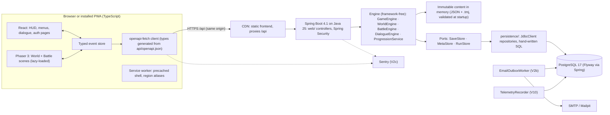

# Shardbound v2 — Specification

> **Source of truth for all v2 work.** `docs/PROJECT_SPEC.md` (v1) is historical. Its engine rules (conditions, ConditionGroup, effects, quest state machine, combat, endings) still apply wherever this document does not override them; its database, importer, API and frontend sections do not (P-03, P-04, P-05, P-07).
> Reasons for every decision: `docs/DECISIONS.md` (V-01 onward, then the platform reset P-01 … P-36, which win over older entries). Diagrams: `docs/diagrams/er-diagram-v2.md`, `docs/diagrams/class-diagram-v2.md`.
> All numbers in §4 and §10 are **starting values**; they live in `content/balance.json` and are retuned by the balance simulator (§4.14).

---

## 1. Vision and scope

A 2D top-down, walkable dark-fantasy RPG for desktop and mobile browsers. You carry the Heartshard across six regions of Valdren, fight turn-based battles against visible foes, rest at **Lanterns**, grow by spending **Shards**, and risk them on every death. The server decides every outcome; the browser renders it and moves the player.

| | |
|---|---|
| Audience | Players on phones and desktops (mobile-first, §4.16), plus reviewers reading a public repository. |
| Look | 16×16 pixel art drawn at an integer scale, pixel-perfect (P-29); one CC0 pack family, **Ninja Adventure** by pixel-boy, graded dark (palette remap + per-region colour grade); code and content use logical sprite keys mapped by an art manifest (P-34); original UI. Fonts **Cinzel** (headings) and **Cormorant Garamond** (text), self-hosted (OFL). Inspired by the *mood* of Souls-like games; no borrowed names, assets, fonts or UI. |
| Battles | Turn-based, classic monster-battler layout: enemy info top-left / sprite top-right, player sprite bottom-left / info bottom-right, text box with **ATTACK · SKILLS · BAG · FLEE**. |
| HUD | Top-left: HP bar, FP bar below it, level below that. Bottom-right: Shards counter. Bottom-left: 4 quick slots. Bottom-centre during boss fights: boss name + long bar. |
| Length | Critical path **1–2 h** (budget 105 min, §10); side content **+2–3 h**. 6 regions, 28 areas, 85 creep fights, 8 bosses. |
| Endings | Six (v1 §6.9). **The Merchant's Bargain** stays as an early secret bad ending in Eldmere. |
| Names used | Lanterns (rest points) · Shards (XP and currency) · Lost Shards (death drop) · "FOE VANQUISHED" (boss banner) · Lantern Draught (refillable heal). |
| Release | Public alpha after the Eldmere vertical slice (phase ALPHA, §12), then 1.0 at V12. Semver releases with a CHANGELOG. |
| Presentations | Dev-only chapter select (§4.13), available only in the Spring `dev` profile. |

---

## 2. Architecture and tech



| Layer | Choice |
|---|---|
| Backend | Java 25, **Spring Boot 4.1** (web, JDBC, Flyway, Actuator, validation; Security from V2a; mail from V2b), **JdbcClient** with hand-written SQL, Jackson, springdoc-openapi, networknt json-schema-validator, Caffeine, Bouncy Castle (Argon2 through Spring Security's encoder), JUnit 5, **Testcontainers**, ArchUnit |
| Database | **PostgreSQL 17**, player data only; roles `shardbound_owner` / `shardbound_app` / `shardbound_telemetry_ro` |
| Frontend | TypeScript, React 19 (HUD/menus), Phaser 3.90 (world/battle), Vite, openapi-typescript + openapi-fetch, Vitest, Playwright (budgets, e2e), installable PWA (V2c) |
| Ops | Docker Compose for dev (postgres + mailpit), GitHub Actions CI (Testcontainers, OpenAPI drift, gitleaks, PR-title lint), Dependabot, release-please, Cloudflare Turnstile, Sentry |

**Rules**
- The server is authoritative. React and Phaser render server views and send intents. The client moves the player tile by tile (P-51); the server validates every world event (§4.11).
- The engine packages are framework-free (no Spring, `jakarta.*` or `java.sql`), enforced by ArchUnit. Persistence is reached through ports in `engine/port/`.
- One lock per game: every handler runs game logic inside `synchronized (state)` (D16).
- Content is schema-validated JSON (`content/**`), loaded and validated once at startup. Any content error stops startup. There are no content tables.
- Every state-changing action is written through to `active_run` (§4.12), so a restart or deploy loses nothing.
- Secrets and settings come from environment variables bound to Spring properties; nothing secret is committed.
- No WebSocket. All traffic is REST over HTTPS on one origin.
- Branching: `main` is the trunk; v1 is tag `v1-archive`; each phase is one branch and one PR into `main`.

---

## 3. File structure

```
api/openapi.json                 generated contract (committed; CI fails on drift)
docker-compose.yml               dev services: postgres:17 + mailpit
package.json                     npm run dev → compose + API + Vite (concurrently)
scripts/dev-backend.mjs          starts the API with mvnw.cmd or mvnw
backend/src/main/java/com/shardbound/
  web/         @RestControllers (Game, Combat, Save, Profile, Meta, World, Lantern, …),
               SessionArgumentResolver (X-Session until V2a), ProblemDetailAdvice,
               dev/ (dev profile only: Inspector, ChapterSelect)
  config/      ShardboundProperties (@ConfigurationProperties "shardbound"), SecurityConfig (V2a)
  engine/      GameEngine, GameState, Mode, EndingResolver, live-run cache (Caffeine)
  engine/port/ SaveStore, MetaStore, RunStore
  view/        view records sent to the client (SessionView, BattleView, …)
  save/        SaveSnapshot, CombatSnapshot, SaveUpgrader (SortedMap<Integer, SaveUpgrade>), upgrades/*
  content/     ContentLoader (schema validation → JsonContentReader → ContentAssembler → prepareForPlay),
               MapLoader + MapValidator (.tmj)
  persistence/ PlayerRepository, SaveRepository, MetaRepository, ActiveRunRepository (JdbcClient)
  auth/        AccountService, GoogleLoginHandler, SessionService, SlidingWindowRateLimiter, LoginGuard,
               TurnstileVerifier, AccountCleanupJob (V2a); PasswordService, TokenService (V2b)
  privacy/     DataExportService, AccountDeletionService (V2a)
  email/       EmailSender (interface), SmtpEmailSender, EmailOutboxWorker, EmailTemplates (V2b)
  world/       WorldEngine, AreaGraph, MapData, CollisionGrid (BitSet), WorldEventValidator,
               EncounterService, CreepSpawner, SpatialHash
  battle/      BattleEngine (evolves combat.CombatEngine), BattleState, ElementChart, StatusTracker, Skill,
               DamageCalculator (v2 formula), BossScript, BossAI, TelegraphQueue
  progression/ Attributes (EnumMap<Attribute,Integer>), Curve, LevelCost, ShardWallet, LostShards, LanternService
  gear/        WeaponInstance (tier + upgrade), ScalingGrade, UpgradeService, MaterialCost
  dialogue/    DialogueGraph, DialogueEngine (reuses rules.ConditionGroup / Effect)
  cutscene/    Cutscene, CutsceneStep (sealed), CutscenePlayer
  telemetry/   TelemetryRecorder, TelemetryEvent
  tools/       GraphExporter, BalanceSimulator, PlaytestBot
  (kept from v1: combat, quest, rules, story, item, model, ds, event, achievement, exception)
backend/src/main/resources/
  application.yml (profiles dev, test, prod)
  db/migration/V1__baseline.sql …   (Flyway; hand-written SQL)
  email/       verify.html|txt, reset.html|txt, email_changed.html|txt, account_exists.html|txt (V2b)
backend/src/test/resources/saves/v1/   golden save fixtures for SaveUpgrader
backend/Dockerfile                     container image (V2c)
content/
  schema/*.schema.json (JSON Schema 2020-12; every content file names its "$schema")
  art/manifest.json (logical sprite keys → atlas frames, P-34)
  balance.json  regions.json  items.json  creeps.json  bosses.json  skills.json  elements.json  statuses.json
  world.json (factions, npcs, endings, achievements)  quests.json  maps/*.tmj  dialogue/*.json  cutscenes/*.json
frontend/src/
  api/ (client.ts, types.ts, schema.gen.ts — generated, gitignored)  store/ (eventStore.ts, mappers.ts)
  react/ (hud/, menus/, dialogue/, auth/, pages/privacy|terms)  phaser/ (BootScene, WorldScene, BattleScene)
  assets/ (atlases per region, audio)  settings/  pwa/ (service worker, V2c)
frontend/public/manifest.webmanifest (V2c)
tools/balance/progression.mjs (progression model, §10.2)
.github/workflows/ci.yml  .github/dependabot.yml  release-please config  CHANGELOG.md  CREDITS.md
```

---

## 4. Systems

### 4.1 Lanterns (rest points)
Resting at a Lantern, in one transaction:
1. HP and FP are set to max, and Lantern Draught charges are refilled.
2. Defeated creeps respawn: the run's defeated-creep set is cleared, and each spawn rerolls its level from the run's seeded RNG.
3. The Lantern becomes `last_lantern`, the respawn point.
4. An autosave is written to slot 0 (the D24 path: reseed the live state → snapshot → write).
5. The Lantern menu opens: **Level up** (§4.3), **Skills** (4-slot loadout), **Leave**; **Fast travel** joins it with the map in V8. Weapon upgrades happen at Smith NPCs (§4.6).

**From V5 (P-61):** Lanterns are `lantern` map objects (`lanternId`, `name`, `spawn`). A Lantern is cold until the player carries the Heartshard; interacting lights it once, and a lit Lantern stays lit and usable without the Heartshard. Steps 1–5 run as one keyed transaction, and the slot-0 autosave is written synchronously inside it.

**Fast travel.** Lanterns are vertices of the **area graph**: the edges in `regions.json` (`from`, `to`, `weight`), where the weight is the walking time in seconds between connected areas (from the maps). Edges whose `gateFlag` the player hasn't set are excluded. `Graph.dijkstra(source, weight)` returns each area's distance and the parent map. Travel is allowed to any **discovered** Lantern whose area is reachable.
- The route is drawn on the map screen, and the ETA sets the length of the travel transition: `min(3 s, ETA / 30)`.
- The same Dijkstra gives the **quest-marker next hop**: the first edge toward the objective area.
- The playtest bot uses it to route between areas.

### 4.2 Creeps and encounters
**V4 (P-54):** the request's `creepId` must name the creep the rule below selects; the lookup is a linear scan of the area's creeps until an area holds more than 16; after a FLEE the server accepts that creep again only after time enough to walk three tiles out and back (`2 × 3 × stepMs ÷ speedTolerance`).

- Creeps are placed as `creep_spawn` objects in Tiled: `template`, `levelMin`, `levelMax`, `aggroRadius` (1–3 tiles), optional `patrol` (cosmetic idle only).
- Level on (re)spawn = `levelMin + rng.nextInt(levelMax − levelMin + 1)`, using the run's seeded RNG.
- **Encounter rule:** when the player comes within a creep's aggro radius, the client sends `POST /api/world/encounter {creepId, x, y}`. The server validates the event (§4.11), looks up creeps in nearby `SpatialHash` cells (cell = 8×8 tiles), and starts a battle with the first living creep whose Chebyshev distance to the validated position is ≤ `aggroRadius`. Ties go to the lowest object id.
- Creep stats from its template (`base*`) and level: `hp = round(baseHp·(1 + 0.12(lvl−1)))`, `atk = round(baseAtk·(1 + 0.10(lvl−1)))`, `def = round(baseDef·(1 + 0.08(lvl−1)))`, `spd = baseSpd`.
- A defeated creep stays down (run state) until the player rests or dies.
- Running away (FLEE) keeps the creep alive; it ignores the player until they have moved 3 tiles out of its aggro radius.

### 4.3 Shards, levels and attributes
Shards are both XP and currency. They are earned from creeps, bosses and chests; spent on levels and upgrades; and lost on death (§4.4).

| Formula | Starting value |
|---|---|
| Level | `1 + (Vig + Mnd + Str + Dex + End + Arc) − 60` (all six start at 10; max 99) |
| Level-up cost (L → L+1) | `cost(L) = round(100 · L^1.5)` — L1 100 · L2 283 · L5 1 118 · L10 3 162 · L20 8 944 · L30 16 432 |
| Creep Shards | `creepShards(lvl) = round(35 · lvl^1.45)` — lvl1 35 · lvl2 96 · lvl5 361 · lvl10 986 · lvl20 2 695 · lvl30 4 852 |
| Boss Shards | `5 · creepShards(bossLevel)` |
| First level-up | after **3** Eldmere fights (35 + 35 + 96 = 166 ≥ 100) at the first Lantern |

These curves were fitted to the progression table in §10.2: the model hits every boss-level target exactly.

**Attribute effects** are piecewise-linear `Curve`s (soft caps where the slope drops). Points are `(attribute, value)`; `Curve.valueAt(x)` interpolates between `floorEntry` and `ceilingEntry` of a `TreeMap<Integer, Double>` in O(log n).

| Attribute | Effect | Curve points |
|---|---|---|
| Vigor | max HP | (10,100) (20,180) (30,280) (40,380) (60,500) (99,600) |
| Mind | max FP | (10,30) (20,55) (30,80) (50,120) (99,150) |
| Mind | spell power for Fire/Frost/Lightning skills | `SPm = 20 + 80·sat(Mind)` |
| Endurance | defence (all elements) | (10,10) (25,25) (40,40) (60,50) (99,60) |
| Endurance | status resist % | (10,5) (40,35) (99,50) |
| Strength / Dexterity / Arcane | weapon scaling saturation `sat(x)` | (10,0.00) (20,0.35) (40,0.70) (60,0.85) (99,1.00) |
| Dexterity | speed; crit bonus | `spd = 5 + floor(Dex/10)`; `crit% = weapon.crit + min(10, floor((Dex−10)/5))` |
| Arcane | status chance bonus (percentage points) | (10,0) (40,15) (99,25) |
| Arcane | spell power for Holy/Crystal skills | `SPa = 20 + 80·sat(Arcane)` |

Level-up happens only at a Lantern. The menu shows a server-computed **preview** (POST `/api/lantern/levelup/preview`, read-only and unkeyed). Several levels can be bought in one confirm, which runs in one keyed transaction. Input never waits on the network: + and − change the pending values at once, only the preview numbers follow the server's answer, and stale answers are ignored (P-61). The cost curve and the caps live in `balance.json`.

### 4.4 Death and Lost Shards
On death (HP reaches 0 in battle):
1. All held Shards become **Lost Shards** at the tile where the battle started. This replaces any previous Lost Shards (those are destroyed).
2. Held Shards are set to 0. The player respawns at `last_lantern` with full HP/FP and refilled draughts. Creeps respawn, and the boss resets (its intro cutscene does not replay, §4.7).
3. Recovering them: stepping within Chebyshev distance 1 of the marker sends `POST /api/world/recover` (a keyed, validated world event, §4.11), which adds them back, deletes the marker, and shows the toast "Shards recovered".
4. Dying again before recovering destroys them.
5. Telemetry records `DEATH` and `SHARDS_LOST` / `SHARDS_RECOVERED`.

**From V5 (P-62):** one seam (`engine/Death`) applies these steps. Before any Lantern is lit, the player wakes at the region's `respawn` point. Dialogue fights (the Hired Blade) keep their story outcome on a loss and drop no Lost Shards. **P-63:** the Lantern Draught has 3 charges of 40 % max HP, refilled at rests and on death; a victory restores 25 % of max FP.

### 4.5 Elements and statuses
Elements: **Physical, Fire, Frost, Lightning, Holy, Crystal**. Creature families: Beast, Human, Undead, Sylvan, Construct, Ashen, Crystalborn, Draconic.

| Family | Physical | Fire | Frost | Lightning | Holy | Crystal |
|---|---|---|---|---|---|---|
| Beast | N | **W** | N | N | N | R |
| Human | N | N | N | N | N | N |
| Undead | R | N | R | N | **W** | N |
| Sylvan | N | **W** | R | N | R | N |
| Construct | R | R | N | **W** | N | N |
| Ashen | N | I | **W** | N | N | R |
| Crystalborn | N | N | N | **W** | R | I |
| Draconic | R | R | **W** | N | N | N |

Multipliers: W 1.5 · N 1.0 · R 0.5 · I 0. The **bestiary** reveals a family's row for a creep after the first battle with it.

**Status effects** (tracked per combatant in an `EnumMap<Status, Integer>` of turns left; ticks at the start of the affected combatant's turn):

| Status | Effect | Turns |
|---|---|---|
| Bleed | on proc: burst of 12 % max HP, then 3 % max HP per turn | 2 |
| Poison | 4 % max HP per turn | 5 |
| Burn | 6 % max HP per turn; a Frost hit removes it | 3 |
| Frost | defence −30 %, speed −3; a Fire hit removes it | 2 |
| Stun | skips the next turn, then immune to Stun for 2 turns | 1 |

- Proc chance: `clamp(move.statusChance + arcaneBonus(attacker) − statusResist(target), 0, 90)` %, halved against bosses. Bosses become Stun-immune for 3 turns after a Stun.
- Family immunities: Undead and Construct ignore Bleed and Poison, Ashen ignores Burn, Crystalborn ignores Bleed.
- Status damage is never reduced by defence, and is at least 1.

### 4.6 Skills, weapons, tiers, upgrades, scaling
**Weapons** keep tiers F..SSS (v1 multipliers F 1.00 … SSS 3.00) and gain an upgrade level `u` = 0..10 and scaling grades.

| Weapon | Tier | Base | Str | Dex | Arc | Crit % | Source |
|---|---|---|---|---|---|---|---|
| Rusty Shortsword | F | 20 | D | D | – | 5 | start |
| Woodcutter's Hatchet | E | 28 | C | – | – | 5 | Eldmere side quest / merchant route |
| Hunter's Longbow | D | 30 | – | B | – | 10 | Eldmere wolf hunt |
| Iron Longsword | C | 36 | C | D | – | 8 | Brann's errand |
| Thornwood Spear | B | 44 | – | C | D | 10 | Warden trial |
| Moonsteel Blade | A | 52 | – | B | C | 12 | Sealed Vault |
| Kingsguard Halberd | S | 60 | B | – | – | 12 | Royal Tournament |
| Dragonbone Greatsword | SS | 70 | A | – | – | 15 | optional elite, Hollow Deep |
| Aetherion | SSS | 82 | C | C | B | 20 | Crystal Edge quest |

Grade coefficients: **S 1.5 · A 1.2 · B 0.9 · C 0.6 · D 0.35 · E 0.15 · – 0**.

**Attack rating** (shown in the menu):
```
AR = base · tierMult · (1 + 0.08u)  +  Σ_{a ∈ Str,Dex,Arc} base · grade(a) · (1 + 0.03u) · sat(attr_a)
```

**Upgrades** happen at Smith NPCs (Brann in Eldmere, the Royal Armourer in Valdren), one step at a time, as one transaction:

| Step | Shards `150·(u+1)²` | Materials |
|---|---|---|
| +0→+1 … +2→+3 | 150 · 600 · 1 350 | Shard Dust × 2(u+1) |
| +3→+4 … +5→+6 | 2 400 · 3 750 · 5 400 | Shard Fragment × (u−1) |
| +6→+7 … +8→+9 | 7 350 · 9 600 · 12 150 | Shard Crystal × (u−4) |
| +9→+10 | 15 000 | Heartstone × 1 (side content only) |

**Skills.** There are 4 equippable slots (loadout changed at a Lantern). Each skill has `element, power, fpCost, statusChance, status, scaling (WEAPON | MIND | ARCANE), target (ONE | ALL), telegraph=false`.
- Weapon arts use AR; spells use SPm or SPa.
- Skills are learned from quests, chests and levels (`skills.json` `unlock`).
- FP persists between battles; it refills at Lanterns and from Azure Tonics.

**BAG.** Holds Lantern Draughts (3 charges, +1 per Glimmer Seed up to 8; heal 45 % max HP; refilled at Lanterns), consumables and status cures. Quick slots 1–4 bind BAG items, usable in battle and in the world.

### 4.7 Battle
**V4 (P-54, P-57):** battles are 1 v 1. Creeps pick weighted moves (`creeps.json`) by AI strategy (`AGGRESSIVE`, `DEFENSIVE`, `AFFLICTER`); a creep move's raw damage is `atk × power`, and creeps crit at 5 %. Telegraphed heavy moves arrive with creeps in V4 (not only bosses). Guard lasts until the guarder's next turn; turn order is rebuilt each round from current speed. Round text auto-advances, a tap or E skips the round, holding E fast-forwards, and a Battle text speed setting (Slow/Normal/Fast/Instant, default Fast) sets the pace. Until V5 (P-55): attributes are fixed at 10, victories give held Shards and refill FP, HP does not regenerate, the starting bag holds 3 healing draughts, and defeat by a creep wakes the player at the region's `respawn` point with Shards kept and creeps reset.

**Layout:** v1 `CombatEngine` turn order (`PriorityQueue` by speed; player first on ties).
- Main menu: **ATTACK** (Strike / Guard) · **SKILLS** (4 slots) · **BAG** · **FLEE**.
- FLEE is disabled in boss fights. Flee chance follows v1 §6.6, using the speed above.

**Damage** (`battle/DamageCalculator`; the order of random calls is fixed, so a seed reproduces a fight):
```
raw      = (move uses weapon ? AR : SP) · move.power              Strike: power 1.0
elem     = chart[defender.family][move.element]                    W 1.5 · N 1 · R 0.5 · I 0
roll     = 0.9 + rng.nextDouble() · 0.2
crit     = rng.nextInt(100) < crit% ? 1.5 : 1.0                    (status damage never crits)
mitigate = 100 / (100 + DEF)                                        DEF after Frost −30 % if frosted
guard    = guarding ? (incoming move telegraphed ? 0.25 : 0.5) : 1.0
damage   = elem == 0 ? 0 : max(1, round(raw · elem · roll · crit · mitigate · guard))
status   = rng.nextInt(100) < procChance ? apply : —               (only if move.status set)
```
Defence is now a **ratio** (100 / (100 + DEF)) instead of v1's subtraction, so it stays balanced at large numbers (V-12).

**Bosses** (`content/bosses.json`):
- 2 phases. Phase 2 starts at `hpPct ≤ phase2At` (default 50 %). It plays a transition line, can switch move table, family/element and speed, and is Stun-immune for 1 turn.
- Moves are weighted (`weight`), chosen with the run's seeded RNG. A **telegraphed** move announces itself one boss turn earlier ("The Hollow King raises the bone crown…"), shown in the text box, and is executed on the boss's next turn. Guard reduces it to ×0.25.
- **Intro cutscene** plays on first entry. Skippable. Recorded in the run's seen-cutscenes set, so it is never replayed after a death.
- **Boss bar** at the bottom-centre: name + long HP bar with a phase-2 tick mark.
- **"FOE VANQUISHED"** banner on victory, then the Shards reward and loot.
- Boss defeat is recorded in the run's defeated-bosses set and is permanent.

Bosses on the critical path: Ashen Herald (Eldmere) · Thornmother (Whispering Wood) · Bone Warden, The Hollow King (Hollow Deep) · Ser Calder the Gilded (Valdren City) · Cinder Matriarch, Ashborn Wyrm (Ashen Wastes) · The Shard Sovereign (Crystal Spire). The optional elite **Dragonbone Revenant** (side content) is not counted among the 8.

### 4.8 NPCs, dialogue, quests, journal, map, bestiary
- **Dialogue** graphs (`content/dialogue/<npc>.json`) reuse v1 choices: every option has `conditions` (ConditionGroup with `grp`, D4) and `effects`.
  - Nodes carry `speaker`, `portrait`, and `mood` (neutral/happy/angry/sad/afraid), so dialogue reacts via conditions on flags, reputation, affinity and quest steps.
  - The v1 prologue becomes Eldmere dialogue. The merchant route ends in **END_QUICK**.
  - **Pages (P-44, P-49, P-50):** the client splits a node's text into pages of at most 3 lines over the world and 4 in the portrait deck (fewer if the box has no room), the last page leaving room for the choices; the box, and the portrait deck, fit their pages. Pages break between sentences, else clauses (after , ; : or a dash), else words, and the last two are rebalanced so the final page starts a sentence; `[page]` in the text forces a break. Each page types out; E, Space, Enter, gamepad A or a tap completes it, then turns the page; ▼ marks a finished page with more to come. Choices appear on the last page only. Holding the key fast-forwards pages already read on this profile.
  - **Choices (P-44):** W/S or ↑/↓ move a visible highlight, E, Space or Enter take it, 1–4 take a choice directly; mouse hover, clicks, taps and the gamepad also work.
  - **Message boxes (P-49):** a node whose only option is unlocked, ends the dialogue and has no effects is `DialogueView.message`: a box closed with E, A or a tap, without a choice button.
  - **Story cues (P-49):** an affinity change shows a cue from `world.json` `affinityCues` ("Corvin will remember that."), not a number; the number stays in the Bag.
- **Current objective (P-46):** `objectives` in `world.json` (`{id, text, conditions}`, the first whose conditions hold wins) give one short line, sent as `SessionView.objective`; it shows briefly when it changes and always in the pause menu. Quest steps (below) take over when they arrive.
- **Quests** gain ordered **steps**, each with an objective text and a marker target (`area` + optional object id). The quest state machine and Kahn order stay as in v1 (D14, `topoOrder`).
- **Quest markers:** the active quest's current step shows a marker on the map. In the world, an edge arrow points along the Dijkstra next hop.
- **Journal:** quests (in topo order) with completed steps, and dialogue memory (last 30 entries).
- **Map screen:** discovered areas, the edges between them, Lanterns, markers and the fast-travel route.
- **Bestiary:** a creep entry is created at first sight (`seen`). Its stats are revealed after the first battle, and its weakness row after the first battle **or** after hitting it with an element.

### 4.9 Audio, settings and accessibility
- **Audio:** one loop per region, a battle theme, a boss theme and a final-boss theme; SFX for steps, hits, crits, statuses, menus, Lantern and banner. CC0 or CC-BY only, all listed in CREDITS.md. **From V3 (P-42):** rain, footsteps, dialogue blips, UI clicks and the Eldmere track, starting after the first user interaction, within a CI audio size budget; each music track ships as OGG plus an AAC (`.m4a`) fallback for Safari (P-48); mute, music and effects volume in a small settings panel (stored in the browser until account settings arrive in V2a).
- **Settings** (stored per account in `account_setting`):

| Setting | Values |
|---|---|
| Text speed | slow / normal / fast / instant |
| Volume | master, music, sfx (0–100) |
| Reduce motion | no screen shake, no flashes, no typewriter |
| Colour-blind-safe icons | every element/status icon has a shape + letter, never colour alone |
| Input | keyboard, gamepad (Gamepad API) and touch (§4.16); remappable keyboard/gamepad bindings |
| Font size | 90–150 % |
| Telemetry | opt-out |

### 4.10 Accounts and security
Accounts for a public game, in two steps:
- **V2a (before the public alpha):** guest accounts and **Google sign-in (OIDC)**, guest → Google upgrade, sessions, CSRF, rate limits, Turnstile, data export and account deletion.
- **V2b:** email + password accounts with verification, forgot/reset and change email.

There are no public email accounts until reset and verification exist.

**Framework.** Spring Security handles authentication, sessions, CSRF and security headers. Google sign-in uses Spring Security's OAuth2 client (authorization code flow with PKCE, OIDC ID token).

**Guest mode (V2a)**
- `POST /api/auth/guest` creates an account with `is_guest = true`, no email, and display name `Guest-xxxx`, and starts a session. Turnstile-protected, plus a loose **30 per IP per hour** (configurable).
- Guests are hidden from the leaderboard.
- Upgrade keeps the same `account_id` and therefore all progress: to Google in V2a, to email + password in V2b (`POST /api/account/upgrade`).
- Guests inactive for **30 days** are deleted.

**Google sign-in (V2a)**
- Identities live in `account_identity(provider, subject, account_id, email, created_at)`, unique on `(provider, subject)`. The account is found by the ID token's `sub`, never by email alone.
- A new `sub` creates a new account, or upgrades the current guest when the sign-in starts from a guest session.
- **Linking to an existing email account (V2b onward)** happens only when Google reports `email_verified = true` **and** the account's own email is verified. Otherwise the sign-in creates a separate account. This prevents account pre-hijacking (someone registering a victim's email first and waiting for the victim to link Google).

**Sessions**
- 32 random bytes (`SecureRandom`), base64url, in cookie `sb_session`: `HttpOnly; Secure; SameSite=Lax; Path=/`.
- **Why Lax, not Strict:** the Google callback is a cross-site top-level navigation back to the game; with `Strict` the browser would not send the session cookie on it, and the sign-in would lose the guest session it should upgrade.
- `auth_session` stores only `SHA-256(token)`, plus `created_at`, `last_seen_at`, `expires_at` (30-day idle, sliding) and `absolute_expires_at` (90 days). Spring Security reads it through a custom `SecurityContextRepository`.
- Logout revokes the current session. Until V2a the API uses the `X-Session` header (declared as an API-key scheme in the OpenAPI contract).

**CSRF and cross-site protection**
- Spring Security's CSRF protection with a token: the `XSRF-TOKEN` cookie is read by the client and sent back as the `X-XSRF-TOKEN` header on every non-GET request.
- Every non-GET request must also have an `Origin` equal to `shardbound.app-origin` and a JSON content type.
- Bodies are limited to 64 KB. Input is validated per field (Bean Validation); failures return 400 `ProblemDetail` with `code = VALIDATION_FAILED` and the field errors.

**Email + password accounts (V2b)**

*Sign-up* (`POST /api/auth/signup`, Turnstile-protected)
- `email`: trimmed, stored **lowercase** (`CHECK (email = lower(email))`), unique, ≤ 254 chars.
- `password`: 10–128 chars, not equal to the email or display name.
- `displayName`: 3–20 chars `[A-Za-z0-9 _-]`, unique case-insensitively. It is shown on the leaderboard.
- Terms acceptance (checkbox) is stored as `terms_version` + `terms_accepted_at`.
- The response is **always** `202 "Check your inbox"`. If the email already exists, an *account exists* email is sent instead of a new account being created (no enumeration, V-21).

*Passwords.* Argon2id through Spring Security's `Argon2PasswordEncoder` (Bouncy Castle underneath): memory 19 MiB, iterations 2, parallelism 1, 16-byte salt, 32-byte hash, stored as a PHC string `$argon2id$v=19$m=19456,t=2,p=1$…`. Rehashed on login if the parameters change.

*Email verification*
- Single-use token, **24 h**, stored hashed in `auth_token(purpose = VERIFY)`. The link is `/verify?token=…`; the page POSTs `/api/auth/verify`.
- Unverified accounts can play but are **hidden from the leaderboard**, see a banner, and are **deleted after 7 days** if never verified.
- Resend: cooldown 60 s, max 5 per day.

*Login* (`POST /api/auth/login`, email + password)
- Rate limits via `SlidingWindowRateLimiter`: per IP **100 attempts / 15 min**, per email **5 failures / 15 min**.
  - The per-IP limit is deliberately loose: campus and mobile networks share one public IP (V-33). The per-email limit protects each account.
- After 5 failures the account is locked for 15 min (`locked_until`), doubling up to 4 h on repeats.
- Every failure gets the same message, "Invalid email or password". Limits respond "Too many attempts, try again later", even for unknown emails.

*Forgot password* (`POST /api/auth/forgot`, Turnstile-protected)
- Always the same `202` response.
- If the account exists, a RESET token is created: single-use, **30 min**, and older RESET tokens are invalidated.
- `POST /api/auth/reset {token, newPassword}` sets the password, marks the token used, **revokes all sessions**, and sends a *password changed* notice.

*Account settings*
- Change password (needs the current password; revokes the other sessions).
- Change email (needs the password): creates a CHANGE_EMAIL token holding `new_email`; the link goes to the new address. On confirm the email is updated (re-verified) and an *email changed* notice goes to the old address.

*Tokens.* `auth_token(token_hash, account_id, purpose ENUM('VERIFY','RESET','CHANGE_EMAIL'), new_email, expires_at, used_at, created_at)`. Only `SHA-256(token)` is stored. Verification is a single UPDATE `… SET used_at = now() WHERE token_hash = ? AND used_at IS NULL AND expires_at > now() RETURNING …`, which is atomic and single-use.

*Email: transactional outbox*
- Every account or token change that needs an email inserts an `email_outbox` row **in the same transaction**.
- `EmailOutboxWorker` (one background thread) polls every 5 s with `SELECT … FOR UPDATE SKIP LOCKED LIMIT 10`, renders the template (HTML + text) and sends it via `EmailSender`.
- On failure it increments `attempts` and sets `next_attempt_at = now() + 30 s · 2^attempts` (max 1 h). After 8 attempts the row is `FAILED`.
- Implementations: `SmtpEmailSender` (production, STARTTLS + auth, through Spring's mail support / Angus Mail, V-24) and Mailpit in development (SMTP on :1025, viewed at :8025). The provider is chosen at deploy time.
- Templates: verify, reset, email_changed, account_exists (HTML + text, `{{placeholders}}` HTML-escaped).
- **Real email delivery needs a domain** (bought before V2b) with **SPF, DKIM and DMARC** records.

**Account deletion and export (V2a).** See §4.18. Deletion needs re-authentication (a fresh Google sign-in, or the password for email accounts from V2b) and runs in one transaction:
- PII removed (email, password hash, identities, settings, sessions, tokens, pending outbox rows, saves, active runs);
- the account row is kept as a tombstone (`deleted_at`) with `display_name = 'Wanderer-' + 6 random chars`, so leaderboard rows are **anonymised**, not lost.

**Configurable limits (V-33).** Every limit, window and lockout duration in this section is a Spring property under `shardbound.security.*`, never a literal in code. Defaults:

| Property | Default |
|---|---|
| `shardbound.security.login.per-ip` | 100 / 15 min |
| `shardbound.security.login.per-email-failures` | 5 / 15 min |
| `shardbound.security.lockout.base` | 15 min (doubling, max 4 h) |
| `shardbound.security.guest.per-ip` | 30 / hour |
| `shardbound.security.verify.resend-cooldown` | 60 s (max 5/day) |

They are bound by `@ConfigurationProperties` from `application.yml` and can be overridden by environment variables (`SHARDBOUND_SECURITY_LOGIN_PER_IP`, …). Game balance stays in `content/balance.json`.

**Bot protection.** Cloudflare Turnstile is the **main defence**; rate limits are a backstop.
- It protects guest creation (V2a), sign-up and forgot-password (V2b). The server verifies each token against `siteverify` with the Turnstile secret, and fails closed in production.
- **Dev and CI use Cloudflare's official Turnstile test keys** (the always-pass site key and secret), so the real verification code path runs everywhere (V-34).
- **There is no Turnstile or rate-limit bypass in production builds.** No flag, header or account type skips them. The playtest bot runs only against the `dev` profile, where the test keys make Turnstile pass normally.

**Security headers** (Spring Security headers config; the CDN passes them through):
- `Content-Security-Policy: default-src 'self'; script-src 'self' https://challenges.cloudflare.com; frame-src https://challenges.cloudflare.com; connect-src 'self' https://<sentry-ingest-host>; img-src 'self' data:; style-src 'self' 'unsafe-inline'; font-src 'self'; worker-src 'self'; manifest-src 'self'; form-action 'self' https://accounts.google.com; frame-ancestors 'none'`
  - Sentry ingest is the only third-party `connect-src` (V2c). `worker-src 'self'` allows the PWA service worker. `accounts.google.com` is needed only where the sign-in leaves the page (form action / redirect); the Google flow is a top-level redirect, not a frame or script.
- `X-Content-Type-Options: nosniff`
- `Referrer-Policy: strict-origin-when-cross-origin`
- `Permissions-Policy: gamepad=(self)`
- `Strict-Transport-Security` (production only)

**Database roles**
- `shardbound_owner` runs migrations only (`spring.flyway.user`).
- `shardbound_app`: SELECT/INSERT/UPDATE/DELETE on application tables and USAGE on sequences; no DDL.
- `shardbound_telemetry_ro`: SELECT on telemetry views.

**Secrets and settings** (environment variables bound to Spring properties; `.env.example` lists them):
`SPRING_PROFILES_ACTIVE`, `SPRING_DATASOURCE_URL`, `SPRING_DATASOURCE_USERNAME`, `SPRING_DATASOURCE_PASSWORD`, `SPRING_FLYWAY_USER`, `SPRING_FLYWAY_PASSWORD`, `SPRING_SECURITY_OAUTH2_CLIENT_REGISTRATION_GOOGLE_CLIENT_ID`, `SPRING_SECURITY_OAUTH2_CLIENT_REGISTRATION_GOOGLE_CLIENT_SECRET`, `SPRING_MAIL_HOST`, `SPRING_MAIL_PORT`, `SPRING_MAIL_USERNAME`, `SPRING_MAIL_PASSWORD`, `SHARDBOUND_MAIL_FROM`, `SHARDBOUND_TURNSTILE_SECRET`, `SHARDBOUND_TURNSTILE_SITE_KEY` (public), `SHARDBOUND_APP_ORIGIN`, `SENTRY_DSN`. In the `dev` profile, Spring Boot's Docker Compose support supplies the datasource; the localhost-only compose credentials are documented as not secret.

**Cleanup.** `AccountCleanupJob` (`@Scheduled`, hourly) deletes:
- guests inactive for 30 days;
- expired sessions;
- unverified email accounts older than 7 days, expired tokens and SENT outbox rows older than 30 days (V2b).

**Privacy and terms:** §4.18.

### 4.11 Server-validated world events
- **The client moves in tile steps (P-51).** The player always stands on a whole tile; each step slides smoothly to the next tile in `world.stepMs` (`balance.json`, 160 ms). Holding a direction keeps walking; a quick tap on a new direction turns in place (it must still be held after `world.turnMs` to walk). Every press is a queued step, so no press is lost in a long frame, and movement is time-based, so speed and arrival tiles are the same at any frame rate. Collision is a tile lookup (the `collision` layer, active obstacles, NPC tiles, the map edge); no physics. Keyboard, gamepad or the touch D-pad (§4.16). The client does not report every step.
- **The server validates events, not steps.** Three REST endpoints carry the client's current position (the pixel centre of the player's tile; the server uses tile `floor(x/tilewidth), floor(y/tileheight)` from the map, 16 px today, P-29):

| Endpoint | Body | Effect when accepted |
|---|---|---|
| `POST /api/world/exit` | `{exitId, x, y}` | area change to the exit's `toArea` / `toSpawn` |
| `POST /api/world/interact` | `{targetId, x, y}` | NPC → dialogue; chest; Lantern; Smith; Lost Shards; `trigger` objects (sent automatically when the player walks into one) |
| `POST /api/world/encounter` | `{creepId, x, y}` | battle starts (§4.2) |

- **Checks**, in order; all must pass:
  1. the game is in WORLD mode;
  2. the position is a tile centre (P-51), and its tile is in bounds and walkable on the area's `CollisionGrid` (a `BitSet`, index `y·width + x`: the `collision` layer, every building footprint (P-43) and every **active obstacle** for this game's flags (P-45));
  3. the tile is **reachable** by BFS on the `CollisionGrid` from the **last validated position**;
  4. **speed check** (P-19): the BFS path length in tiles ≤ `speed × elapsed × speedTolerance + slack`, where `speed = 1000 / stepMs` is the walk speed in tiles per second (P-51), `elapsed` is the server time since the last validated event, and `slack` absorbs latency (both in `balance.json`);
  5. the target object or creep exists, is active (not opened, not defeated), and is **within range**: Chebyshev distance ≤ 1 tile for interactions, on the exit's rectangle for exits, ≤ `aggroRadius` for encounters.
- **Accepted:** the position becomes the new last validated position, the event's effect runs, and the response is the updated `SessionView`.
- **Rejected:** `409` `ProblemDetail` with `code = WORLD_EVENT_REJECTED` and the last validated position; the client moves the player back to it.
- **Lost to an outage:** an event that never got an answer (network down, server restarting) shows "Reconnecting…" (P-30); once the game reconnects, the client moves the player to the position in the server's view, so stepping onto the exit or trigger again sends it again.
- **The last validated position is what saves store.** It changes only on accepted events, area changes and respawns.
- **Locking:** every world event runs inside `synchronized (state)`, the same per-game lock as every other handler (D16). Each accepted event is written through to `active_run` (§4.12).
- There is no WebSocket and no reconnect protocol. After a reload the client fetches `GET /api/game` and continues from the last validated position.

### 4.12 Saves and active runs
**Save slots.** Slots 1–3 (manual, only at a Lantern) plus slot 0 (autosave on rest, area change, boss defeat).
- One row per slot in `save_slot`: `data JSONB` holds a `SaveSnapshot` (everything `GameState` persists), plus `save_version` and summary columns `level`, `area_id` and `playtime_seconds` for the slot list. The summary columns are written in the same UPSERT as `data`.
- `slot_no` has `CHECK (slot_no BETWEEN 0 AND 3)` and `UNIQUE (player_id, slot_no)`; `data` has `CHECK (jsonb_typeof(data) = 'object')`.
- Saving is refused during battle, dialogue or cutscene (409, D27).

**Versioned upgrades.** `SaveUpgrader` holds a `SortedMap<Integer, SaveUpgrade>` of JSON-tree transforms, each taking a document from version N to N+1. On load, every upgrade above the saved version is applied in order, and the upgraded document is written back in the same transaction. Golden fixtures in `backend/src/test/resources/saves/v1/` pin each version. A save that names content ids the current content does not know is refused with 409 `SAVE_INCOMPATIBLE`.

**Content id guard (P-28, from V2c).** CI compares every content id (nodes, items, quests, factions, encounters, endings, achievements, and later areas and creeps) with the last release's content and fails if an id is removed or renamed without a `SaveUpgrade` that maps it. The 409 on load stays as the last line of defence.

There is no v1 → v2 conversion: v1 never ran in production, so no v1 saves exist (P-05).

**Active runs (durable sessions, P-22).**
- The in-memory `GameState` is only a cache (Caffeine, bounded, expires after inactivity).
- The source of truth is `active_run(run_id UUID PK, player_id FK, session_token_hash UNIQUE, version BIGINT, data JSONB, updated_at)`. Until V2a it is keyed by `SHA-256(X-Session)`.
- **Write-through:** after every state-changing action, inside the per-game lock: `UPDATE active_run SET data = ?, version = version + 1, updated_at = now() WHERE run_id = ? AND version = ?`. Zero rows updated → `409 RUN_CONFLICT`, and the client refetches `GET /api/game`.
- **Reload:** on a cache miss the run is rebuilt from `active_run`.
- **Client resilience (P-30):** the client discards its session only on `404 RUN_NOT_FOUND`. On network errors, 5xx or `RUN_CONFLICT` it shows "Reconnecting…" and retries `GET /api/game` with backoff 0.5 → 1 → 2 → 4 → 8 s (capped, jittered) until the run resumes. `resume.spec` (Playwright) restarts the backend and reloads the page: 5 cycles on every PR, 20 nightly (P-36).
- The snapshot includes an optional `CombatSnapshot` (enemies, round, log). The RNG is reseeded on each write (D7), so a reloaded run continues deterministically.
- A backend restart or deploy mid-run loses nothing (`ActiveRunIT`).

### 4.13 Performance budgets and dev tools
| Budget | Target | How it is measured |
|---|---|---|
| Title screen interactive | < 2.0 s | Playwright, cold cache, `performance.mark('title-interactive')` |
| Region load | < 1.5 s | mark from the `/api/world/exit` response to the first World frame |
| Battle start | < 300 ms | mark from the `/api/world/encounter` response to the first Battle frame |
| Initial JS (title) | ≤ 200 KB gzip | CI bundle check from **V3** |
| Phaser chunk (lazy) | ≤ 450 KB gzip | CI bundle check from **V3**; Shardbound's own Phaser build with only the modules it uses (P-60) |
| Region asset pack | ≤ 1.5 MB | CI asset check |
| Audio, initial pack | ≤ 64 KB | CI bundle check: interface sounds loaded with the first page (P-59) |
| Audio, region pack | ≤ 1,280 KB per region | CI bundle check: the region's music (larger of OGG and AAC), ambience and the shared Lantern sounds, loaded on entering it (P-59, P-64). V7's boss music gets its own pack, loaded at the boss arena |
| Audio, battle pack | ≤ 1,024 KB | CI bundle check: the battle track and effects, loaded only when a creep is near (P-57, P-59) |

**Mobile performance budget (P-24, from V3).** Target device class: mid-range Android, about 4 GB RAM, Snapdragon 6-series class. The automated measurements run **nightly and before releases**, not as PR gates (P-36).

| Budget | Target | How it is measured |
|---|---|---|
| Frame rate | 60 fps target, 30 fps floor: **p95 main-thread CPU time per frame ≤ 33 ms**, and no more than 25 % worse than the last good nightly run (P-38) | Playwright + Chrome DevTools Protocol with 4× CPU throttling in CI, walking (and from V4 fighting) in each region; per-frame CPU is the sum of the frame's animation-frame callbacks (Phaser update and render) in a DevTools trace. GPU cost is checked on the real device |
| JS heap | ≤ 100 MB per region | CDP heap metrics in the same run |
| Texture memory | ≤ 64 MB per region | atlas sizes summed per region (CI asset check) |
| Real device | one check per region | manual run on a device of the target class, recorded in the phase report |

- Phaser is `import()`ed after the title screen, built from its source with only the modules the game uses (P-60).
- Each region has one texture atlas, and the next region's pack is preloaded in the background when the player is one area away (Dijkstra distance on the area graph).
- **Chapter select (dev only):** the `/api/dev/chapter-select` controller exists only in the Spring `dev` profile (`@Profile("dev")`); in any other profile the route does not exist (404). The frontend button is behind `import.meta.env.DEV` (dead-code-eliminated). CI greps the production bundle and fails if `chapter-select` appears.

### 4.14 Telemetry, balance simulator, playtest bot
- **Events:** `RUN_START`, `AREA_ENTER`, `BATTLE_START`, `BATTLE_END` (outcome, turns), `DEATH`, `SHARDS_LOST/RECOVERED`, `LEVEL_UP`, `BOSS_DEFEATED`, `RUN_END`.
  - Keyed by an **anonymous `run_id`** (a UUID stored in the save). There is no account id in telemetry.
  - The account setting `telemetry_opt_out` makes the recorder drop events.
- **Recorder:** events go into a `LinkedBlockingQueue`; one writer thread batch-inserts every 2 s or every 100 events. Play never waits for it.
- **Storage:** `telemetry_event(event_id BIGSERIAL, run_id UUID, type, area_id, level, payload JSONB, at TIMESTAMPTZ)`.
  - **BRIN on `at`**: append-only rows arrive in time order, so a tiny block-range index serves dashboard time-range scans.
  - **B-tree on `(run_id, at)`**: per-run window functions need the rows of one run in time order, which BRIN cannot provide (V-26).
- **SQL:**
  - `v_deaths_by_area` (GROUP BY);
  - `v_time_per_area` (`LEAD(at) OVER (PARTITION BY run_id ORDER BY at)` minus `at` for AREA_ENTER rows);
  - `v_fights_per_level` (`ROW_NUMBER()`, `SUM() OVER` running totals);
  - `mv_balance_summary`, a **materialized view** per area (death rate, median fights, `percentile_cont(0.5)` entry level), `REFRESH MATERIALIZED VIEW CONCURRENTLY` with a unique index.
- **Balance simulator** (`tools.BalanceSimulator`): runs thousands of seeded headless battles with the real `BattleEngine` for each creep/boss × player level × build (Str/Dex/Mind/Arcane presets).
  - It reports win rate, mean turns and HP lost, and checks them against `balance.json` targets: creeps at their region's expected level ≥ 95 % win, average ≤ 4 turns; bosses on the first try 40–70 %.
- **Playtest bot** (`tools.PlaytestBot`): starts a guest run over the **real REST API** (the generated contract) and plays the critical path. It runs **only against the `dev` profile**: Turnstile test keys, normal rate limits, no bypass (V-34).
  - Within a map: BFS on the collision grid. It sends world events (§4.11) along the path, paced so the speed check passes; there is no speed-check bypass. Between areas: Dijkstra. Dialogue: a per-region route script. Battle policy: weakness skill > Strike; draught when HP < 40 %.
  - It estimates human time as `steps × 0.125 s + battle turns × 2.5 s + dialogue words ÷ 200 wpm`, and fails if any region exceeds its §10 budget by more than 15 %.

### 4.15 Ops: local dev, CI, release, deploy
**Local development**
- Root `docker-compose.yml`: `postgres:17` (healthcheck `pg_isready`, named volume, bound to `127.0.0.1:5432`) and `mailpit` (pinned, `127.0.0.1:1025` SMTP / `127.0.0.1:8025` UI). Its default credentials are localhost-only and not secret.
- One command at the repo root: `npm run dev` starts the compose services, the API on :8080 (`dev` profile; Spring Boot's Docker Compose support wires the datasource) and Vite on :5173 (proxying `/api`).

**CI (GitHub Actions, `ci.yml`, on every push and PR)**
- Backend: Temurin 25, `./mvnw -B verify`: unit tests, ArchUnit, content schema tests and **Testcontainers** integration tests (`postgres:17-alpine`), with the Turnstile test keys.
- **OpenAPI drift check:** `OpenApiExportIT` writes `api/openapi.json`; CI fails if `git diff --exit-code api/openapi.json` shows a change.
- **Breaking-change check** (from V2c): `oasdiff` compares the contract with the previous release (§4.19).
- Frontend: Node 24, `npm ci`, typecheck, Vitest, build.
- **PR gates (P-36):** unit, integration and Playwright e2e functional tests (desktop + mobile; `resume.spec` with 5 restart-and-reload cycles), bundle-size and asset checks, the production-bundle grep and the CREDITS check (bundle and asset checks from V3).
- **Nightly and before releases (P-36):** the mobile performance budget (§4.13) and `resume.spec` with 20 cycles.
- Prod-bundle grep for dev tools.
- **gitleaks** secret scanning; **PR-title lint** (Conventional Commits; PRs are squash-merged).
- **Dependabot:** maven, npm (frontend and root), github-actions, docker; weekly, grouped.
- **release-please:** semver tags and `CHANGELOG.md`, starting at `0.1.0`, with backend and frontend versions kept in step.

**Deploy (V2c)**
- The backend ships as a container image (multi-stage Maven build on a Java 25 JRE base, runs as a non-root user and connects as `shardbound_app`).
- Backend region Mumbai or Singapore, close to the audience; the provider is chosen at deploy time.
- The frontend is served from a CDN that **proxies `/api`** to the backend, so the browser sees one origin and the session cookie stays first-party.
- Managed PostgreSQL with **point-in-time recovery or daily backups**, plus a **tested restore** (a restore drill is part of the ALPHA checklist).
- **Preview deployments** per PR.
- Checklist: domain + TLS, env secrets, log retention 14 days, Turnstile production keys, Google OAuth production client, Sentry alerts; SPF/DKIM/DMARC before email goes live (V2b).

### 4.16 Mobile and PWA
- **Controls:** keyboard (WASD or arrows, E or Space to interact, I for the Bag, Esc for the menu), gamepad (D-pad or left stick, A) and touch (an on-screen D-pad, the interact button, **tap to interact** with a tapped object in reach).
- **View scale (P-29, P-52):** a whole-number zoom that keeps about 11 tiles across the short side, at least 2 where 8 tiles still fit (a phone on its side with the address bar showing), and never less than the map needs to fill the screen. A lifted finger always stops the D-pad, wherever it lands; the world screen allows no text selection or touch callout. Every area's ambient light multiplies each colour channel by at least 0.55, so nights stay readable at half brightness.
- **Full screen (P-53):** on a phone layout the first tap in the game asks for full screen (where the browser supports it); a full-screen button beside Bag and Menu brings it back after the player leaves it. The D-pad and Ⓐ start no browser long-press gesture.
- **Input-aware layouts (P-40, replaces landscape-first):** the layout follows input capability and the last input used (coarse pointer, touch, key presses), not screen width, and switches live; `dvh` units and safe-area insets.
  - *Keyboard and mouse:* no touch controls; the game view fills the screen.
  - *Phone portrait (the main phone layout):* the game view with the HUD cluster on top, a control deck below (D-pad, interact A, menu, bag). An open dialogue renders inside the deck.
  - *Phone landscape:* the desktop layout plus translucent touch controls (about 40 % opacity idle, full while pressed).
  - On touch, quick slots sit behind the bag button; the boss bar is bottom-centre (V7).
- **Interaction marker (P-46):** the key or button for the device in use (E, gamepad A, a tap icon) floats above the nearest NPC or object in reach.
- **Arrival (P-49):** the area title card first (about 2 s), then any opening dialogue, then the objective banner, then hints; never two at once.
- **Layout polish (P-47):** the portrait deck takes about 28–30 % of the height, with pill-shaped Bag and Menu; the area name is a title card when entering an area; desktop shows Bag and Menu as icon buttons with key hints (I, Esc); in landscape Bag and Menu are translucent until pressed.
- **HUD (P-39):** a compact top-left cluster without a panel: level badge, thin HP bar, thinner energy bar. Phones: at most ~10 % of the height and ~35 % of the width, numbers only while a value changes or after a tap. Desktop: fixed maximum width, numbers always. After a few calm seconds at full HP it fades to ~35 % opacity, and returns on damage, energy use, level-up, low HP or a nearby enemy. Shards show bottom-right, briefly, on change. No HUD element covers the player or the area around them.
- **Onboarding (P-41):** a Controls screen on the title screen and in the pause menu; contextual hints once per profile (movement at the start, interact at the first object in reach), skippable, with a setting to turn them off; button labels match the device (E, gamepad A, the tap icon).
- **Every** touch target (menus, dialogue choices, tabs, modals, battle buttons) is at least 48 × 48 px; a Playwright check measures it at mobile size on each screen.
- **Battle:** every touch target (menu buttons, skills, bag items) is at least **48 × 48 px**.
- **Installable PWA (V2c):** web app manifest and a service worker.
  - The app shell (HTML, JS, CSS, fonts) is precached.
  - Region atlases and audio are versioned by content hash and served **cache-first**.
  - **`/api` is never cached** by the service worker.

### 4.17 Observability (V2c)
- **Sentry** in the frontend and backend for errors and releases. No PII: no emails, no display names, no IP addresses; user context is an opaque account id at most, and request bodies are not sent.
- **Structured JSON logs** in production (one line per event, with a request id).
- **Actuator:** `health` (liveness/readiness, including the database) from P0, and metrics from V2c. Actuator endpoints are not exposed publicly beyond health.

### 4.18 Privacy (V2a)
- **Privacy policy** (`/privacy`) and **terms** (`/terms`), versioned in the frontend. The policy lists exactly what is stored: account identifiers (Google subject, email when given), display name, hashed password (V2b), saves and active runs, settings, anonymous telemetry, error reports without PII, and server logs kept 14 days.
- **Data export:** `GET /api/account/export` returns the player's data as one JSON document (account, settings, saves, achievements, endings).
- **Account deletion:** `POST /api/account/delete` after re-authentication; anonymises leaderboard rows (§4.10).
- India's DPDP Act and the GDPR are the reference for these rights.

### 4.19 Version skew (V2c)
PWA caches mean old clients meet new servers.
- Every API response carries `X-API-Version`; every request carries `X-Client-Version`.
- When the client sees a newer incompatible API version, it shows **"Update available — reload"**.
- The backend stays compatible with the previous frontend release for one release.
- CI runs `oasdiff` against the previous release's `api/openapi.json` and fails on breaking changes that are not announced in the release notes.

---

## 5. Design notes: data structures

The structures below were chosen for the jobs they do. They are design notes, not constraints.

| Where | Structure | Why | Complexity |
|---|---|---|---|
| Fast travel, quest next hop, bot routing | `Graph.dijkstra` with `PriorityQueue` (lazy deletion) + `HashMap` dist/parent | non-negative weighted shortest paths | O((V+E) log V) |
| Attribute curves, soft caps | `Curve` = `TreeMap<Integer,Double>`, `floorEntry`/`ceilingEntry` + linear interpolation | sorted breakpoints | O(log n) |
| Login rate limits | `SlidingWindowRateLimiter` = `ConcurrentHashMap<String, ArrayDeque<Long>>` (timestamps) | exact sliding window, drop expired from the head | O(1) amortised |
| Collision | `CollisionGrid` = `BitSet` (index `y·w + x`) | 1 bit per tile, O(1) test | O(1) |
| World-event reachability + speed check, map validator, bot | `Graph.bfs` / grid BFS over walkable neighbours | fewest-tile path from the last validated position | O(W·H) worst case |
| Creep aggro lookup | `SpatialHash` = `HashMap<Long, List<CreepSpawn>>` keyed by packed cell (`cx << 32 \| cy`) | only nearby creeps checked per event | O(k) |
| Live runs | Caffeine cache (bounded, expire after access) | evicts idle runs without a hand-written map and cleanup thread | O(1) |
| Statuses | `EnumMap<Status,Integer>` turns left | fixed keys, array-backed | O(1) |
| Attributes | `EnumMap<Attribute,Integer>` | 6 fixed keys | O(1) |
| Save upgrades | `SortedMap<Integer, SaveUpgrade>` (`TreeMap`) + `tailMap(saved, false)` | apply in version order | O(m) |
| Telemetry buffer | `LinkedBlockingQueue<TelemetryEvent>` | producer/consumer across threads | O(1) |
| Email outbox polling | SQL `FOR UPDATE SKIP LOCKED` | safe concurrent work queue in the DB | — |
| Bestiary / seen creeps / cutscenes seen | `HashSet<String>` | O(1) contains | O(1) |
| Boss telegraphs | `ArrayDeque<BossMove>` (queued next move) | FIFO of announced moves | O(1) |
| Client event store | typed pub/sub `Map<EventName, Set<Listener>>` (TS) | decouples React and Phaser | O(listeners) |

---

## 6. Schema (Flyway, hand-written SQL, player data only)

| Migration | Phase | Tables / objects |
|---|---|---|
| `V1__baseline.sql` | P0 | **player** (`player_id`, `username` UNIQUE, `created_at`), **save_slot** (`save_id`, `player_id` FK CASCADE, `slot_no` CHECK 0–3, `save_version`, `level`, `area_id`, `playtime_seconds`, `data` JSONB CHECK object, `created_at`, `updated_at`, UNIQUE (`player_id`, `slot_no`)), **player_achievement**, **player_ending**, view **v_leaderboard**, **active_run** (`run_id` UUID PK, `player_id` FK, `session_token_hash` UNIQUE, `version` BIGINT, `data` JSONB, `updated_at`) |
| `V2__accounts.sql` | V2a | **account** (replaces `player`; `player_id` kept as `account_id`), **account_identity** (provider, subject, UNIQUE), **auth_session**, **login_attempt** (audit), **account_setting**, roles + grants |
| `V3__email_tokens.sql` | V2b | ENUM **auth_purpose**, **auth_token**, ENUM **outbox_status**, **email_outbox** |
| `V4__feedback.sql` | ALPHA | **feedback** (in-game feedback button) |
| `V5__telemetry.sql` | V10 | **telemetry_event** + BRIN(at) + B-tree(run_id, at), views `v_deaths_by_area`, `v_time_per_area`, `v_fights_per_level`, materialized view **mv_balance_summary** + unique index, role `shardbound_telemetry_ro` |

Merged migrations are never edited; every change is a new migration. Indexes on `level`, `area_id` or `playtime_seconds` are added when a query needs them.

**Why JSONB documents for saves and runs.** A save is read and written as a whole and never queried field by field, so it is a document. One JSONB column replaces a dozen child tables, a save is one UPSERT instead of a multi-table delete-and-insert, and the format evolves through versioned upgrades (§4.12) instead of schema migrations. The few fields the slot list and leaderboard need are real columns written in the same statement. Content no longer lives in the database (P-04), so there are no player → content foreign keys; unknown content ids are caught when a save is loaded (`SAVE_INCOMPATIBLE`).

---

## 7. API

The contract is `api/openapi.json`, generated by springdoc from the controllers and committed. TypeScript types are generated from it (§8).

**Idempotency (P-56, from V4):** every state-changing request carries an `Idempotency-Key` UUID header (`400 IDEMPOTENCY_KEY_REQUIRED` without it; `/api/game/new` exempt). The run keeps the last 8 `{key, requestHash, runVersion}`; a repeat with the same hash returns the current view without applying anything, a reused key with a different request is `422 IDEMPOTENCY_KEY_REUSED`. A save records its key in the same transaction as its slot; load and delete are idempotent by nature and keep no record.

| Method | Path | Notes |
|---|---|---|
| POST | /api/auth/guest · /logout | V2a. The session cookie replaces `X-Session` |
| GET | /oauth2/authorization/google · /login/oauth2/code/google | V2a, Google OIDC (Spring Security) |
| POST | /api/auth/signup · /login · /verify · /verify/resend · /forgot · /reset | V2b |
| GET | /api/auth/me | account, verified flag, guest flag, linked identities, settings |
| POST | /api/account/upgrade · /delete | upgrade a guest; delete after re-authentication (V2a) |
| POST | /api/account/password · /email | V2b, password re-check |
| GET | /api/account/export | JSON data export (V2a, §4.18) |
| GET/PUT | /api/account/settings | §4.9 |
| GET | /api/game | SessionView (§8) |
| POST | /api/game/new · /api/game/continue | new run (new `run_id`) / resume autosave |
| POST | /api/world/exit · /interact · /encounter | §4.11; body carries the client position → SessionView |
| POST | /api/battle/action | `{kind: STRIKE \| GUARD \| SKILL \| ITEM \| FLEE, slot?, itemId?, target?}` → BattleView |
| POST | /api/dialogue/choose | `{choiceId}` → DialogueView or WorldView |
| POST | /api/cutscene/skip | |
| POST | /api/lantern/rest · /levelup/preview · /levelup · /travel · /loadout | |
| POST | /api/smith/upgrade | `{itemId}` |
| POST | /api/bag/use · /quickslot | |
| GET | /api/map · /api/journal · /api/bestiary | |
| GET/POST/DELETE | /api/saves… | slots 1–3 only at a Lantern |
| GET | /api/leaderboard | verified, non-guest accounts only |
| POST | /api/feedback | in-game feedback (ALPHA) |
| GET/POST | /api/dev/chapter-select | **`dev` profile only** (§4.13) |
| GET | /actuator/health | liveness/readiness |

**Errors** are RFC 9457 `ProblemDetail` (`application/problem+json`) with a stable `code` property, mapped in one `@RestControllerAdvice`:

| HTTP | `code` |
|---|---|
| 400 | `VALIDATION_FAILED` (with field errors), `INVALID_CHOICE` |
| 401 | `NOT_AUTHENTICATED` |
| 403 | `LOCKED_CHOICE`, `ORIGIN_REJECTED`, `CSRF_REJECTED` |
| 404 | `SAVE_NOT_FOUND`, `RUN_NOT_FOUND` (the only code that makes the client drop its session, P-30), `PLAYER_NOT_FOUND` |
| 409 | `ACTION_NOT_ALLOWED`, `RUN_CONFLICT`, `SAVE_INCOMPATIBLE`, `WORLD_EVENT_REJECTED` |
| 423 | `ACCOUNT_LOCKED` (shown generically) |
| 429 | `RATE_LIMITED` |

---

## 8. GameView v2

`GET /api/game` and every action return a `SessionView`. The Java view records in `view/` are the source; the TypeScript below shows the shape of the types **generated** from `api/openapi.json` by openapi-typescript (`frontend/src/api/schema.gen.ts`, gitignored, regenerated by `npm run gen:api` before dev, build, typecheck and test). Components import aliases from `src/api/types.ts`; there are no hand-written view types.

```ts
type Mode = "WORLD" | "BATTLE" | "DIALOGUE" | "CUTSCENE" | "LANTERN" | "ENDED";
interface SessionView { runId: string; mode: Mode; hud: HudView; toasts: ToastView[];
  world?: WorldView; battle?: BattleView; dialogue?: DialogueView; cutscene?: CutsceneView;
  lantern?: LanternView; ending?: EndingView; }
interface HudView { hp: number; maxHp: number; fp: number; maxFp: number; level: number; shards: number;
  quickSlots: (QuickSlot | null)[]; bossBar?: { name: string; hp: number; maxHp: number; phase: 1 | 2 } }
interface WorldView { areaId: string; regionId: string; mapKey: string;
  player: { x: number; y: number; facing: Dir };            // last validated position, pixels
  creeps: { id: string; template: string; sprite: string; level: number; x: number; y: number; aggro: number }[];
  npcs: { id: string; sprite: string; x: number; y: number; marker?: "QUEST" | "SMITH" }[];
  lanterns: { id: string; x: number; y: number; lit: boolean }[]; lostShards?: { x: number; y: number; amount: number };
  markers: { x: number; y: number; questId: string }[]; nextHopExit?: string; preloadRegion?: string; }
interface BattleView { enemy: Fighter; player: Fighter; text: string[]; telegraph?: string;
  menu: { canFlee: boolean; skills: SkillView[]; bag: BagItemView[] }; lastHits: HitView[];
  outcome?: "WON" | "LOST" | "FLED"; banner?: "FOE VANQUISHED"; rewards?: { shards: number; items: string[] } }
interface Fighter { name: string; level: number; hp: number; maxHp: number; hpPct: number; statuses: StatusIcon[];
  sprite: string; family?: string; weaknessesKnown?: Record<Element, "W" | "N" | "R" | "I"> }
interface DialogueView { speaker: string; portrait: string; mood: Mood; text: string;
  choices: { id: number; label: string; locked: boolean; lockReason?: string }[] }
```
**Built in V3** (the rest arrives with its phase): `SessionView { sessionId, mode: WORLD | DIALOGUE | COMBAT | ENDED, world, dialogue?, combat? (v1 fight until V4), ending?, hud, inventory, quests, reputation, affinity, journal, toasts, offerReload }`; `WorldView { areaId, areaName, regionId, mapKey, lightState, player {x, y, facing}, npcs [{id, npcId, x, y}], hiddenObjects [] }`, where `lightState` names a lighting state of the region in `content/art/grades.json` and `hiddenObjects` lists the map objects absent for this game (by `showIf`/`hideIf`, or a once-only trigger that fired); `DialogueView { nodeId, title, speaker?, text, choices }`, whose portrait comes from the art manifest by `speaker`. The client talks to Phaser through a typed bridge (`src/world/bridge.ts`).

Menus (LevelUpView with server preview, UpgradeView, MapView with Dijkstra route, JournalView, BestiaryView) are separate GET responses. A springdoc `ModelConverter` marks record properties required unless they are `@Nullable` (JSpecify), so optional fields above are exactly the nullable ones. **Vitest** covers `store/mappers.ts` (view → store events), the event store and the API client's error mapping.

---

## 9. Content formats

All content is JSON (plus Tiled `.tmj` maps) under `content/`, packaged into the backend jar and loaded once at startup by `ContentLoader`. Any error stops startup. In the `dev` profile, `shardbound.content.dir` reads the files from disk instead.

- **JSON Schemas** (draft 2020-12) live in `content/schema/`, one per file type: `balance`, `regions`, `items`, `creeps`, `bosses`, `skills`, `elements`, `statuses`, `world`, `quests`, `dialogue`, `cutscene`. Every content file names its schema in a `"$schema"` key. Validation errors point to the exact file and JSON location. `ContentSchemaTest` checks every real file passes and that broken fixtures fail with the right pointer.
- **Art manifest** `content/art/manifest.json` (P-34): logical sprite keys (`npc.maren`, `creep.<template>`, `portrait.<npc>.<mood>`, tile roles such as `tiles.village.ground`) map to atlas frames. Content and code only ever name keys, so swapping art is a manifest change. Schema-validated like every content file.
- **Maps** `content/maps/<area>.tmj` (Tiled JSON, 16×16 tiles, one tileset family, P-29). The same files are loaded by the server and copied into the frontend build (hashed, CDN-cached, precached by the PWA); there is no map endpoint, and CI checks the two copies match (P-35):
  - tile layers as listed below; only `collision` matters to the server (any non-empty tile blocks);
  - an object layer `objects` with types `spawn_point{main?}` (the object's name is its id), `exit{toArea,toSpawn}`, `creep_spawn{template,levelMin,levelMax,aggroRadius,patrol?,showIf?,once?}`, `npc{npcId,dialogue,showIf?}`, `interact{dialogue}` (signs and objects such as the crater crystal), `lantern{lanternId}`, `smith{npcId}`, `chest{item,qty,flag}`, `trigger{dialogue?,cutscene?,setFlag?,once}`, `effect{effect}` (cosmetic particles such as steam; client only), `prop{sprite}` (a sprite drawn by the client, `<tileset>:<tile id>`, for things that can disappear, such as the Heartshard), `building` (a building's footprint, P-43) and `obstacle{dialogue, opensIn?}` (P-45: what closes a path, blocking its rectangle while active; its tiles are in the `obstacles` layer). `showIf`/`hideIf` name a flag and apply to every object type; the server lists the absent ones in `WorldView.hiddenObjects`. A closed way is always an obstacle in the world; an exit only leads to a built area.
  - Maps are loaded and validated at startup (no database). `MapValidator` checks the structure, that every referenced id exists, that every `spawn_point`, exit, Lantern, NPC, trigger and obstacle is reachable by BFS from the area's main spawn (with every obstacle open), and that every building footprint is blocked in the `collision` layer. Every flag an obstacle or edge gate reads must be set somewhere in the content.
  - Layers, bottom to top: `ground`, `shadows` (soft drop shadows), `decor` (trunks, walls, props), `obstacles` (drawn only while their obstacle is active), the actors (drawn by the game, each with a drop shadow), `above` (canopies, roof edges: always drawn over the player), `collision` (hidden). Object types also include `light{radius,color,intensity}` and `reserved{for: lantern|creep|chest|secret}` (space kept for later phases; ignored at runtime).
- **Map rules (level design), for every map:**
  1. **Boundaries:** dense tree walls, cliffs or fences form the edges. No lone trees as obstacles; interior trees stand in deliberate groups with clear walkable space between them.
  2. **Purpose:** every region has a reason: a landmark, a secret, or space reserved for a Lantern, creep or chest (marked with `reserved` objects). Empty areas are cut or shrunk, and maps shrink if they stay empty.
  3. **Ground variation:** dark patches, mud, tall grass and flowers break up the base tile, and the ground tells the area's story (Cottage Lane after the storm: puddles, fallen branches, mud along the lane, the flooded west road).
  4. **Paths:** gentle bends, wider junctions and worn edges, using the full autotile set including inner corners.
  5. **Depth:** soft drop shadows under trees, buildings, props and characters; canopies and roof edges in `above`.
  6. **Lighting:** warm light sources (windows, doors, lanterns) are `light` objects rendered as additive light sprites. Each area has an ambient level per story state (the storm-night opening is darkest, with pools of warm light). Weather such as light rain is a particle effect within the performance budget (§4.13).
  7. **Foreshadowing:** the edge toward the next region hints at it (Cottage Lane's west edge: dead trees and the flooded road toward the Whispering Wood).
  8. **Solid buildings and visible gates (P-43, P-45):** a building blocks its whole footprint and its door is an interactable until interiors exist; a way that opens later is closed by an obstacle the player can look at; a way that never opens is a natural boundary.
- **regions.json:** `start{area,spawn,dialogue,flags}` (where a new game begins and its opening dialogue), `regions[{id,name,music,lightStates[{id,flag?}]}]` (the first light state whose flag is set wins; the last has no flag), `areas[{id,region,name,map|null}]` (an area without a map is not built yet), `edges[{from,to,weight,gateFlag?}]` (undirected, between built areas; a gate's flag must be set somewhere in the content).
- **art/grades.json** (schema `grades`): the offline colour grade per region with per-file overrides (`match` limits one to some pixels), and the runtime `lighting` per region: ambient level and tint per light state, light radius scale, the player's night light and rain (opacity, density, length and angle ranges, splashes). **art/manifest.json** (schema `manifest`, P-34): sprite keys (`player`, `npc.<id>`) to sheets and facesets, and the sheet layout. Both are schema-checked with the rest of the content but not shipped in the server jar.
- **creeps.json:** `{id,name,family,sprite,baseHp,baseAtk,baseDef,baseSpd,skills[],statusChance?,status?,drops[{item,pct}]}`.
- **bosses.json:** `{id,name,family,level,arena,introCutscene,phases[{phase2At?,line,family?,spdDelta?,moves[{skill,weight,telegraph?}]}],rewards}`.
- **skills.json:** `{id,name,element,power,fpCost,scaling,target,status?,statusChance?,unlock}`.
- **dialogue/<id>.json:** `{id,npc?,start,entries?[{node,conditions[]}],nodes[{id,type?: TEXT|COMBAT|RESOLVER|ENDING,title,speaker?,text,encounter?,win?,lose?,flee?,choices[{label,to|end,conditions[],effects[],hiddenWhenLocked?}]}]}` (v1 condition/effect shape, `grp` OR-groups). A dialogue opens on its first entry whose conditions hold, else `start`; a choice goes `to` a node (in any dialogue) or `end`s the dialogue and returns to the world (P-37). Portrait moods arrive with the V7 portraits.
- **cutscenes/<id>.json:** `{id,skippable:true,steps[{say|move|camera|music|wait|fade}]}`.
- **balance.json:** every constant from §4 (curves as point lists, formulas' coefficients, flee, status values, step and turn times, speed-check tolerance and slack, budget targets).

---

## 10. Playtime budget and progression

### 10.1 Areas, fights, bosses, minutes
| Region | Areas | Creep fights | Creep levels | Bosses (level) | Minutes |
|---|---|---|---|---|---|
| Eldmere | Cottage Lane, Old Ruins, Eldmere Square, Mill Road (4) | 8 | 1–4 | Ashen Herald (5) | 12 |
| Whispering Wood | Forest Edge, Mossy Hollow, Warden Camp, Thornwalk, Thornmother's Glade (5) | 15 | 4–9 | Thornmother (10) | 18 |
| Hollow Deep | Deep Entrance, Ossuary, Sealed Vault, Drowned Cistern, Hollow Throne (5) | 18 | 9–15 | Bone Warden (14), The Hollow King (17) | 22 |
| Valdren City | Lower Gate, Market Ward, Tournament Grounds, Royal Archive, Palace Court (5) | 14 | 15–20 | Ser Calder the Gilded (21) | 18 |
| Ashen Wastes | Cinder Road, Glass Dunes, Ashen Encampment, Matriarch's Pyre, Wyrm's Caldera (5) | 18 | 20–27 | Cinder Matriarch (25), Ashborn Wyrm (28) | 22 |
| Crystal Spire | Spire Foot, Prism Halls, Shard Gallery, Sovereign's Apex (4) | 12 | 27–31 | The Shard Sovereign (32) | 13 |
| **Total** | **28** | **85** | | **8** | **105** |

Side content (+2–3 h): the Sealed Vault puzzle chain, the Dragonbone Revenant, the tournament ladder, NPC questlines, bestiary completion, +10 Heartstone, Aetherion.

### 10.2 Progression table
**Model** (`tools/balance/progression.mjs`, re-run whenever `balance.json` changes):
- the player rests every 3 fights and before each boss, buys levels greedily, and buys weapon upgrades only at the pre-boss rest;
- creep levels rise linearly across the region.

**Run:** `node tools/balance/progression.mjs` (prints both scenarios; add `a p b q bossMult` to try other curves).

**Scenario A: baseline (no deaths)**

| Region | Shards earned (creeps + bosses) | Spent on levels | Spent on upgrades (weapon level) | Carried into next region | Expected level at boss (target) |
|---|---|---|---|---|---|
| Eldmere | 2 933 | 903 | 150 (+1) | 1 880 | Ashen Herald **4** (4) |
| Whispering Wood | 13 075 | 7 503 | 1 950 (+3) | 5 502 | Thornmother **9** (9) |
| Hollow Deep | 42 003 | 29 401 | 6 150 (+5) | 11 954 | Bone Warden **13** (13) · Hollow King **16** (16) |
| Valdren City | 45 637 | 29 328 | 5 400 (+6) | 22 863 | Ser Calder **20** (20) |
| Ashen Wastes | 102 044 | 77 431 | 16 950 (+8) | 30 526 | Cinder Matriarch **24** (24) · Ashborn Wyrm **27** (27) |
| Crystal Spire | 82 108 | 60 895 | 12 150 (+9) | 39 589 | Shard Sovereign **31** (31) |
| **Total** | **287 800** | **205 461** | **42 750** | | |

**Scenario B: robustness (one death per boss, half the Lost Shards never recovered)**

| Region | Shards lost for good | Carried into next region | Expected level at boss (target) |
|---|---|---|---|
| Eldmere | 37 | 1 843 | Ashen Herald **4** (4) |
| Whispering Wood | 267 | 5 198 | Thornmother **9** (9) |
| Hollow Deep | 719 | 10 931 | Bone Warden **13** (13) · Hollow King **16** (16) |
| Valdren City | 3 687 | 18 153 | Ser Calder **20** (20) |
| Ashen Wastes | 3 256 | 22 560 | Cinder Matriarch **24** (24) · Ashborn Wyrm **27** (27) |
| Crystal Spire | 2 491 | 29 132 | Shard Sovereign **31** (31) |
| **Total** | **10 457** (3.6 % of income) | | every boss target still met |

**Why the levels don't move:** the player rests and spends just before each boss, so a boss death drops only the small remainder, and the carried balance absorbs the loss.

The harsher case (dying mid-region with a full purse, or under-levelled) is covered by the V10 simulator check: **every boss beatable at target − 2 with the weapon one upgrade lower**.

- **First level-up:** at the first Lantern after fight 3, as required.
- **Carry** is the balance after each region's boss reward; it pays for the next region's first levels.
- +10 (Heartstone) and the S/SS/SSS weapons come from side content, so a completionist is stronger than the table, which is intentional.
- Boss targets are the **player level** expected on a first attempt; each boss's own level is one higher (§10.1).

**Measured in V5 (P-64):** `balance/EldmereProgressionTest` plays Eldmere's real route (storm night, kindle and rest, Ember at dawn, Mill Road, the Hired Blade, the ruins, rests and greedy level-ups) over 1,000 seeds with the real battle engine: the first level-up is affordable after fight 3 and not before, the median level before the boss is **4**, creep fights take a median of 3–6 turns, and the boss stand-in (the Hired Blade template at level 5 with **HP ×1.8**) is won on the first attempt in **84 %** of runs, inside the 70–85 % band. ×1.8 is the starting point for the Ashen Herald in V7.

---

## 11. Assets and licensing (CREDITS.md)
1. **One pack family, one tile size (16×16 at an integer scale, P-29)**: Ninja Adventure by pixel-boy (CC0). Recolours and the dark grade are allowed and recorded per file in CREDITS. Never mixed with another family.
2. **No AI-generated art or audio.**
3. Art: **CC0** only. Audio: **CC0 or CC-BY** (credited per file).
4. Fonts: Cinzel and Cormorant Garamond (SIL OFL 1.1), self-hosted, licence files in `frontend/public/fonts/`.
5. Every asset gets a row in CREDITS.md (file/folder, author, source URL, licence, changes made) **in the same commit** that adds it. CI fails if a file under `frontend/src/assets/` has no CREDITS row.
6. No assets, names, fonts, UI layouts or text from Elden Ring or any other commercial game. The battle layout follows a common genre convention, drawn with original UI.
7. Licences for the repository itself (code vs story and art) are decided before ALPHA (P-25).

---

## 12. Phase plan (each phase: playable, tests green, one PR into `main`)

| # | Phase | Acceptance (summary) |
|---|---|---|
| **P0** | Platform reset | Tag `v1-archive` on `main`. From a fresh clone with Docker running, `npm run dev` starts postgres, mailpit, API and Vite, and the prologue plays to the quick ending with save/load. Restarting the backend mid-run loses nothing (`ActiveRunIT` + manual restart). `mvnw verify` green (unit tests, ArchUnit, content schema tests, Testcontainers ITs, OpenAPI export). `npm run typecheck`, `npm test`, `npm run build` green with no hand-written view types. No content tables, no `ContentImporter`, no Javalin, no `db.properties`. CI config complete |
| **V3** | World | Phaser 4 lazy-loaded (P-33); 16×16 art at integer scale with the art manifest (P-29, P-34); Tiled maps loaded and validated at startup (BFS reachability) and shipped in the frontend build (P-35). Tile-step client movement (P-51); REST events (exit, interact, encounter) validated with BFS reachability **+ speed check** (path ≤ speed × elapsed × 1.25 + slack). Eldmere's 4 areas walkable, NPC dialogue, merchant ending reachable. **Touch D-pad + tap to interact, landscape responsive HUD, every touch target ≥ 48 px.** No debug inspector code in the production bundle. PR gates: Playwright e2e (desktop + mobile, resume ×5), bundle and asset budgets, bundle grep, CREDITS check; **mobile performance budget** nightly (P-36) |
| **V4** | Battles | Battle layout (portrait, landscape, desktop), ATTACK/SKILLS/BAG/FLEE with touch targets ≥ 48 px, elements, statuses, 4 skill slots (2 to start; Ember from Brann), telegraphed creep moves, visible creeps with aggro in the south meadow; the Hired Blade on the battle screen; interim victory/defeat (P-55). **Idempotency keys** on every state-changing action (P-31, P-56). Seeded balance runner. Battle music loaded lazily |
| **V5** | Progression | Shards, Lanterns (rest, respawn, autosave), attributes and curves, level-up with preview, Lost Shards; first level-up after fight 3. The Lantern Draught flask; Eldmere's six creeps (P-64) with expected level 4 before the boss; Osric the Lamplighter |
| **V7** | Bosses (Eldmere only) | Ashen Herald: phases, telegraphs, Guard, skippable intro, FOE VANQUISHED, boss bar; tuned for an unupgraded weapon |
| **V2a** | Accounts + privacy | Guest + Google sign-in (OIDC), guest → Google upgrade, Spring Security sessions, CSRF, configurable rate limits, Turnstile, data export, account deletion, privacy policy + terms |
| **V2c** | Observability, deploy, PWA, version skew | Sentry (frontend + backend), JSON logs, Actuator metrics + health. Container image; hosting (backend Mumbai/Singapore, frontend CDN proxying `/api`, managed Postgres with PITR or daily backups plus a tested restore). Preview deployments per PR. Installable PWA with asset caching. Version skew: `X-API-Version`, "Update available — reload", backend compatible with the previous frontend for one release (`oasdiff` check). Content id guard in CI: no id removed or renamed without a `SaveUpgrade` (P-28) |
| **ALPHA** | Public alpha (Eldmere) | Deployed; Eldmere start → Ashen Herald on phone and desktop. In-game feedback button. Release `v0.x`. Launch checklist: ASVS L1 review, backup restore drill, Sentry alert, privacy page live, **licences chosen (code vs story/art)**, **no endpoint accepts a player id from the client (P-32)**, repo public |
| **V6** | Gear | Smith upgrades +0..+10, scaling, materials, bag + quick slots |
| **WW** | Whispering Wood (Alpha 2) | 5 areas, 15 fights, Thornmother with both phases; released as Alpha 2. Verified by manual playtests and the §10.2 progression table (expected level 9 at Thornmother); V10's bot re-checks the 18-minute budget later (P-27) |
| **V8** | Navigation | Map, Dijkstra fast travel, quest markers + next hop, journal, bestiary |
| **V2b** | Accounts II | Email + password sign-up, verification, forgot/reset, change email, transactional outbox + worker, cleanup job |
| **V9** | Saves & slots | 3 slots + autosave UI, first real save upgrade, dev-only chapter select |
| **V10** | Telemetry & tools | Anonymous telemetry + opt-out, SQL views, balance simulator (every boss ≥ 40 % at target − 2, §10.2), playtest bot over REST |
| **V11a** | Hollow Deep | 5 areas, 18 fights, 2 bosses, Sealed Vault side chain; bot budget ≤ 22 min (+15 %), simulator targets met |
| **V11b** | Valdren City | 5 areas, 14 fights, Ser Calder, tournament; bot ≤ 18 min |
| **V11c** | Ashen Wastes | 5 areas, 18 fights, 2 bosses; bot ≤ 22 min |
| **V11d** | Crystal Spire | 4 areas, 12 fights, Shard Sovereign, 6 endings via resolver; bot ≤ 13 min and full critical path ≤ 120 min |
| **V12** | Polish & 1.0 | Audio, settings/accessibility (§4.9), load budgets, domain email (SPF/DKIM/DMARC), CREDITS, 1.0 |

The earlier V1 (Foundation) phase is closed: its useful parts (Flyway baseline, env config, Dijkstra, TypeScript port, Vitest, CI) are carried into P0.

Order after ALPHA (P-27): V6 → **WW** (Alpha 2) → V8 → V2b → V9 → V10 → V11a → V11b → V11c → V11d → V12.

---

## 13. Decisions recorded, risks

**Recorded (no longer open):**
1. Names: Lanterns / FOE VANQUISHED / Lost Shards.
2. v1 is archived as tag `v1-archive` on `main`, without a PostgreSQL run (P-26).
3. Art: CC0 Kenney or 0x72, one pack family and one tile size, no AI art.
4. Audio: CC0/CC-BY, listed in CREDITS.md.
5. Hosting: backend in Mumbai/Singapore, CDN frontend proxying `/api`, managed Postgres; the provider is chosen at deploy time (P-16). A domain is bought before V2b (SPF/DKIM/DMARC).
6. Tile-step client movement with server-validated REST events; no WebSocket (P-06, P-19, P-51).
7. Spring Boot 4.1 on Java 25, JdbcClient + hand-written SQL, Flyway via Spring (P-02, P-03).
8. Accounts: guest + Google at alpha, email + password in V2b (P-11).
9. 6 endings; the merchant ending is the secret early one.
10. Telemetry: anonymous run ids plus an opt-out setting.
11. Eclipse Angus Mail (through Spring's mail support) for SMTP (V-24).
12. Rate limits are loose per IP (shared networks) and configurable; Turnstile is the main defence; official test keys in dev/CI; no production bypass (V-33, V-34).
13. The deadline question is closed: there is no external deadline; phases ship in the §12 order (P-01, P-17).

**Risks**
| Risk | Mitigation |
|---|---|
| Scope is months of solo work | playable after every phase; public alpha after the Eldmere slice; cut V11/V12 side content first |
| Migration churn in the early phases | merged migrations are never edited; saves are JSONB documents, so most format changes are save upgrades, not schema changes; Testcontainers ITs run every migration from empty |
| Cheating under client-side movement | the server owns every outcome; world events pass reachability, speed and range checks (§4.11); rewards and encounters are decided server-side |
| Mobile performance | mobile budget enforced in CI with CPU throttling from V3, plus a real-device check per region; one atlas per region; lazy Phaser chunk |
| Managed-stack cost (hosting, managed Postgres, CDN, Sentry) | small instance sizes and free tiers for the alpha; costs reviewed at V2c and before 1.0 |
| Art pipeline (one CC0 family must cover 6 regions, portraits, bosses) | choose the pack in V3 after checking coverage; recolour within the licence |
| Email deliverability | domain + SPF/DKIM/DMARC; outbox retries |
| Public deploy security | §4.10 controls, OWASP ASVS L1 review before ALPHA, Dependabot, gitleaks, least-privilege DB role |
| Load budgets vs Phaser size | lazy chunk, atlases, CI budgets from V3 |
| Trade-dress similarity to Souls games | original names/UI/assets only (§11) |
