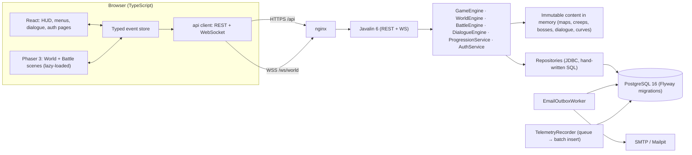

# Shardbound v2 — Specification

> **Source of truth for all v2 work.** `docs/PROJECT_SPEC.md` (v1) still applies wherever this document does not override it (e.g. JDBC conventions, ConditionGroup, quest state machine).
> Reasons for every v2 decision: `docs/DECISIONS.md` § V-01 onward. Diagrams: `docs/diagrams/er-diagram-v2.md`, `docs/diagrams/class-diagram-v2.md`.
> All numbers in §4 and §10 are **starting values**; they live in `content/balance.json` and are retuned by the balance simulator (§4.14).

---

## 1. Vision and scope

A 2D top-down, walkable dark-fantasy RPG. You carry the Heartshard across six regions of Valdren, fight turn-based battles against visible foes, rest at **Lanterns**, grow by spending **Shards**, and risk them on every death. Java decides everything; the browser only shows it.

| | |
|---|---|
| Look | 32×32 pixel art, one CC0 pack family (Kenney or 0x72, not mixed), dark palette, original UI. Fonts **Cinzel** (headings) and **Cormorant Garamond** (text), self-hosted (OFL). Inspired by the *mood* of Souls-like games; no borrowed names, assets, fonts or UI. |
| Battles | Turn-based, classic monster-battler layout: enemy info top-left / sprite top-right, player sprite bottom-left / info bottom-right, text box with **ATTACK · SKILLS · BAG · FLEE**. |
| HUD | Top-left: HP bar, FP bar below it, level below that. Bottom-right: Shards counter. Bottom-left: 4 quick slots. Bottom-centre during boss fights: boss name + long bar. |
| Length | Critical path **1–2 h** (budget 105 min, §10); side content **+2–3 h**. 6 regions, 28 areas, 85 creep fights, 8 bosses. |
| Endings | Six (v1 §6.9). **The Merchant's Bargain** stays as an early secret bad ending in Eldmere. |
| Names used | Lanterns (rest points) · Shards (XP and currency) · Lost Shards (death drop) · "FOE VANQUISHED" (boss banner) · Lantern Draught (refillable heal). |
| Presentations | Dev-only chapter select (§4.13), excluded from production builds and rejected by the server outside dev mode. |

---

## 2. Architecture and tech



| Layer | Choice (new in **bold**) |
|---|---|
| Backend | Java 21, Javalin 6 (REST **+ WebSocket**), plain JDBC, Jackson, JUnit 5, **Flyway** (runs hand-written SQL migrations), **Bouncy Castle** (Argon2id), **Eclipse Angus Mail** (SMTP, V-24) |
| Database | PostgreSQL 16, roles `shardbound_owner` / `shardbound_app` / `shardbound_telemetry_ro` |
| Frontend | **TypeScript**, React 19 (HUD/menus), **Phaser 3.90** (world/battle), Vite, **Vitest**, **Playwright** (budgets, e2e) |
| Ops | **Docker Compose** (postgres, migrate, backend, nginx, mailpit[dev]), **GitHub Actions** CI, **Cloudflare Turnstile** |

**Rules carried over and tightened**
- Java is authoritative. React and Phaser render server views; the client may **predict movement only**, and the server corrects it (§4.11).
- One lock per game: REST handlers **and** WebSocket messages run game logic inside `synchronized (state)` (D16 extended, V-08).
- Content is data (`content/**`), imported into PostgreSQL, loaded once at startup.
- Secrets come from environment variables; `db.properties` is a dev fallback only.
- Branching: v1 is tagged `v1-semester` on `main`; **all v2 work happens on branch `v2`**.

---

## 3. File structure (v2 additions)

```
backend/src/main/java/com/shardbound/
  auth/        AuthService, PasswordHasher (Argon2id), SessionService, TokenService, SlidingWindowRateLimiter ✍,
               LoginGuard, TurnstileVerifier, SecurityHeaders, OriginCheck, AccountCleanupJob
  email/       EmailSender (interface), SmtpEmailSender, MailpitEmailSender, EmailOutboxWorker, EmailTemplates
  world/       WorldEngine, AreaGraph, MapData, CollisionGrid (BitSet), MovementValidator, EncounterService,
               CreepSpawner, SpatialHash, WorldSocket (WS handler)
  battle/      BattleEngine (evolves combat.CombatEngine), BattleState, ElementChart, StatusTracker, Skill,
               DamageCalculator (v2 formula), BossScript, BossAI, TelegraphQueue
  progression/ Attributes (EnumMap<Attribute,Integer>), Curve ✍(valueAt), LevelCost, ShardWallet, LostShards, LanternService
  gear/        WeaponInstance (tier + upgrade), ScalingGrade, UpgradeService, MaterialCost
  dialogue/    DialogueGraph, DialogueEngine (reuses rules.ConditionGroup / Effect)
  cutscene/    Cutscene, CutsceneStep (sealed), CutscenePlayer
  telemetry/   TelemetryRecorder, TelemetryEvent
  save/        SaveV2Repository, SaveMigrator (TreeMap<Integer, Migration>), migrations/*
  tools/       + BalanceSimulator, PlaytestBot, MapImporter
  dev/         ChapterSelect (registered only when APP_ENV=dev and DEV_TOOLS=true)
backend/src/main/resources/
  db/migration/V1__baseline.sql … (Flyway; hand-written SQL)
  email/       verify.html|txt, reset.html|txt, email_changed.html|txt, account_exists.html|txt
content/
  balance.json  regions.json  items.json  creeps.json  bosses.json  skills.json  elements.json  statuses.json
  world.json (factions, npcs, endings, achievements)  quests.json  maps/*.tmj  dialogue/*.json  cutscenes/*.json
  migration/v1_nodes.json (v1 story node → v2 area/spawn)
frontend/src/
  api/ (rest.ts, socket.ts)  store/ (eventStore.ts, mappers.ts)  types/ (views.ts)
  react/ (hud/, menus/, dialogue/, auth/, pages/privacy|terms)  phaser/ (BootScene, WorldScene, BattleScene)
  assets/ (atlases per region, audio)  settings/
infra/  docker-compose.yml  nginx.conf  backend.Dockerfile  frontend.Dockerfile
config/ security.properties (rate-limit defaults, V-33)
tools/balance/progression.mjs (progression model, §10.2)
.github/workflows/ci.yml   CREDITS.md
```
✍ = student-implemented (CLAUDE.md rule 8).

---

## 4. Systems

### 4.1 Lanterns (rest points)
Resting at a Lantern, in one transaction:
1. HP and FP are set to max, and Lantern Draught charges are refilled.
2. Defeated creeps respawn: the save's `save_defeated_creep` rows are deleted, and each spawn rerolls its level from the save's seeded RNG.
3. The Lantern becomes `last_lantern`, the respawn point.
4. An autosave is written to slot 0 (the D24 path: reseed the live state → deep copy → background write).
5. The Lantern menu opens: **Level up** (§4.3), **Fast travel**, **Skills** (4-slot loadout), **Leave**. Weapon upgrades happen at Smith NPCs (§4.6).

**Fast travel.** Lanterns are vertices of the **area graph**: `area_edge(from, to, weight)`, where the weight is the walking time in seconds between connected areas (from the maps). Edges whose `gate_flag` the player hasn't set are excluded. `Graph.dijkstra(source, weight)` ✍ returns each area's distance and the parent map. Travel is allowed to any **discovered** Lantern whose area is reachable.
- The route is drawn on the map screen, and the ETA sets the length of the travel transition: `min(3 s, ETA / 30)`.
- The same Dijkstra gives the **quest-marker next hop**: the first edge toward the objective area.
- The playtest bot uses it to route between areas.

### 4.2 Creeps and encounters
- Creeps are placed as `creep_spawn` objects in Tiled: `template`, `levelMin`, `levelMax`, `aggroRadius` (1–3 tiles), optional `patrol` (cosmetic idle only).
- Level on (re)spawn = `levelMin + rng.nextInt(levelMax − levelMin + 1)`, using the save's seeded RNG.
- **Encounter rule:** after every accepted step, the server looks up creeps in nearby `SpatialHash` cells (cell = 8×8 tiles). A battle starts with the first living creep whose Chebyshev distance to the player is ≤ `aggroRadius`. Ties go to the lowest object id.
- Creep stats from its template (`base*`) and level: `hp = round(baseHp·(1 + 0.12(lvl−1)))`, `atk = round(baseAtk·(1 + 0.10(lvl−1)))`, `def = round(baseDef·(1 + 0.08(lvl−1)))`, `spd = baseSpd`.
- A defeated creep stays down (`save_defeated_creep`) until the player rests or dies.
- Running away (FLEE) keeps the creep alive; it ignores the player until they have moved 3 tiles out of its aggro radius.

### 4.3 Shards, levels and attributes
Shards are both XP and currency. They are earned from creeps, bosses and chests; spent on levels and upgrades; and lost on death (§4.4).

| Formula | Starting value |
|---|---|
| Level | `1 + (Vig + Mnd + Str + Dex + End + Arc) − 60` (all six start at 10; max 99) |
| Level-up cost (L → L+1) | `cost(L) = round(100 · L^1.5)` — L1 100 · L2 283 · L5 1 118 · L10 3 162 · L20 8 944 · L30 16 432 |
| Creep Shards | `creepShards(lvl) = round(35 · lvl^1.45)` — lvl1 35 · lvl2 96 · lvl5 361 · lvl10 986 · lvl20 2 695 · lvl30 4 852 |
| Boss Shards | `5 · creepShards(bossLevel)` |
| First level-up | after **3** Eldmere fights (35 + 35 + 96 = 166 ≥ 100) at the first Lantern |

These curves were fitted to the progression table in §10.2: the model hits every boss-level target exactly.

**Attribute effects** are piecewise-linear `Curve`s (soft caps where the slope drops). Points are `(attribute, value)`; `Curve.valueAt(x)` ✍ interpolates between `floorEntry` and `ceilingEntry` of a `TreeMap<Integer, Double>` in O(log n).

| Attribute | Effect | Curve points |
|---|---|---|
| Vigor | max HP | (10,100) (20,180) (30,280) (40,380) (60,500) (99,600) |
| Mind | max FP | (10,30) (20,55) (30,80) (50,120) (99,150) |
| Mind | spell power for Fire/Frost/Lightning skills | `SPm = 20 + 80·sat(Mind)` |
| Endurance | defence (all elements) | (10,10) (25,25) (40,40) (60,50) (99,60) |
| Endurance | status resist % | (10,5) (40,35) (99,50) |
| Strength / Dexterity / Arcane | weapon scaling saturation `sat(x)` | (10,0.00) (20,0.35) (40,0.70) (60,0.85) (99,1.00) |
| Dexterity | speed; crit bonus | `spd = 5 + floor(Dex/10)`; `crit% = weapon.crit + min(10, floor((Dex−10)/5))` |
| Arcane | status chance bonus (percentage points) | (10,0) (40,15) (99,25) |
| Arcane | spell power for Holy/Crystal skills | `SPa = 20 + 80·sat(Arcane)` |

Level-up happens only at a Lantern. The menu shows a server-computed **preview** (POST `/api/lantern/levelup/preview`). Several levels can be bought in one confirm, which runs in one transaction.

### 4.4 Death and Lost Shards
On death (HP reaches 0 in battle):
1. All held Shards become **Lost Shards** at the tile where the battle started. This replaces any previous Lost Shards (those are destroyed).
2. Held Shards are set to 0. The player respawns at `last_lantern` with full HP/FP and refilled draughts. Creeps respawn, and the boss resets (its intro cutscene does not replay, §4.7).
3. Recovering them: an accepted step within Chebyshev distance 1 of the Lost Shards tile adds them back, deletes the marker, and shows the toast "Shards recovered".
4. Dying again before recovering destroys them.
5. Telemetry records `DEATH` and `SHARDS_LOST` / `SHARDS_RECOVERED`.

### 4.5 Elements and statuses
Elements: **Physical, Fire, Frost, Lightning, Holy, Crystal**. Creature families: Beast, Human, Undead, Sylvan, Construct, Ashen, Crystalborn, Draconic.

| Family | Physical | Fire | Frost | Lightning | Holy | Crystal |
|---|---|---|---|---|---|---|
| Beast | N | **W** | N | N | N | R |
| Human | N | N | N | N | N | N |
| Undead | R | N | R | N | **W** | N |
| Sylvan | N | **W** | R | N | R | N |
| Construct | R | R | N | **W** | N | N |
| Ashen | N | I | **W** | N | N | R |
| Crystalborn | N | N | N | **W** | R | I |
| Draconic | R | R | **W** | N | N | N |

Multipliers: W 1.5 · N 1.0 · R 0.5 · I 0. The **bestiary** reveals a family's row for a creep after the first battle with it.

**Status effects** (tracked per combatant in an `EnumMap<Status, Integer>` of turns left; ticks at the start of the affected combatant's turn):

| Status | Effect | Turns |
|---|---|---|
| Bleed | on proc: burst of 12 % max HP, then 3 % max HP per turn | 2 |
| Poison | 4 % max HP per turn | 5 |
| Burn | 6 % max HP per turn; a Frost hit removes it | 3 |
| Frost | defence −30 %, speed −3; a Fire hit removes it | 2 |
| Stun | skips the next turn, then immune to Stun for 2 turns | 1 |

- Proc chance: `clamp(move.statusChance + arcaneBonus(attacker) − statusResist(target), 0, 90)` %, halved against bosses. Bosses become Stun-immune for 3 turns after a Stun.
- Family immunities: Undead and Construct ignore Bleed and Poison, Ashen ignores Burn, Crystalborn ignores Bleed.
- Status damage is never reduced by defence, and is at least 1.

### 4.6 Skills, weapons, tiers, upgrades, scaling
**Weapons** keep tiers F..SSS (v1 multipliers F 1.00 … SSS 3.00) and gain an upgrade level `u` = 0..10 and scaling grades.

| Weapon | Tier | Base | Str | Dex | Arc | Crit % | Source |
|---|---|---|---|---|---|---|---|
| Rusty Shortsword | F | 20 | D | D | – | 5 | start |
| Woodcutter's Hatchet | E | 28 | C | – | – | 5 | Eldmere side quest / merchant route |
| Hunter's Longbow | D | 30 | – | B | – | 10 | Eldmere wolf hunt |
| Iron Longsword | C | 36 | C | D | – | 8 | Brann's errand |
| Thornwood Spear | B | 44 | – | C | D | 10 | Warden trial |
| Moonsteel Blade | A | 52 | – | B | C | 12 | Sealed Vault |
| Kingsguard Halberd | S | 60 | B | – | – | 12 | Royal Tournament |
| Dragonbone Greatsword | SS | 70 | A | – | – | 15 | optional elite, Hollow Deep |
| Aetherion | SSS | 82 | C | C | B | 20 | Crystal Edge quest |

Grade coefficients: **S 1.5 · A 1.2 · B 0.9 · C 0.6 · D 0.35 · E 0.15 · – 0**.

**Attack rating** (shown in the menu):
```
AR = base · tierMult · (1 + 0.08u)  +  Σ_{a ∈ Str,Dex,Arc} base · grade(a) · (1 + 0.03u) · sat(attr_a)
```

**Upgrades** happen at Smith NPCs (Brann in Eldmere, the Royal Armourer in Valdren), one step at a time, as one transaction:

| Step | Shards `150·(u+1)²` | Materials |
|---|---|---|
| +0→+1 … +2→+3 | 150 · 600 · 1 350 | Shard Dust × 2(u+1) |
| +3→+4 … +5→+6 | 2 400 · 3 750 · 5 400 | Shard Fragment × (u−1) |
| +6→+7 … +8→+9 | 7 350 · 9 600 · 12 150 | Shard Crystal × (u−4) |
| +9→+10 | 15 000 | Heartstone × 1 (side content only) |

**Skills.** There are 4 equippable slots (loadout changed at a Lantern). Each skill has `element, power, fpCost, statusChance, status, scaling (WEAPON | MIND | ARCANE), target (ONE | ALL), telegraph=false`.
- Weapon arts use AR; spells use SPm or SPa.
- Skills are learned from quests, chests and levels (`skills.json` `unlock`).
- FP persists between battles; it refills at Lanterns and from Azure Tonics.

**BAG.** Holds Lantern Draughts (3 charges, +1 per Glimmer Seed up to 8; heal 45 % max HP; refilled at Lanterns), consumables and status cures. Quick slots 1–4 bind BAG items, usable in battle and in the world.

### 4.7 Battle
**Layout:** v1 `CombatEngine` turn order (`PriorityQueue` by speed; player first on ties).
- Main menu: **ATTACK** (Strike / Guard) · **SKILLS** (4 slots) · **BAG** · **FLEE**.
- FLEE is disabled in boss fights. Flee chance follows v1 §6.6, using the speed above.

**Damage** (`battle/DamageCalculator`; the order of random calls is fixed, so a seed reproduces a fight):
```
raw      = (move uses weapon ? AR : SP) · move.power              Strike: power 1.0
elem     = chart[defender.family][move.element]                    W 1.5 · N 1 · R 0.5 · I 0
roll     = 0.9 + rng.nextDouble() · 0.2
crit     = rng.nextInt(100) < crit% ? 1.5 : 1.0                    (status damage never crits)
mitigate = 100 / (100 + DEF)                                        DEF after Frost −30 % if frosted
guard    = guarding ? (incoming move telegraphed ? 0.25 : 0.5) : 1.0
damage   = elem == 0 ? 0 : max(1, round(raw · elem · roll · crit · mitigate · guard))
status   = rng.nextInt(100) < procChance ? apply : —               (only if move.status set)
```
Defence is now a **ratio** (100 / (100 + DEF)) instead of v1's subtraction, so it stays balanced at large numbers (V-12).

**Bosses** (`content/bosses.json`):
- 2 phases. Phase 2 starts at `hpPct ≤ phase2At` (default 50 %). It plays a transition line, can switch move table, family/element and speed, and is Stun-immune for 1 turn.
- Moves are weighted (`weight`), chosen with the save's seeded RNG. A **telegraphed** move announces itself one boss turn earlier ("The Hollow King raises the bone crown…"), shown in the text box, and is executed on the boss's next turn. Guard reduces it to ×0.25.
- **Intro cutscene** plays on first entry. Skippable. Recorded in `save_cutscene_seen`, so it is never replayed after a death.
- **Boss bar** at the bottom-centre: name + long HP bar with a phase-2 tick mark.
- **"FOE VANQUISHED"** banner on victory, then the Shards reward and loot.
- Boss defeat is recorded in `save_defeated_boss` and is permanent.

Bosses on the critical path: Ashen Herald (Eldmere) · Thornmother (Whispering Wood) · Bone Warden, The Hollow King (Hollow Deep) · Ser Calder the Gilded (Valdren City) · Cinder Matriarch, Ashborn Wyrm (Ashen Wastes) · The Shard Sovereign (Crystal Spire). The optional elite **Dragonbone Revenant** (side content) is not counted among the 8.

### 4.8 NPCs, dialogue, quests, journal, map, bestiary
- **Dialogue** graphs (`content/dialogue/<npc>.json`) reuse v1 choices: every option has `conditions` (ConditionGroup with `grp`, D4) and `effects`.
  - Nodes carry `speaker`, `portrait`, and `mood` (neutral/happy/angry/sad/afraid), so dialogue reacts via conditions on flags, reputation, affinity and quest steps.
  - The v1 prologue becomes Eldmere dialogue. The merchant route ends in **END_QUICK**.
- **Quests** gain ordered **steps**, each with an objective text and a marker target (`area` + optional object id). The quest state machine and Kahn order stay as in v1 (D14, `topoOrder` ✍).
- **Quest markers:** the active quest's current step shows a marker on the map. In the world, an edge arrow points along the Dijkstra next hop.
- **Journal:** quests (in topo order) with completed steps, and dialogue memory (last 30 entries).
- **Map screen:** discovered areas, the edges between them, Lanterns, markers and the fast-travel route.
- **Bestiary:** a creep entry is created at first sight (`seen`). Its stats are revealed after the first battle, and its weakness row after the first battle **or** after hitting it with an element.

### 4.9 Audio, settings and accessibility
- **Audio:** one loop per region, a battle theme, a boss theme and a final-boss theme; SFX for steps, hits, crits, statuses, menus, Lantern and banner. CC0 or CC-BY only, all listed in CREDITS.md.
- **Settings** (stored per account in `account_setting`):

| Setting | Values |
|---|---|
| Text speed | slow / normal / fast / instant |
| Volume | master, music, sfx (0–100) |
| Reduce motion | no screen shake, no flashes, no typewriter |
| Colour-blind-safe icons | every element/status icon has a shape + letter, never colour alone |
| Input | keyboard and gamepad (Gamepad API), remappable bindings |
| Font size | 90–150 % |
| Telemetry | opt-out |

### 4.10 Accounts and security
Email-based accounts for a public game.

**Sign-up** (`POST /api/auth/signup`, Turnstile-protected)
- `email`: trimmed, stored **lowercase** (`CHECK (email = lower(email))`), unique, ≤ 254 chars.
- `password`: 10–128 chars, not equal to the email or display name.
- `displayName`: 3–20 chars `[A-Za-z0-9 _-]`, unique case-insensitively. It is shown on the leaderboard.
- Terms acceptance (checkbox) is stored as `terms_version` + `terms_accepted_at`.
- The response is **always** `202 "Check your inbox"`. If the email already exists, an *account exists* email is sent instead of a new account being created (no enumeration, V-21).

**Passwords.** Argon2id (Bouncy Castle), memory 19 MiB, iterations 2, parallelism 1, 16-byte salt, 32-byte hash, stored as a PHC string `$argon2id$v=19$m=19456,t=2,p=1$…`. Rehashed on login if the parameters change.

**Sessions**
- 32 random bytes (`SecureRandom`), base64url, sent in cookie `sb_session`: `HttpOnly; Secure; SameSite=Strict; Path=/`.
- `auth_session` stores only `SHA-256(token)`, plus `created_at`, `last_seen_at`, `expires_at` (30-day idle, sliding) and `absolute_expires_at` (90 days).
- Logout revokes the current session.

**Email verification**
- Single-use token, **24 h**, stored hashed in `auth_token(purpose = VERIFY)`. The link is `/verify?token=…`; the page POSTs `/api/auth/verify`.
- Unverified accounts can play but are **hidden from the leaderboard**, see a banner, and are **deleted after 7 days** if never verified.
- Resend: cooldown 60 s, max 5 per day.

**Login** (`POST /api/auth/login`, email + password)
- Rate limits via `SlidingWindowRateLimiter` ✍: per IP **100 attempts / 15 min**, per email **5 failures / 15 min**.
  - The per-IP limit is deliberately loose: whole college or mobile networks can share one IP (V-33). The per-email limit protects each account.
- After 5 failures the account is locked for 15 min (`locked_until`), doubling up to 4 h on repeats.
- Every failure gets the same message, "Invalid email or password". Limits respond "Too many attempts, try again later", even for unknown emails.

**Configurable limits (V-33).** Every limit, window and lockout duration in this section is a config value, never a literal in code. Defaults:

| Key | Default |
|---|---|
| `security.login.perIp` | 100 / 15 min |
| `security.login.perEmailFailures` | 5 / 15 min |
| `security.lockout.base` | 15 min (doubling, max 4 h) |
| `security.guest.perIp` | 30 / hour |
| `security.verify.resendCooldown` | 60 s (max 5/day) |
| `security.ws.stepsPerSecond` | 8 |

They are read by `AppConfig` from env vars, falling back to `config/security.properties`. Game balance stays in `content/balance.json`.

**Forgot password** (`POST /api/auth/forgot`, Turnstile-protected)
- Always the same `202` response.
- If the account exists, a RESET token is created: single-use, **30 min**, and older RESET tokens are invalidated.
- `POST /api/auth/reset {token, newPassword}` sets the password, marks the token used, **revokes all sessions**, and sends a *password changed* notice.

**Account settings**
- Change password (needs the current password; revokes the other sessions).
- Change email (needs the password): creates a CHANGE_EMAIL token holding `new_email`; the link goes to the new address. On confirm the email is updated (re-verified) and an *email changed* notice goes to the old address.
- **Delete account** (needs the password), in one transaction:
  - PII removed (email, password hash, settings, sessions, tokens, pending outbox rows, saves);
  - the account row is kept as a tombstone (`deleted_at`) with `display_name = 'Wanderer-' + 6 random chars`, so leaderboard rows are **anonymised**, not lost.

**Guest mode**
- `POST /api/auth/guest` creates `is_guest = true` with no email and display name `Guest-xxxx`, and starts a session. Turnstile-protected, plus a loose **30 per IP per hour** (configurable, V-33).
- Guests are hidden from the leaderboard.
- Upgrade (`POST /api/account/upgrade {email, password, displayName}`) keeps the same `account_id` and therefore all progress, then runs verification.
- Guests inactive for **30 days** are deleted.

**Tokens.** `auth_token(token_hash, account_id, purpose ENUM('VERIFY','RESET','CHANGE_EMAIL'), new_email, expires_at, used_at, created_at)`. Only `SHA-256(token)` is stored. Verification is a single UPDATE `… SET used_at = now() WHERE token_hash = ? AND used_at IS NULL AND expires_at > now() RETURNING …`, which is atomic and single-use.

**Email: transactional outbox**
- Every account or token change that needs an email inserts an `email_outbox` row **in the same transaction**.
- `EmailOutboxWorker` (one background thread) polls every 5 s with `SELECT … FOR UPDATE SKIP LOCKED LIMIT 10`, renders the template (HTML + text) and sends it via `EmailSender`.
- On failure it increments `attempts` and sets `next_attempt_at = now() + 30 s · 2^attempts` (max 1 h). After 8 attempts the row is `FAILED`.
- Implementations: `SmtpEmailSender` (production, STARTTLS + auth) and `MailpitEmailSender` (development, Mailpit on :1025, viewed at :8025). The provider is chosen at deploy time (V12).
- Templates: verify, reset, email_changed, account_exists (HTML + text, `{{placeholders}}` HTML-escaped).

**Bot protection.** Cloudflare Turnstile is the **main defence**; rate limits are a backstop.
- It protects sign-up, forgot-password and guest creation. The server verifies each token against `siteverify` with `TURNSTILE_SECRET`, and fails closed in production.
- **Dev and CI use Cloudflare's official Turnstile test keys** (the always-pass site key and secret), so the real verification code path runs everywhere (V-34).
- **There is no Turnstile or rate-limit bypass in production builds.** No flag, header or account type skips them. The playtest bot runs only against dev mode, where the test keys make Turnstile pass normally.

**Cross-site protection.** Cookies are `SameSite=Strict`. Every non-GET request must have an `Origin` equal to `APP_ORIGIN` and a JSON content type. Bodies are limited to 64 KB. Input is validated per field, with 400 + `{error, message, field}` on failure.

**Security headers** (Javalin before-handler, mirrored in nginx):
- `Content-Security-Policy: default-src 'self'; script-src 'self' https://challenges.cloudflare.com; frame-src https://challenges.cloudflare.com; connect-src 'self' wss://<host>; img-src 'self' data:; style-src 'self' 'unsafe-inline'; font-src 'self'; frame-ancestors 'none'`
- `X-Content-Type-Options: nosniff`
- `Referrer-Policy: strict-origin-when-cross-origin`
- `Permissions-Policy: gamepad=(self)`
- `Strict-Transport-Security` (production only)

**Database roles**
- `shardbound_owner` runs migrations only.
- `shardbound_app`: SELECT/INSERT/UPDATE/DELETE on application tables and USAGE on sequences; no DDL.
- `shardbound_telemetry_ro`: SELECT on telemetry views.

**Secrets** (env vars): `DB_URL`, `DB_APP_USER`, `DB_APP_PASSWORD`, `DB_OWNER_USER`, `DB_OWNER_PASSWORD`, `SMTP_HOST`, `SMTP_PORT`, `SMTP_USER`, `SMTP_PASSWORD`, `MAIL_FROM`, `TURNSTILE_SECRET`, `TURNSTILE_SITE_KEY` (public), `APP_ORIGIN`, `APP_ENV` (dev|prod), `DEV_TOOLS`.

**Cleanup.** `AccountCleanupJob` (a `ScheduledExecutorService`, hourly) deletes:
- unverified accounts older than 7 days;
- guests inactive for 30 days;
- expired sessions and tokens;
- SENT outbox rows older than 30 days.

**Privacy and terms.** Static pages `/privacy` and `/terms`, versioned in the frontend. The privacy page lists exactly what is stored: email, display name, hashed password, saves, anonymous telemetry, and server logs kept 14 days.

**Real email delivery needs a domain** (bought before V2b) with **SPF, DKIM and DMARC** records (V12 deploy checklist).

### 4.11 Server-authoritative world
- **Movement is grid-locked**, 4 directions, one 32 px tile per step. The client predicts and animates each step immediately and sends `{"t":"move","seq":n,"dir":"N|E|S|W"}` over **WebSocket `/ws/world`**.
- The server accepts a step only if:
  - the game is in WORLD mode;
  - the target tile is in bounds and not blocked: `CollisionGrid` is a `BitSet` (index `y·width + x`), plus NPC/object tiles;
  - the rate is within **≤ 8 steps per 1 000 ms**, checked by a per-session `SlidingWindowRateLimiter` ✍ (the same class used for login).
- Accepted → `{"t":"ack","seq":n,"x":..,"y":..}`. Rejected → `{"t":"correct","seq":n,"x":..,"y":..}`; the client snaps back and drops its later predicted steps.
- After each accepted step the server checks triggers in order: area exit → Lost Shards pickup → cutscene trigger → creep aggro.
  - An encounter pushes `{"t":"mode","mode":"BATTLE"}`; the client then fetches the BattleView over REST.
- **Handshake** (`wsBeforeUpgrade`): the `sb_session` cookie must be a valid session, and `Origin` must equal `APP_ORIGIN`. Otherwise 403, no upgrade.
- **Message limits:** text frames only, ≤ 1 KB (larger frames close with code 1009); ≤ 20 messages per second per socket, otherwise close 1008. One socket per game; a new socket replaces the old one.
- **Locking:** every WS message calls `WorldEngine` methods that run inside `synchronized (state)`, the same lock as the REST handlers (V-08).
- **Reconnect:** the client reconnects with backoff (0.5 s → 8 s). It sends `{"t":"hello"}`, and the server answers with a full `{"t":"snapshot", ...WorldView}` built from authoritative state. Predicted, unacknowledged steps are discarded.
- Interactions (`{"t":"interact"}`) act on the faced tile: NPC → dialogue; chest; Lantern; Smith.

### 4.12 Saves v2
- Slots 1–3 (manual, only at a Lantern) plus slot 0 (autosave on rest, area change, boss defeat).
- `save_slot.save_version INT NOT NULL`, current = 2.
- **Migration:** `SaveMigrator` holds a `TreeMap<Integer, Migration>` and applies every migration above the saved version, in order, when loading. The migrated save is written back in the same transaction.
  - v1 → v2 maps `current_node` to an area + spawn point using `content/migration/v1_nodes.json`, converts v1 level/xp into attributes and Shards (`migration.v1LevelToShards`), and keeps flags, reputation, affinity and quests.
- Saving is refused during battle, dialogue or cutscene (409, D27).

### 4.13 Performance budgets and dev tools
| Budget | Target | How it is measured |
|---|---|---|
| Title screen interactive | < 2.0 s | Playwright, cold cache, `performance.mark('title-interactive')` |
| Region load | < 1.5 s | mark from `area-change` to the first World frame |
| Battle start | < 300 ms | mark from the `mode: BATTLE` message to the first Battle frame |
| Initial JS (title) | ≤ 200 KB gzip | CI bundle check from **V3** |
| Phaser chunk (lazy) | ≤ 450 KB gzip | CI bundle check from **V3** |
| Region asset pack | ≤ 1.5 MB | CI asset check |

- Phaser is `import()`ed after the title screen.
- Each region has one texture atlas, and the next region's pack is preloaded in the background when the player is one area away (Dijkstra distance on the area graph).
- **Chapter select (dev only):** `/api/dev/chapter-select` is registered only when `APP_ENV=dev` and `DEV_TOOLS=true`; otherwise the route does not exist (404) and the server also rejects the request. The frontend button is behind `import.meta.env.DEV` (dead-code-eliminated). CI greps the production bundle and fails if `chapter-select` appears.

### 4.14 Telemetry, balance simulator, playtest bot
- **Events:** `RUN_START`, `AREA_ENTER`, `BATTLE_START`, `BATTLE_END` (outcome, turns), `DEATH`, `SHARDS_LOST/RECOVERED`, `LEVEL_UP`, `BOSS_DEFEATED`, `RUN_END`.
  - Keyed by an **anonymous `run_id`** (a UUID stored in the save). There is no account id in telemetry.
  - The account setting `telemetry_opt_out` makes the recorder drop events.
- **Recorder:** events go into a `LinkedBlockingQueue`; one writer thread batch-inserts every 2 s or every 100 events. Play never waits for it.
- **Storage:** `telemetry_event(event_id BIGSERIAL, run_id UUID, type, area_id, level, payload JSONB, at TIMESTAMPTZ)`.
  - **BRIN on `at`**: append-only rows arrive in time order, so a tiny block-range index serves dashboard time-range scans.
  - **B-tree on `(run_id, at)`**: per-run window functions need the rows of one run in time order, which BRIN cannot provide (V-26).
- **SQL:**
  - `v_deaths_by_area` (GROUP BY);
  - `v_time_per_area` (`LEAD(at) OVER (PARTITION BY run_id ORDER BY at)` minus `at` for AREA_ENTER rows);
  - `v_fights_per_level` (`ROW_NUMBER()`, `SUM() OVER` running totals);
  - `mv_balance_summary`, a **materialized view** per area (death rate, median fights, `percentile_cont(0.5)` entry level), `REFRESH MATERIALIZED VIEW CONCURRENTLY` with a unique index.
- **Balance simulator** (`tools.BalanceSimulator`): runs thousands of seeded headless battles with the real `BattleEngine` for each creep/boss × player level × build (Str/Dex/Mind/Arcane presets).
  - It reports win rate, mean turns and HP lost, and checks them against `balance.json` targets: creeps at their region's expected level ≥ 95 % win, average ≤ 4 turns; bosses on the first try 40–70 %.
- **Playtest bot** (`tools.PlaytestBot`): logs in as a bot guest over the **real** REST + WebSocket API and plays the critical path. It runs **only against dev mode**: Turnstile test keys, normal rate limits, no bypass (V-34).
  - Within a map: BFS on the collision grid. Between areas: Dijkstra. Dialogue: a per-region route script. Battle policy: weakness skill > Strike; draught when HP < 40 %.
  - It estimates human time as `steps × 0.125 s + battle turns × 2.5 s + dialogue words ÷ 200 wpm`, and fails if any region exceeds its §10 budget by more than 15 %.

### 4.15 Ops: Docker, CI, deploy
- **Docker Compose:**
  - `postgres:16`;
  - `migrate` (Flyway, one-shot, as `shardbound_owner`);
  - `backend` (multi-stage Maven → `eclipse-temurin:21-jre`, runs as `shardbound_app`);
  - `nginx` (serves the frontend build, proxies `/api` and `/ws` with upgrade headers, TLS in production);
  - `mailpit` (`dev` profile only).
- **GitHub Actions** (`ci.yml`), on every push and PR:
  - backend `mvn verify` with a Postgres service (Flyway migrate + ITs), using the Turnstile test keys;
  - frontend `npm ci`, `tsc --noEmit`, `vitest run`, `vite build`;
  - bundle-size check (from V3);
  - Playwright e2e + budgets against Compose (from V3);
  - Docker image build;
  - prod-bundle grep for dev tools.
- **Deploy (V12):** the host is chosen at V12 and must support WebSockets. Checklist: domain + TLS, SPF/DKIM/DMARC, env secrets, DB backups, log retention 14 days, Turnstile production keys.

---

## 5. Data structures (v2 additions to spec §5)

| Where | Structure | Why | Complexity |
|---|---|---|---|
| Fast travel, quest next hop, bot routing | `Graph.dijkstra` ✍ with `PriorityQueue` (lazy deletion) + `HashMap` dist/parent | non-negative weighted shortest paths | O((V+E) log V) |
| Attribute curves, soft caps | `Curve` ✍ = `TreeMap<Integer,Double>`, `floorEntry`/`ceilingEntry` + linear interpolation | sorted breakpoints, O(log n) lookup | O(log n) |
| Login and movement rate limits | `SlidingWindowRateLimiter` ✍ = `ConcurrentHashMap<String, ArrayDeque<Long>>` (timestamps) | exact sliding window, drop expired from the head | O(1) amortised |
| Collision | `CollisionGrid` = `BitSet` (index `y·w + x`) | 1 bit per tile, O(1) test | O(1) |
| Creep aggro lookup | `SpatialHash` = `HashMap<Long, List<CreepSpawn>>` keyed by packed cell (`cx << 32 \| cy`) | only nearby creeps checked per step | O(k) |
| In-map BFS (bot, map validator) | `Graph.bfs` ✍ over grid neighbours | reuses the student BFS | O(W·H) |
| Statuses | `EnumMap<Status,Integer>` turns left | fixed keys, array-backed | O(1) |
| Attributes | `EnumMap<Attribute,Integer>` | 6 fixed keys | O(1) |
| Save migrations | `TreeMap<Integer, Migration>` + `tailMap(saved, false)` | apply in version order | O(m) |
| Telemetry buffer | `LinkedBlockingQueue<TelemetryEvent>` | producer/consumer across threads | O(1) |
| Email outbox polling | SQL `FOR UPDATE SKIP LOCKED` | safe concurrent work queue in the DB | — |
| Bestiary / seen creeps / cutscenes seen | `HashSet<String>` | O(1) contains | O(1) |
| Boss telegraphs | `ArrayDeque<BossMove>` (queued next move) | FIFO of announced moves | O(1) |
| Client event store | typed pub/sub `Map<EventName, Set<Listener>>` (TS) | decouples React and Phaser | O(listeners) |

---

## 6. Schema changes (Flyway, hand-written SQL)

| Migration | Tables / objects |
|---|---|
| `V1__baseline.sql` | all v1 tables, triggers, function, view, indexes (= today's 01–03) |
| `V2__accounts.sql` (V2a) | **account** (replaces `player`; `player_id` kept as `account_id`), **auth_session**, **login_attempt** (audit), **account_setting**, roles + grants |
| `V3__email_tokens.sql` (V2b) | ENUM **auth_purpose**, **auth_token**, ENUM **outbox_status**, **email_outbox** |
| `V4__world.sql` (V3) | **region**, **area** (map key, music, region), **area_edge** (from, to, weight, gate_flag), **map_object** (type, x, y, props JSONB), **area_collision** (width, height, bits BYTEA), **lantern**, **dialogue**, **dialogue_node**, **dialogue_choice** (+ `dialogue_choice_condition` / `_effect`, same shape as v1) |
| `V5__battle.sql` (V4) | ENUM **element**, **creature_family**, **family_element** (multiplier ENUM W/N/R/I), ENUM **status**, **family_status_immunity**, **creep_template**, **creep_skill**, **skill** |
| `V6__progression.sql` (V5) | **curve_point** (curve, x, y), ALTER **save_slot** (+ shards, attributes via **save_attribute**, last_lantern, area_id, x, y, facing, fp, draught_charges), **save_lost_shards**, **save_defeated_creep**, **save_discovered_lantern** |
| `V7__gear.sql` (V6) | ALTER **weapon** (+ base_attack), **weapon_scaling** (item, attribute, grade ENUM), **upgrade_cost**, **save_weapon** (item, upgrade), **save_skill_loadout**, **save_quick_slot** |
| `V8__bosses_cutscenes.sql` (V7) | **boss**, **boss_phase**, **boss_move** (weight, telegraph text, power, element, status), **cutscene**, **cutscene_step**, **save_defeated_boss**, **save_cutscene_seen** |
| `V9__journal.sql` (V8) | **quest_step** (objective, marker area/object), **save_quest_step**, **save_bestiary** (template, seen_at, revealed), **save_dialogue_memory** |
| `V10__saves_v2.sql` (V9) | ALTER **save_slot** (+ save_version NOT NULL DEFAULT 2, run_id UUID); drops `current_node` after migration |
| `V11__telemetry.sql` (V10) | **telemetry_event** + BRIN(at) + B-tree(run_id, at), views `v_deaths_by_area`, `v_time_per_area`, `v_fights_per_level`, materialized view **mv_balance_summary** + unique index, role `shardbound_telemetry_ro` |

All player → content FKs stay `ON DELETE RESTRICT` (D1). Every new `save_*` table cascades from `save_slot`. 3NF is kept: derived stats are never stored (D28 extends to attributes: max HP/FP/def come from curves).

---

## 7. API changes

| Method | Path | Notes |
|---|---|---|
| POST | /api/auth/signup · /login · /logout · /guest · /verify · /verify/resend · /forgot · /reset | §4.10. The session cookie replaces `X-Session` |
| GET | /api/auth/me | account, verified flag, guest flag, settings |
| POST | /api/account/password · /email · /upgrade · /delete | password re-check |
| GET/PUT | /api/account/settings | §4.9 |
| GET | /api/game | SessionView (§8) |
| POST | /api/game/new · /api/game/continue | new run (new `run_id`) / resume autosave |
| WS | /ws/world | §4.11 messages: move, interact, hello → ack, correct, snapshot, mode, event |
| POST | /api/battle/action | `{kind: STRIKE \| GUARD \| SKILL \| ITEM \| FLEE, slot?, itemId?, target?}` → BattleView |
| POST | /api/dialogue/choose | `{choiceId}` → DialogueView or WorldView |
| POST | /api/cutscene/skip | |
| POST | /api/lantern/rest · /levelup/preview · /levelup · /travel · /loadout | |
| POST | /api/smith/upgrade | `{itemId}` |
| POST | /api/bag/use · /quickslot | |
| GET | /api/map · /api/journal · /api/bestiary | |
| GET/POST/DELETE | /api/saves… | v1 routes, slots 1–3 only at a Lantern |
| GET | /api/leaderboard | verified, non-guest accounts only |
| GET/POST | /api/dev/chapter-select | **dev only** (§4.13) |

Errors keep `{error, message}` (+ `field` for validation). New codes: 401 `NOT_AUTHENTICATED`, 403 `ORIGIN_REJECTED`, 429 `RATE_LIMITED`, 423 `ACCOUNT_LOCKED` (shown generically).

---

## 8. GameView v2

The REST `GET /api/game` returns a `SessionView`; the WebSocket pushes `WorldView` snapshots and deltas.

```ts
type Mode = "WORLD" | "BATTLE" | "DIALOGUE" | "CUTSCENE" | "LANTERN" | "ENDED";
interface SessionView { runId: string; mode: Mode; hud: HudView; toasts: ToastView[];
  world?: WorldView; battle?: BattleView; dialogue?: DialogueView; cutscene?: CutsceneView;
  lantern?: LanternView; ending?: EndingView; }
interface HudView { hp: number; maxHp: number; fp: number; maxFp: number; level: number; shards: number;
  quickSlots: (QuickSlot | null)[]; bossBar?: { name: string; hp: number; maxHp: number; phase: 1 | 2 } }
interface WorldView { areaId: string; regionId: string; mapKey: string; player: { x: number; y: number; facing: Dir };
  creeps: { id: string; template: string; sprite: string; level: number; x: number; y: number; aggro: number }[];
  npcs: { id: string; sprite: string; x: number; y: number; marker?: "QUEST" | "SMITH" }[];
  lanterns: { id: string; x: number; y: number; lit: boolean }[]; lostShards?: { x: number; y: number; amount: number };
  markers: { x: number; y: number; questId: string }[]; nextHopExit?: string; preloadRegion?: string; }
interface BattleView { enemy: Fighter; player: Fighter; text: string[]; telegraph?: string;
  menu: { canFlee: boolean; skills: SkillView[]; bag: BagItemView[] }; lastHits: HitView[];
  outcome?: "WON" | "LOST" | "FLED"; banner?: "FOE VANQUISHED"; rewards?: { shards: number; items: string[] } }
interface Fighter { name: string; level: number; hp: number; maxHp: number; hpPct: number; statuses: StatusIcon[];
  sprite: string; family?: string; weaknessesKnown?: Record<Element, "W" | "N" | "R" | "I"> }
interface DialogueView { speaker: string; portrait: string; mood: Mood; text: string;
  choices: { id: number; label: string; locked: boolean; lockReason?: string }[] }
```
Menus (LevelUpView with server preview, UpgradeView, MapView with Dijkstra route, JournalView, BestiaryView) are separate GET responses. **Vitest** covers `store/mappers.ts` (view → store events) and the event store itself.

---

## 9. Content formats

- **Maps** `content/maps/<area>.tmj` (Tiled JSON, 32×32, one tileset family):
  - layers `ground`, `decor` (client only), `collision` (any non-empty tile blocks);
  - an object layer `objects` with types `spawn_point{id}`, `exit{toArea,toSpawn}`, `creep_spawn{template,levelMin,levelMax,aggroRadius,patrol?}`, `npc{npcId,dialogue}`, `lantern{lanternId}`, `smith{npcId}`, `chest{item,qty,flag}`, `trigger{cutscene?,setFlag?,once}`.
  - `MapImporter` stores the collision bits and objects in PostgreSQL. Map validation: every `spawn_point`, exit, Lantern and NPC must be reachable by BFS from the area's main spawn.
- **regions.json:** `regions[{id,name,music}]`, `areas[{id,region,map,music?}]`, `edges[{from,to,weight,gateFlag?}]`.
- **creeps.json:** `{id,name,family,sprite,baseHp,baseAtk,baseDef,baseSpd,skills[],statusChance?,status?,drops[{item,pct}]}`.
- **bosses.json:** `{id,name,family,level,arena,introCutscene,phases[{phase2At?,line,family?,spdDelta?,moves[{skill,weight,telegraph?}]}],rewards}`.
- **skills.json:** `{id,name,element,power,fpCost,scaling,target,status?,statusChance?,unlock}`.
- **dialogue/<npc>.json:** `{id,npc,start,nodes[{id,speaker,portrait,mood,text,choices[{label,to|end,conditions[],effects[],hiddenWhenLocked?}]}]}` (v1 condition/effect rows, `grp` OR-groups).
- **cutscenes/<id>.json:** `{id,skippable:true,steps[{say|move|camera|music|wait|fade}]}`.
- **balance.json:** every constant from §4 (curves as point lists, formulas' coefficients, flee, status values, budget targets).

---

## 10. Playtime budget and progression

### 10.1 Areas, fights, bosses, minutes
| Region | Areas | Creep fights | Creep levels | Bosses (level) | Minutes |
|---|---|---|---|---|---|
| Eldmere | Cottage Lane, Old Ruins, Eldmere Square, Mill Road (4) | 8 | 1–4 | Ashen Herald (5) | 12 |
| Whispering Wood | Forest Edge, Mossy Hollow, Warden Camp, Thornwalk, Thornmother's Glade (5) | 15 | 4–9 | Thornmother (10) | 18 |
| Hollow Deep | Deep Entrance, Ossuary, Sealed Vault, Drowned Cistern, Hollow Throne (5) | 18 | 9–15 | Bone Warden (14), The Hollow King (17) | 22 |
| Valdren City | Lower Gate, Market Ward, Tournament Grounds, Royal Archive, Palace Court (5) | 14 | 15–20 | Ser Calder the Gilded (21) | 18 |
| Ashen Wastes | Cinder Road, Glass Dunes, Ashen Encampment, Matriarch's Pyre, Wyrm's Caldera (5) | 18 | 20–27 | Cinder Matriarch (25), Ashborn Wyrm (28) | 22 |
| Crystal Spire | Spire Foot, Prism Halls, Shard Gallery, Sovereign's Apex (4) | 12 | 27–31 | The Shard Sovereign (32) | 13 |
| **Total** | **28** | **85** | | **8** | **105** |

Side content (+2–3 h): the Sealed Vault puzzle chain, the Dragonbone Revenant, the tournament ladder, NPC questlines, bestiary completion, +10 Heartstone, Aetherion.

### 10.2 Progression table
**Model** (`tools/balance/progression.mjs`, re-run whenever `balance.json` changes):
- the player rests every 3 fights and before each boss, buys levels greedily, and buys weapon upgrades only at the pre-boss rest;
- creep levels rise linearly across the region.

**Run:** `node tools/balance/progression.mjs` (prints both scenarios; add `a p b q bossMult` to try other curves).

**Scenario A: baseline (no deaths)**

| Region | Shards earned (creeps + bosses) | Spent on levels | Spent on upgrades (weapon level) | Carried into next region | Expected level at boss (target) |
|---|---|---|---|---|---|
| Eldmere | 2 933 | 903 | 150 (+1) | 1 880 | Ashen Herald **4** (4) |
| Whispering Wood | 13 075 | 7 503 | 1 950 (+3) | 5 502 | Thornmother **9** (9) |
| Hollow Deep | 42 003 | 29 401 | 6 150 (+5) | 11 954 | Bone Warden **13** (13) · Hollow King **16** (16) |
| Valdren City | 45 637 | 29 328 | 5 400 (+6) | 22 863 | Ser Calder **20** (20) |
| Ashen Wastes | 102 044 | 77 431 | 16 950 (+8) | 30 526 | Cinder Matriarch **24** (24) · Ashborn Wyrm **27** (27) |
| Crystal Spire | 82 108 | 60 895 | 12 150 (+9) | 39 589 | Shard Sovereign **31** (31) |
| **Total** | **287 800** | **205 461** | **42 750** | | |

**Scenario B: robustness (one death per boss, half the Lost Shards never recovered)**

| Region | Shards lost for good | Carried into next region | Expected level at boss (target) |
|---|---|---|---|
| Eldmere | 37 | 1 843 | Ashen Herald **4** (4) |
| Whispering Wood | 267 | 5 198 | Thornmother **9** (9) |
| Hollow Deep | 719 | 10 931 | Bone Warden **13** (13) · Hollow King **16** (16) |
| Valdren City | 3 687 | 18 153 | Ser Calder **20** (20) |
| Ashen Wastes | 3 256 | 22 560 | Cinder Matriarch **24** (24) · Ashborn Wyrm **27** (27) |
| Crystal Spire | 2 491 | 29 132 | Shard Sovereign **31** (31) |
| **Total** | **10 457** (3.6 % of income) | | every boss target still met |

**Why the levels don't move:** the player rests and spends just before each boss, so a boss death drops only the small remainder, and the carried balance absorbs the loss.

The harsher case (dying mid-region with a full purse, or under-levelled) is covered by the V10 simulator check: **every boss beatable at target − 2 with the weapon one upgrade lower**.

- **First level-up:** at the first Lantern after fight 3, as required.
- **Carry** is the balance after each region's boss reward; it pays for the next region's first levels.
- +10 (Heartstone) and the S/SS/SSS weapons come from side content, so a completionist is stronger than the table, which is intentional.
- Boss targets are the **player level** expected on a first attempt; each boss's own level is one higher (§10.1).

---

## 11. Assets and licensing (CREDITS.md)
1. **One pack family, one tile size (32×32)**: either Kenney or 0x72. Never mixed.
2. **No AI-generated art or audio.**
3. Art: **CC0** only. Audio: **CC0 or CC-BY** (credited per file).
4. Fonts: Cinzel and Cormorant Garamond (SIL OFL 1.1), self-hosted, licence files in `frontend/public/fonts/`.
5. Every asset gets a row in CREDITS.md (file/folder, author, source URL, licence, changes made) **in the same commit** that adds it. CI fails if a file under `frontend/src/assets/` has no CREDITS row.
6. No assets, names, fonts, UI layouts or text from Elden Ring or any other commercial game. The battle layout follows a common genre convention, drawn with original UI.

---

## 12. Phase plan (each phase: playable, tests green, committed on `v2`)

| # | Phase | Acceptance criteria |
|---|---|---|
| **V1** | Foundation | Your 5 v1 methods pass (`GraphTest`, `QuestManagerTest`, `SaveRepositoryIT`) · PostgreSQL installed · quick route plays to END_QUICK on PostgreSQL (`--auto-quick` against DB) · tag **`v1-semester`** · branch **`v2`** created · Flyway `V1__baseline` migrates an empty DB · env-var config · frontend ported to TypeScript (prologue still playable) · Vitest + CI (backend `mvn verify` with Postgres service, frontend typecheck/test/build) green |
| **V2a** | Accounts I | sign-up/login/logout, Argon2id, cookie sessions (hash stored), guest mode + upgrade, configurable rate limits + lockout (`SlidingWindowRateLimiter` ✍ tests; no limit hardcoded), Turnstile with official test keys in dev/CI, Origin check, security headers, DB roles (app cannot DDL), Docker Compose (postgres, migrate, backend, nginx) runs the prologue behind login |
| **V2b** | Accounts II | email verification (24 h), resend cooldown, forgot/reset (30 min, no enumeration, sessions revoked), change email, delete account (anonymised leaderboard), transactional outbox + worker with backoff, Mailpit in Compose, templates HTML+text, Turnstile on sign-up/forgot/guest, privacy + terms pages, cleanup job; ITs cover token single use and outbox atomicity |
| **V3** | World | Phaser lazy-loaded, Tiled import + map validator, WS movement (handshake cookie + Origin, size/rate limits, shared lock, reconnect snapshot), Eldmere's 4 areas walkable, NPC dialogue (prologue converted), merchant secret ending reachable; **CI bundle-size budget + Playwright e2e start here** |
| **V4** | Battles v2 | battle scene layout, ATTACK/SKILLS/BAG/FLEE, elements + chart, statuses, 4-slot skills, visible creeps with aggro, Eldmere creeps fightable; `DamageCalculatorTest` v2 (fixed + seeded RNG) |
| **V5** | Progression | Shards, Lanterns (rest/respawn/autosave), attributes + `Curve` ✍ tests, level-up with preview, Lost Shards; first level-up after fight 3 verified by a test |
| **V6** | Gear | upgrades +0..+10 at Smiths, scaling grades, materials, bag + quick slots, AR shown in menus |
| **V7** | Bosses | phases, telegraphs, Guard, intro cutscenes (skippable, not replayed), "FOE VANQUISHED", boss bar; Eldmere + Whispering Wood complete with both bosses |
| **V8** | Navigation | map screen, `Graph.dijkstra` ✍ fast travel, quest steps + markers + next hop, journal, bestiary, NPC portrait questlines |
| **V9** | Saves v2 | save_version + `SaveMigrator`, v1→v2 migration tested with v1 fixtures, 3 slots + autosave, dev-only chapter select (absent from prod bundle, 404 outside dev) |
| **V10** | Telemetry & tools | recorder + opt-out, BRIN + B-tree indexes, views with window functions, materialized view, balance simulator report, **simulator shows every boss is beatable (≥ 40 % win rate) at target level − 2 with the weapon one upgrade lower**, `progression.mjs` reads `balance.json` and its scenarios A and B still meet §10.2, playtest bot (dev mode) plays Eldmere + Wood within budget |
| **V11a** | Hollow Deep | 5 areas, 18 fights, 2 bosses, Sealed Vault side chain; **bot budget check ≤ 22 min (+15 %)**, simulator targets met |
| **V11b** | Valdren City | 5 areas, 14 fights, Ser Calder, tournament; **bot ≤ 18 min** |
| **V11c** | Ashen Wastes | 5 areas, 18 fights, 2 bosses; **bot ≤ 22 min** |
| **V11d** | Crystal Spire | 4 areas, 12 fights, Shard Sovereign, 6 endings via resolver; **bot ≤ 13 min and full critical path ≤ 120 min** |
| **V12** | Polish & ship | audio, settings/accessibility (§4.9), load budgets met in CI, host chosen (WebSockets), domain + TLS, **SPF/DKIM/DMARC**, prod Turnstile keys, backups, CREDITS complete, portfolio README with GIFs |

---

## 13. Decisions recorded, open question, risks

**Your answers (recorded, no longer open):**
1. Names: Lanterns / FOE VANQUISHED / Lost Shards.
2. v1 work committed before v2 (done).
3. Your v1 methods and the new ✍ methods are written during V1 (and the phase that needs them).
4. Art: CC0 Kenney or 0x72, one pack family and one tile size, no AI art.
5. Audio: CC0/CC-BY, listed in CREDITS.md.
6. Host chosen at V12 (must support WebSockets); a domain is bought earlier (needed for real email delivery: SPF/DKIM/DMARC).
7. Grid-locked movement.
8. Flyway and Bouncy Castle allowed.
9. Email-based accounts as in §4.10.
10. 6 endings; the merchant ending is the secret early one.
11. Telemetry: anonymous run ids plus an opt-out setting.

12. Eclipse Angus Mail approved for SMTP (V-24).
13. Rate limits are loose per IP (shared networks) and configurable; Turnstile is the main defence; official test keys in dev/CI; no production bypass (V-33, V-34).

**Still open:** your **deadline / viva date** (it decides which phases must land before submission).

**Risks**
| Risk | Mitigation |
|---|---|
| Scope is months of solo work | playable after every phase; cut V11/V12 side content first |
| Viva: explaining code you didn't write | 8 student-implemented methods, ALGORITHMS/SYLLABUS updated each phase, viva questions after each phase |
| Art pipeline (one CC0 family must cover 6 regions, portraits, bosses) | choose the pack in V3 after checking coverage; recolour within the licence |
| WebSocket latency on a remote host | client-side prediction + acks; the bot measures it |
| Email deliverability | domain + SPF/DKIM/DMARC; outbox retries |
| Public deploy security | §4.10 controls, dependency updates in CI, least-privilege DB role |
| Load budgets vs Phaser size | lazy chunk, atlases, CI budgets from V3 |
| Trade-dress similarity to Souls games | original names/UI/assets only (§11) |
