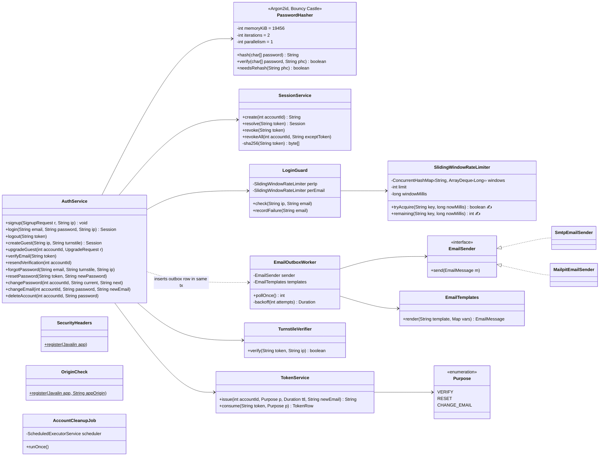
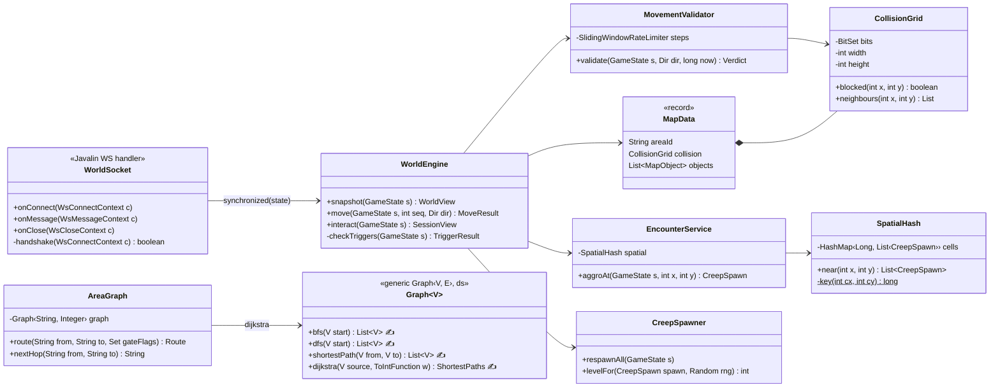
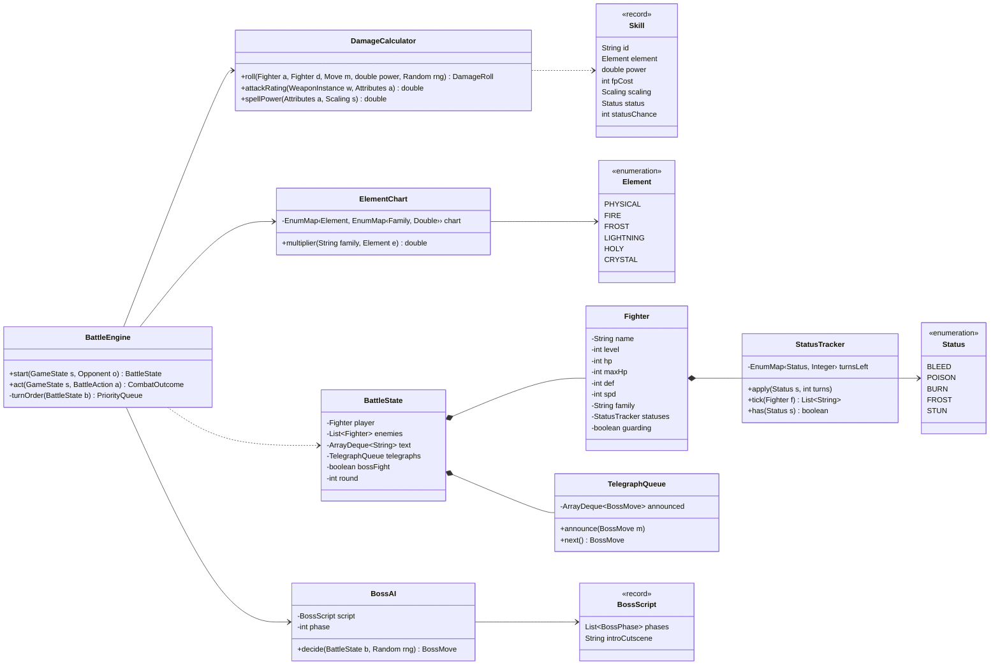
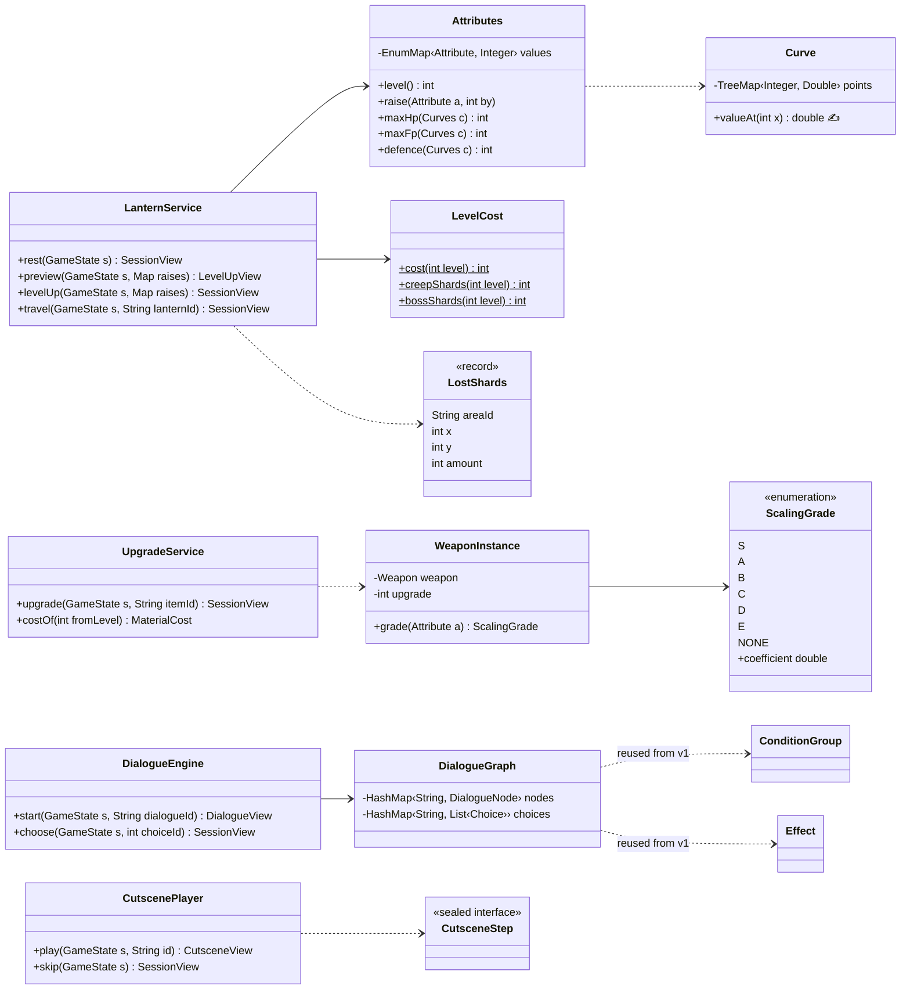
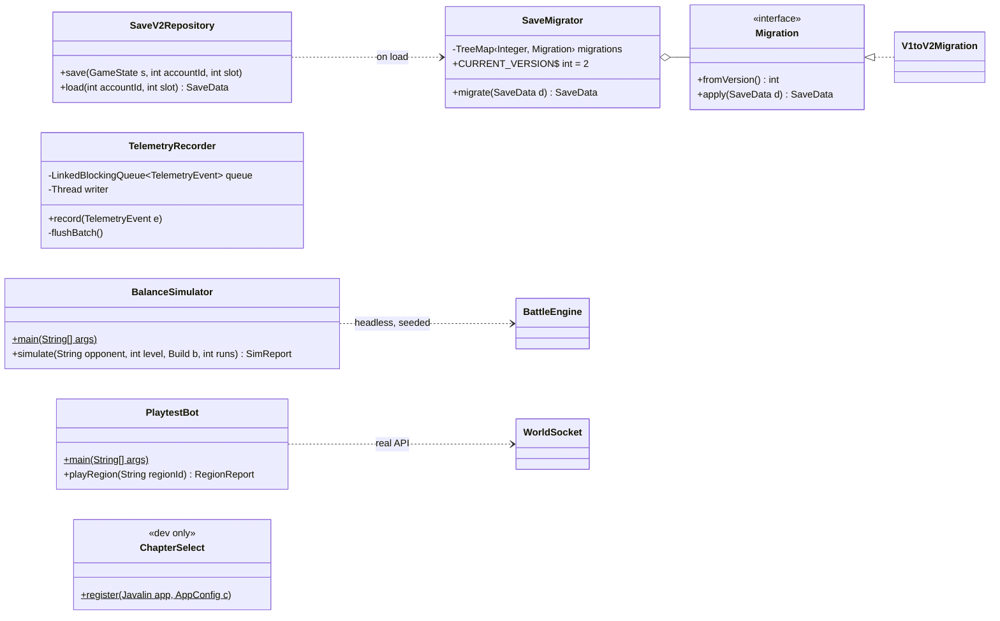

# Shardbound — Class Diagram v2

New and changed classes for v2 (V2_SPEC §3–§5). Unchanged v1 classes (rules, quest, event, achievement, item, persistence, api) are described in `class-diagram.md` and appear here as plain boxes only.
Legend: `+` public, `-` private, `~` package-private, `$` static. ✍ = student-implemented (CLAUDE.md rule 8). Two-parameter generics are written `Map‹K, V›`.

---

## 1. Accounts, sessions, email

---

## 2. World and movement

---

## 3. Battle

---

## 4. Progression, gear, dialogue, cutscenes

---

## 5. Saves, telemetry, tools, dev

