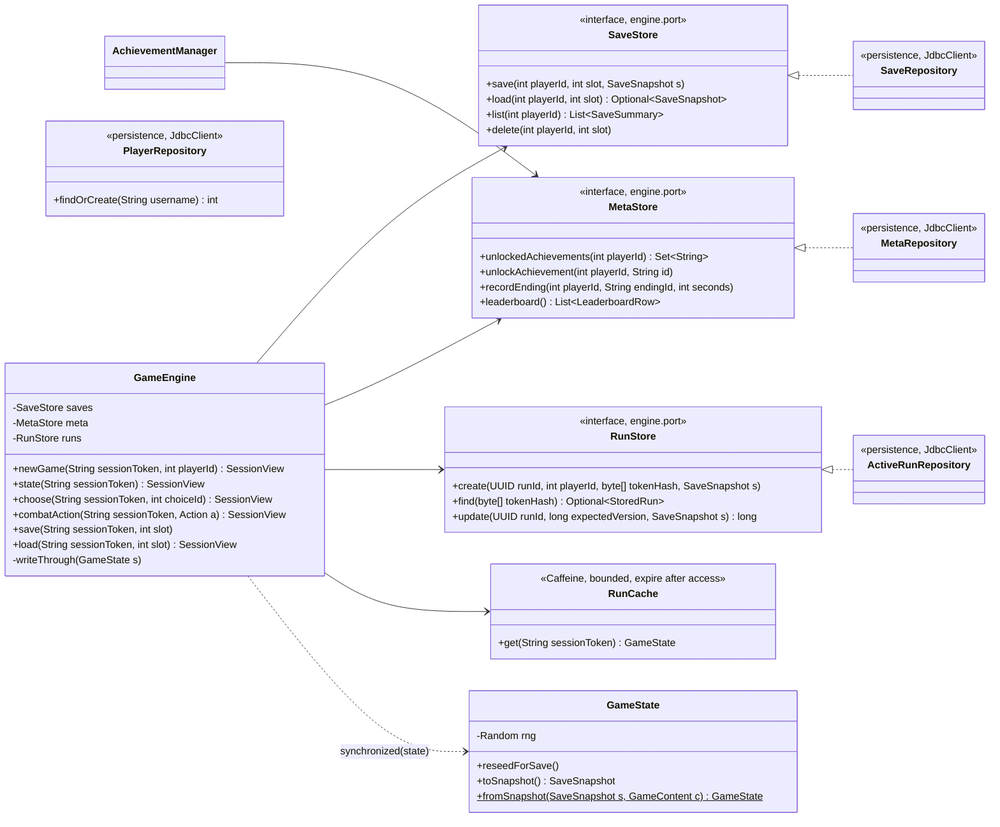
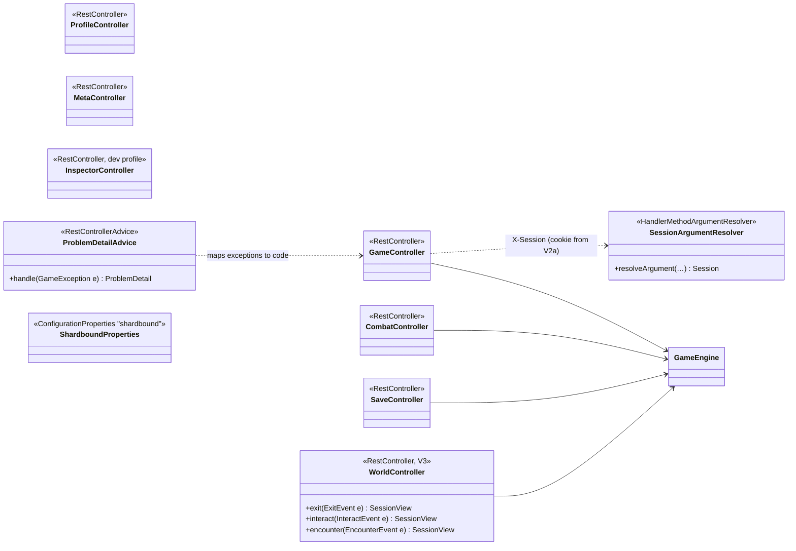
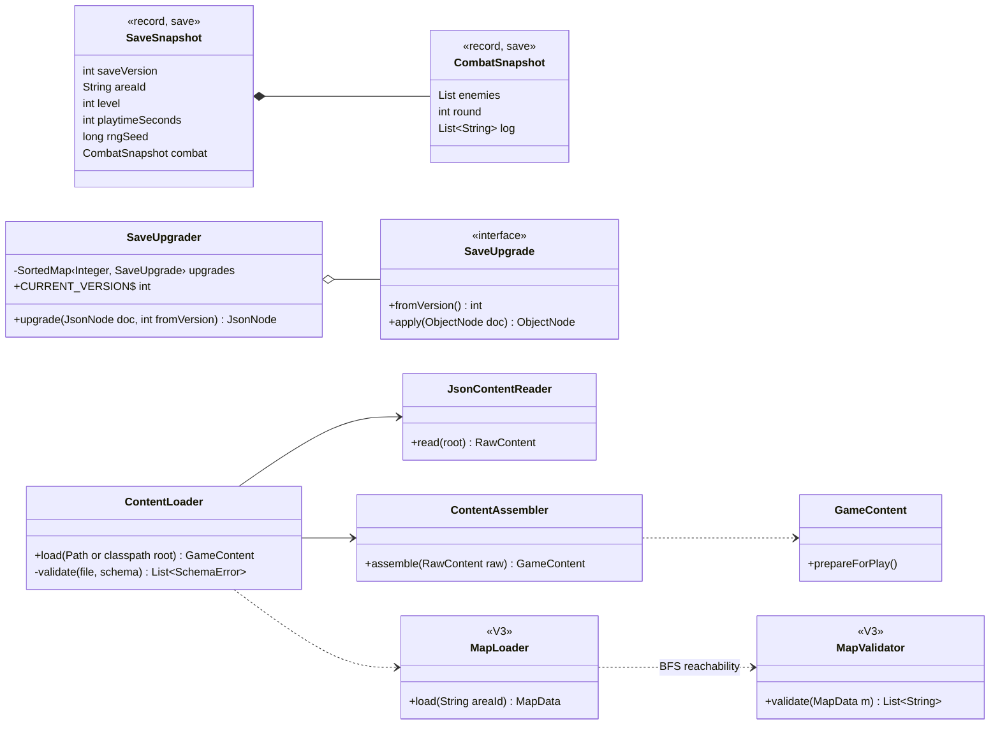
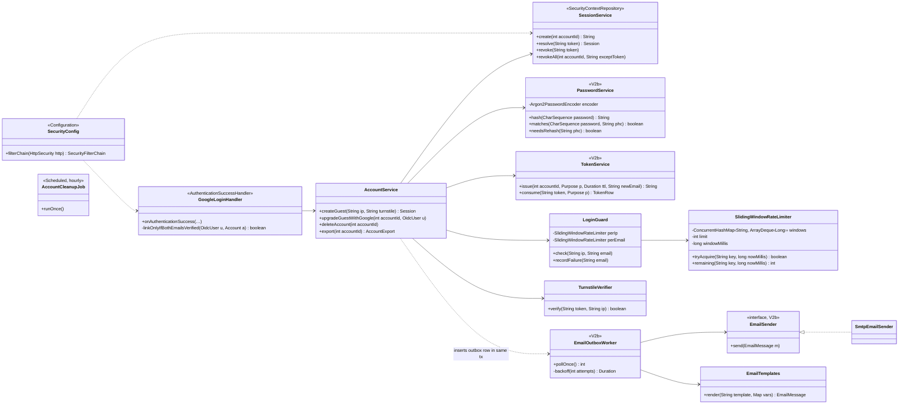
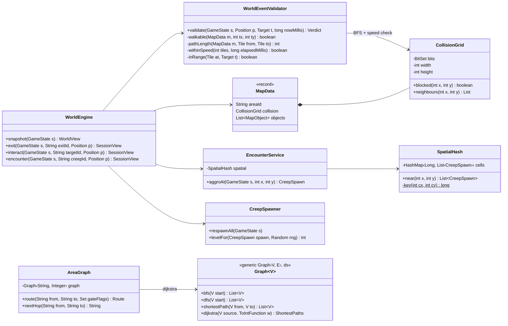
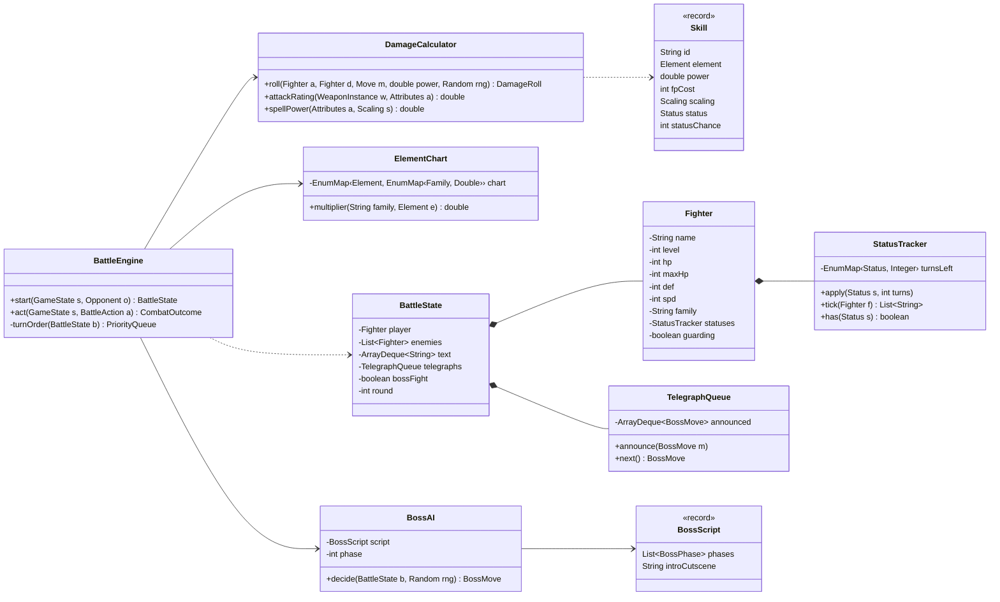
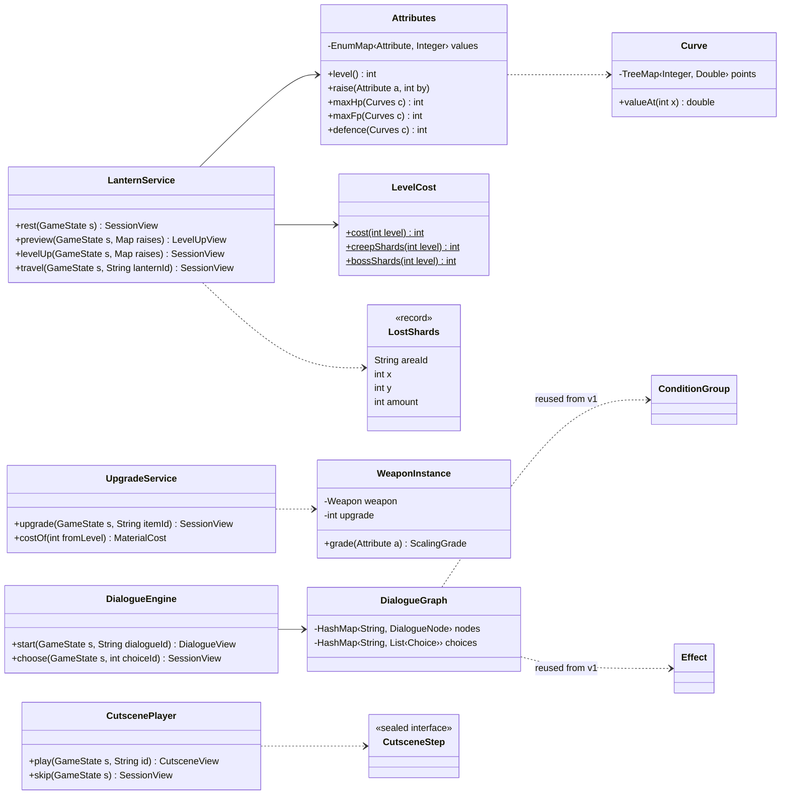
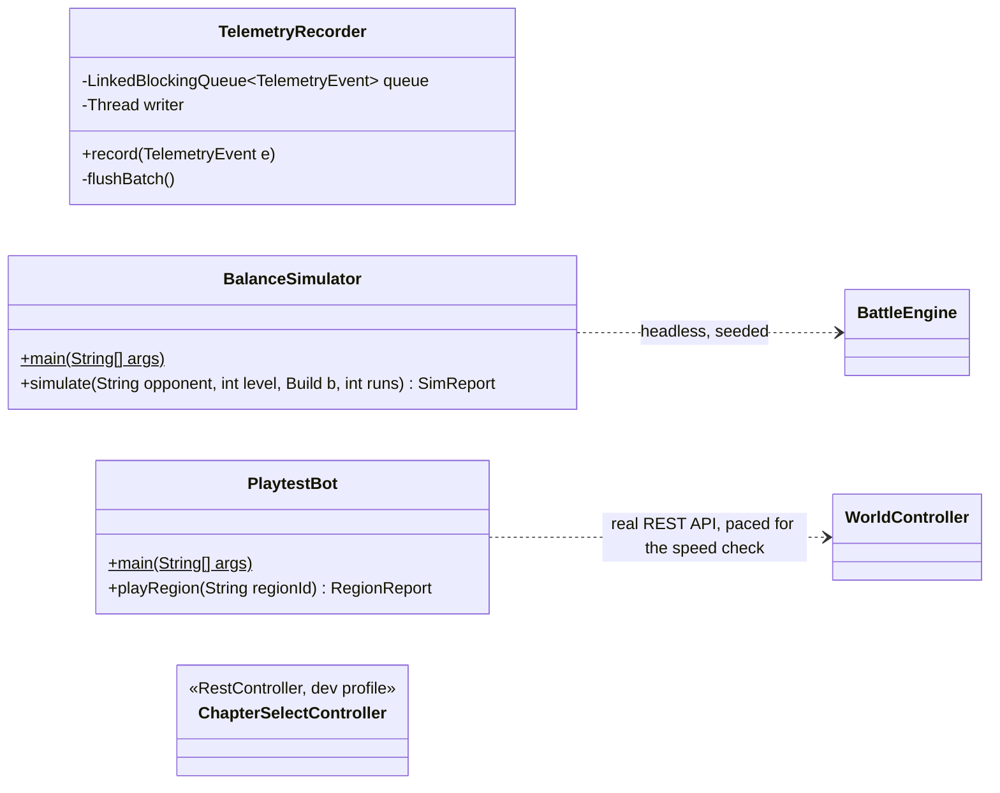

# Shardbound — Class Diagram v2

Classes for v2 (V2_SPEC §3–§5). Rule classes kept from v1 (rules, quest, story, item, event, achievement, combat) are described in `class-diagram.md` and appear here as plain boxes only. Signatures are indicative; the code is authoritative.
Legend: `+` public, `-` private, `~` package-private, `$` static. Two-parameter generics are written `Map‹K, V›`.

---

## 1. Engine, ports and persistence (P0)

The engine is framework-free (ArchUnit). It reaches the database only through the ports in `engine/port/`, which `persistence/` implements with `JdbcClient` and hand-written SQL.

`RunStore.update` returns the new version; a stale `expectedVersion` updates zero rows and the engine throws `RunConflictException` (409 `RUN_CONFLICT`).

---

## 2. Web layer (P0)

---

## 3. Saves and content (P0)

---

## 4. Accounts, sessions, email (V2a / V2b)

---

## 5. World and world events (V3)

---

## 6. Battle (V4, V7)

---

## 7. Progression, gear, dialogue, cutscenes (V5–V8)

---

## 8. Telemetry, tools, dev (V9–V10)

