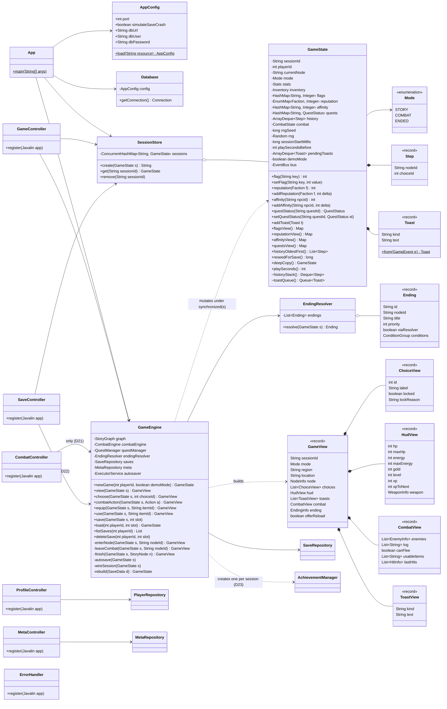
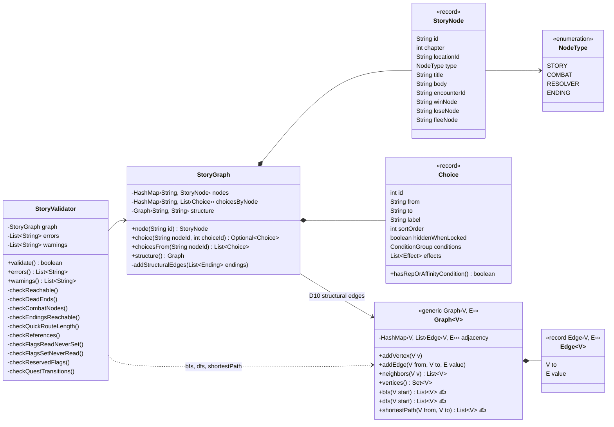
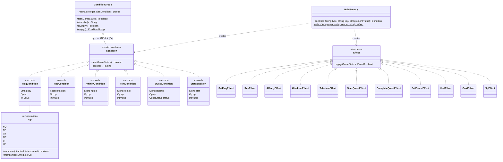
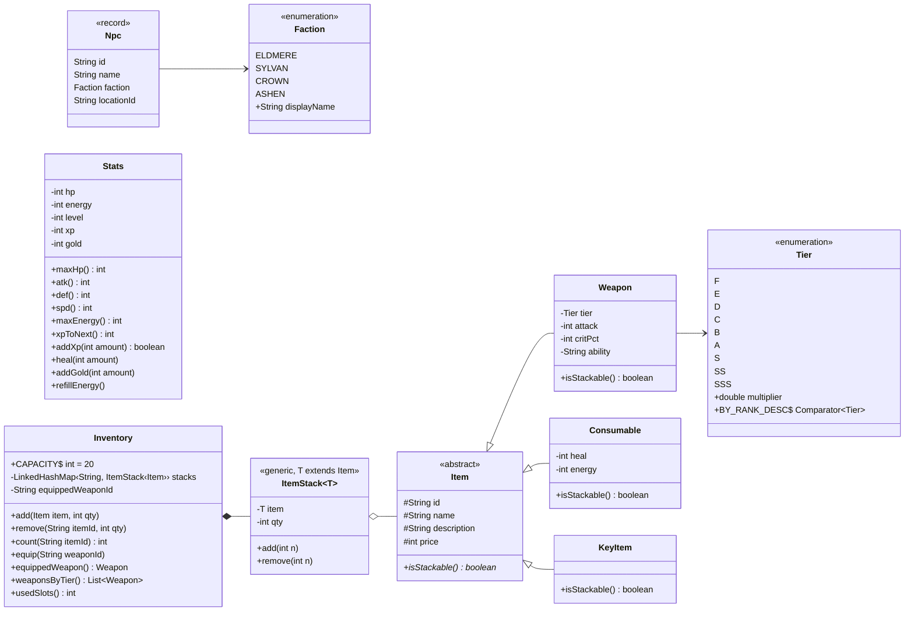
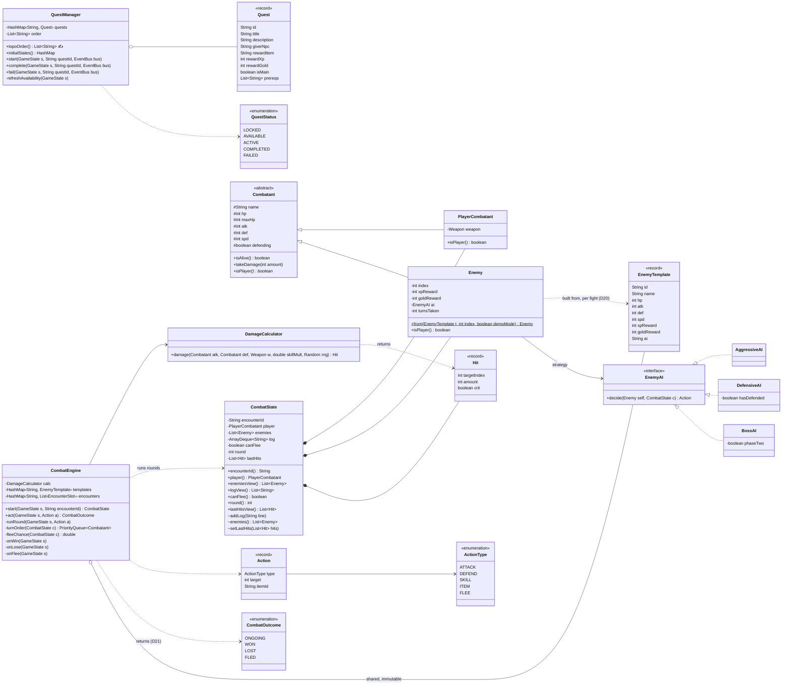
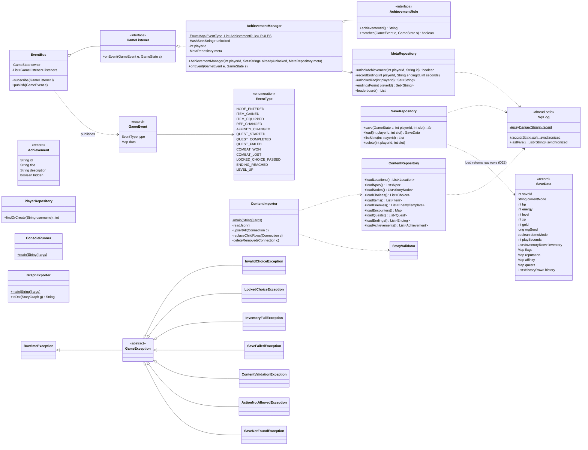

# Shardbound — Class Diagram

Source for `docs/class-diagram.png` (exported in Phase 10). One diagram per area so each stays readable.
Matches spec §3, §5 and §6 including decisions D4, D6, D7, D9, D10, D14, D15, D16 and D20–D31.

Legend: `+` public, `-` private, `#` protected, `$` static, `*` abstract. ✍ = student-implemented (CLAUDE.md rule 8).
Generic types with two parameters are written `Map‹K, V›` inside member text, because Mermaid cannot draw a comma inside `~generic~` markers.

Design notes that the diagrams rely on:
- **One `EventBus` per session.** It is created with its `GameState`, so `publish(event)` keeps the spec's one-argument signature and listeners still receive the state. The engine registers a lambda listener that turns each event into a `Toast`.
- **`Ending`, `Step` and `Toast`** are small records in `engine` (the spec's data-structure table already uses them).
- **Controllers call only `GameEngine` for gameplay** (D21, D22); `GameEngine` takes the state lock.
- **Content is immutable and shared; per-session objects are created per session or per fight** (D20, D23).
- **`GameState` / `CombatState` fields are private** (D30). `~` before a member means package-private.

---

## 1. Engine, sessions and API

---

## 2. Story graph and generic graph

---

## 3. Rules: conditions and effects

Every effect class holds `key` and/or `value` fields and publishes one `GameEvent` from `apply`. Quest effects delegate to `QuestManager`, which logs and ignores invalid transitions (D14).

---

## 4. Model and items

`Stats` derives `maxHp` (`40 + 5 * (level − 1)`), `atk`, `def`, `spd` and `maxEnergy` from `level` (D6, D28). `xp` is progress within the current level; `addXp` levels up while `xp ≥ xpToNext` and keeps the leftover (D29). `Inventory.add` throws `InventoryFullException` when a new stack would exceed 20 slots.

---

## 5. Quests and combat

Turn order: a `PriorityQueue<Combatant>` by speed descending; ties go to the player, then lower enemy index (S1). Energy refills at `start` (S2). `act` returns a `CombatOutcome`; `GameEngine.combatAction` routes WON → `win_node`, LOST → `lose_node`, FLED → `flee_node` or `lose_node`, no penalty for fleeing (D9, D21). `EncounterSlot` is a small record `(String enemyId, int qty)` from `encounter_enemy`.

---

## 6. Events, achievements, persistence, tools and exceptions

`ErrorHandler` maps `InvalidChoiceException` → 400, `LockedChoiceException` → 403, `SaveNotFoundException` → 404, `ActionNotAllowedException` → 409, `SaveFailedException` → 500 (D27). `ContentValidationException` only occurs at startup or import. `InventoryRow (itemId, qty, equipped)` and `HistoryRow (stepNo, nodeId, choiceId)` are small records nested in `SaveData`. `Location` is a record `(id, name, region)`.
