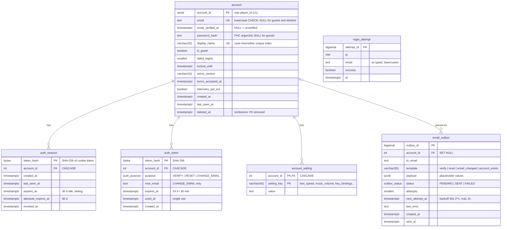
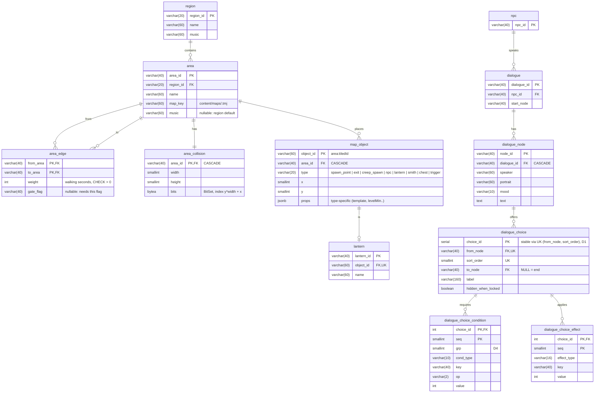
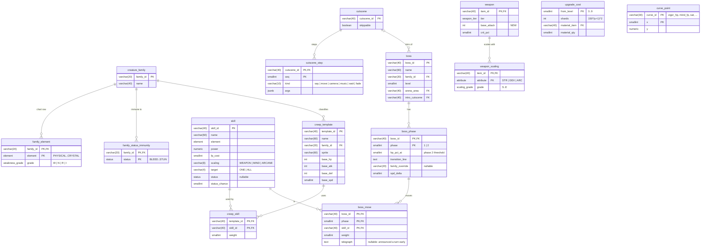
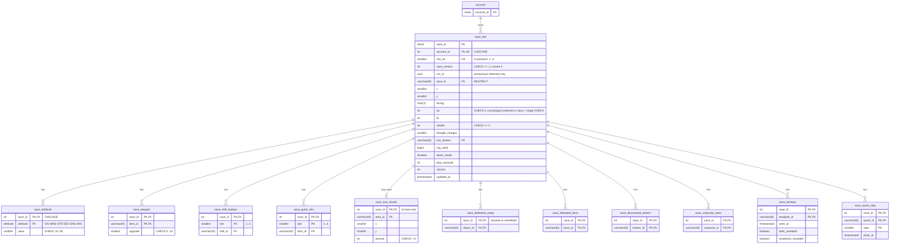
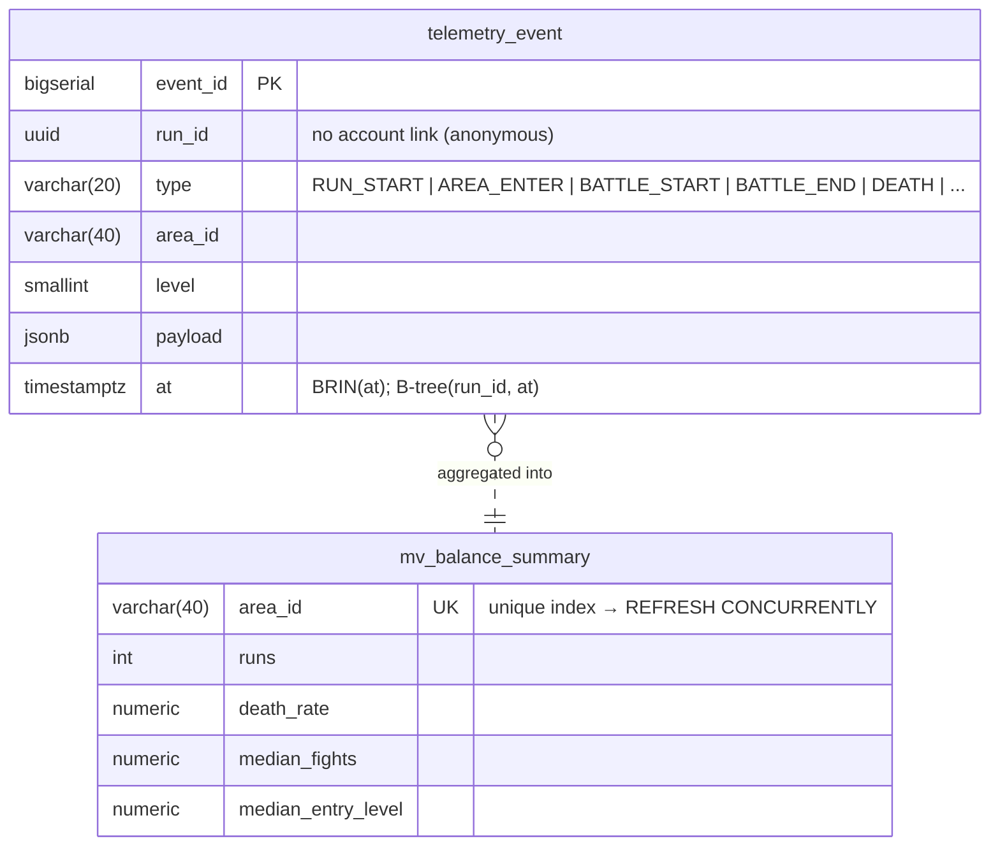

# Shardbound — ER Diagram v2

v2 additions and changes (V2_SPEC §6). The v1 diagram (`er-diagram.md`) still describes the baseline tables (`V1__baseline.sql`); this file shows what v2 adds or changes. Unchanged v1 entities appear with keys only.

Keys: **PK**, **FK**, **UK**. Crow's-foot: `||` one, `|o` zero-or-one, `o{` zero-or-many.

---

## 1. Accounts, sessions, tokens, email outbox (V2a / V2b)

---

## 2. World content (V3)

---

## 3. Battle content (V4, V6, V7)

---

## 4. Saves v2 (V5–V9)

v1 child tables `save_inventory`, `save_flag`, `save_reputation`, `save_affinity`, `save_quest` and `save_history` stay unchanged. `current_node` is dropped after the v1→v2 migration (V10__saves_v2).

---

## 5. Telemetry (V10)

Views: `v_deaths_by_area`, `v_time_per_area` (`LEAD(at) OVER (PARTITION BY run_id ORDER BY at)`), `v_fights_per_level` (`ROW_NUMBER()`, `SUM() OVER`).

## 6. Normal-form notes (v2)
- Still 3NF. Max HP/FP, defence, AR and spell power are **derived** from attributes, curves and weapons, never stored (D6/D28 extended).
- `save_slot.hp` keeps a plain range CHECK (`hp >= 0`); the curve-based upper bound is enforced in Java, because a CHECK cannot read `curve_point` rows (V-15).
- `map_object.props` is JSONB because each object type has different properties. It is the one deliberate semi-structured column; everything the server queries by (type, area, x, y) is a real column.
