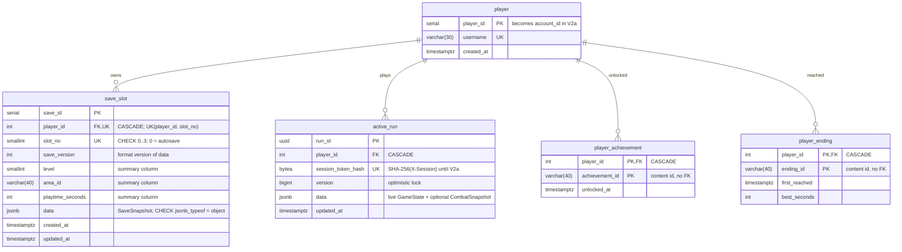
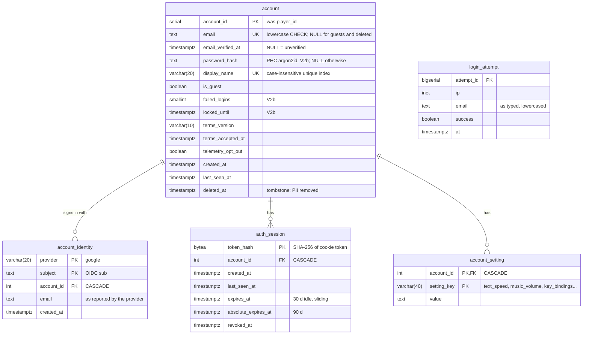
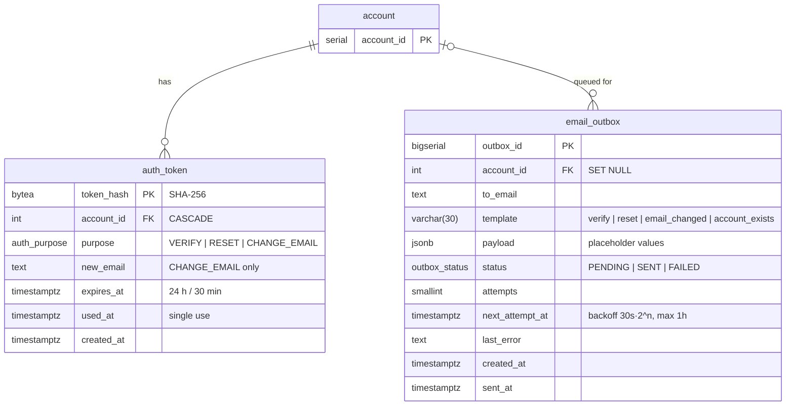
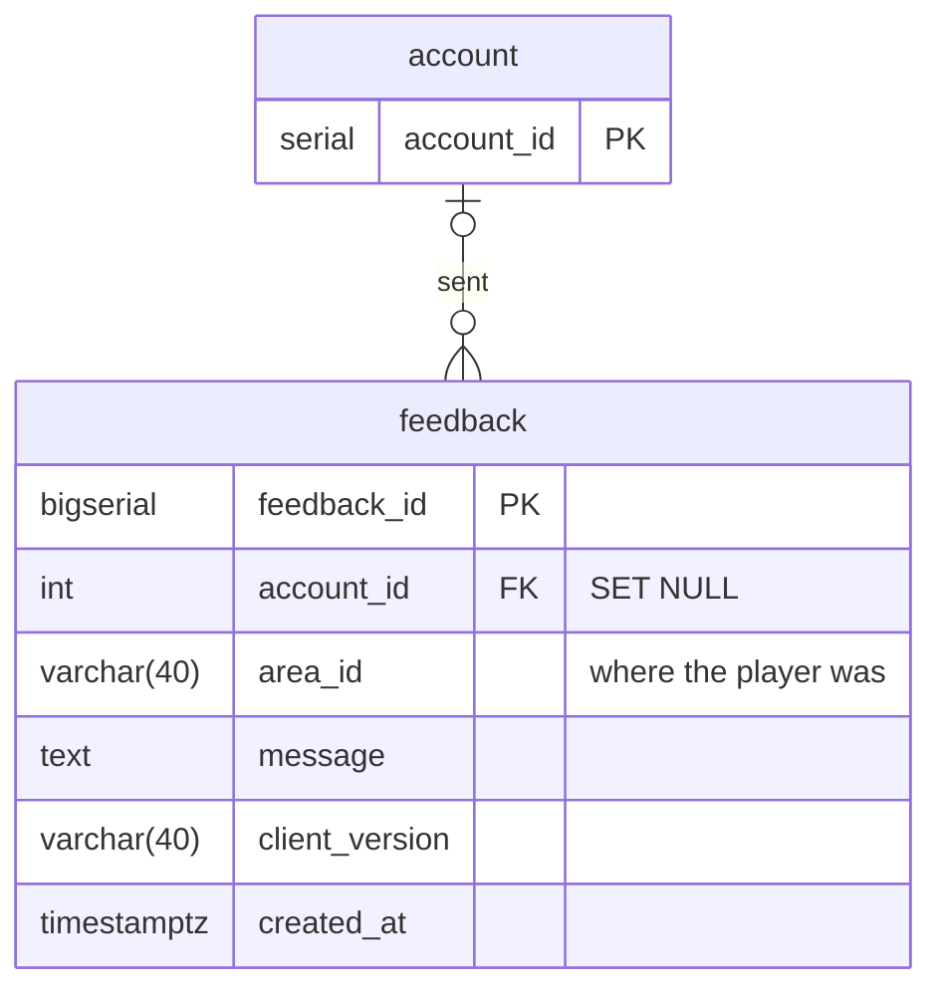
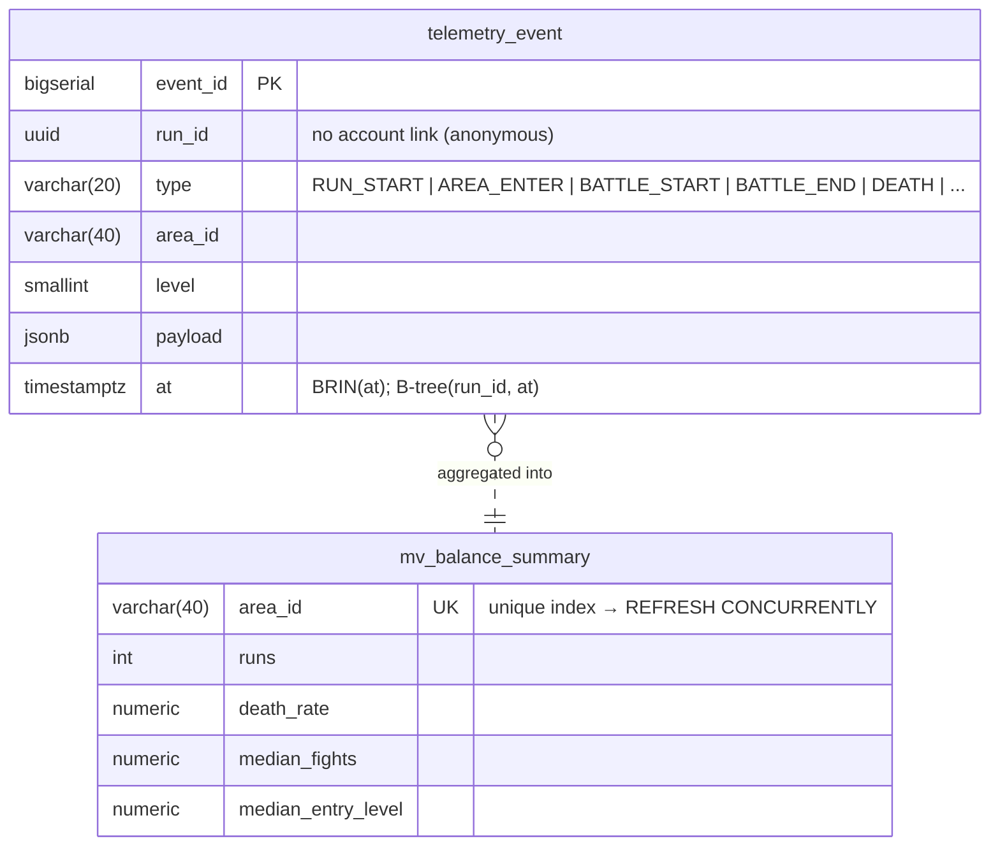

# Shardbound — ER Diagram v2

PostgreSQL holds **player data only** (V2_SPEC §6). Content (story, maps, creeps, bosses, balance) is JSON loaded at startup and has no tables (P-04). Saves and live runs are JSONB documents with a few real columns for what queries need (P-05, P-22). The migrations in `backend/src/main/resources/db/migration/` are authoritative; this file shows their shape.

Keys: **PK**, **FK**, **UK**. Crow's-foot: `||` one, `|o` zero-or-one, `o{` zero-or-many.

| Migration | Phase | Tables |
|---|---|---|
| `V1__baseline.sql` | P0 | player, save_slot, active_run, player_achievement, player_ending, view v_leaderboard |
| `V2__accounts.sql` | V2a | account (replaces player), account_identity, auth_session, login_attempt, account_setting |
| `V3__email_tokens.sql` | V2b | auth_token, email_outbox |
| `V4__feedback.sql` | ALPHA | feedback |
| `V5__telemetry.sql` | V10 | telemetry_event, views, mv_balance_summary |

---

## 1. Baseline (P0)

`v_leaderboard` (view): endings, achievements and fastest ending per player.

---

## 2. Accounts and sessions (V2a)

`save_slot`, `active_run`, `player_achievement` and `player_ending` keep their rows; their `player_id` columns now reference `account.account_id`.

---

## 3. Email tokens and outbox (V2b)

---

## 4. Feedback (ALPHA)

---

## 5. Telemetry (V10)

Views: `v_deaths_by_area`, `v_time_per_area` (`LEAD(at) OVER (PARTITION BY run_id ORDER BY at)`), `v_fights_per_level` (`ROW_NUMBER()`, `SUM() OVER`).

---

## 6. Design notes
- **Saves and runs are documents.** A save is always read and written whole, so `data JSONB` replaces a dozen child tables; the format evolves through versioned upgrades (`SaveUpgrader`), not schema migrations. Only fields that queries need (`level`, `area_id`, `playtime_seconds`) are real columns, written in the same UPSERT.
- **No player → content foreign keys.** Content ids (`area_id`, `achievement_id`, `ending_id`) are checked against the loaded content instead; a save with unknown ids is refused with `SAVE_INCOMPATIBLE`.
- **Derived stats are never stored.** Max HP/FP, defence, AR and spell power come from attributes, curves and weapons (D6 extended).
- **Optimistic locking** on `active_run.version`: every write-through is `UPDATE … WHERE run_id = ? AND version = ?`; zero rows means `RUN_CONFLICT`.
- Merged migrations are never edited; columns like the `feedback` fields above are settled when their phase is planned.
