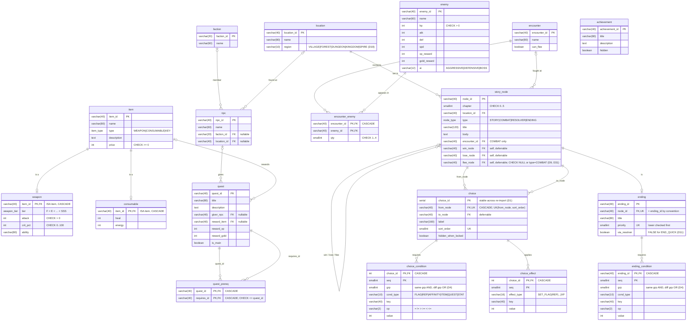

# Shardbound — ER Diagram

Source for `docs/ER-diagram.png` (exported in Phase 10). Matches spec §4.1 including decisions D1, D4, D6, D9, D11, D15, D19, D25, D28, D29, D31.
29 tables: 18 static content, 10 player state, 1 audit log.

Keys: **PK** primary key, **FK** foreign key, **UK** unique. Cardinality uses crow's-foot notation (`||` exactly one, `|o` zero or one, `o{` zero or many, `|{` one or many).

---

## 1. Static content (imported from `content/*.json`)

---

## 2. Player state (written by the game)

Content entities are repeated here with keys only, to show what player rows point at.

```mermaid
erDiagram
    player {
        serial player_id PK
        varchar(30) username UK
        timestamptz created_at
    }
    save_slot {
        serial save_id PK
        int player_id FK, UK "CASCADE; UK(player_id, slot_no)"
        smallint slot_no UK "0 = autosave, 1..3 manual"
        varchar(40) current_node FK "RESTRICT"
        int hp "CHECK 0 .. 40 + 5*(level-1) (D28)"
        int energy "CHECK >= 0 (D32)"
        int level "CHECK >= 1"
        int xp "progress within level (D29)"
        int gold "CHECK >= 0"
        bigint rng_seed "fresh seed drawn at save (D7)"
        boolean demo_mode "default FALSE (D25)"
        int play_seconds
        int version "+1 per overwrite"
        timestamptz updated_at "trigger touch_save"
    }
    save_inventory {
        int save_id PK, FK "CASCADE"
        varchar(40) item_id PK, FK "RESTRICT"
        int qty "CHECK > 0"
        boolean equipped "partial UNIQUE: one per save"
    }
    save_flag {
        int save_id PK, FK "CASCADE"
        varchar(40) flag_key PK "'_' prefix = engine-reserved (D15)"
        int value
    }
    save_reputation {
        int save_id PK, FK "CASCADE"
        varchar(20) faction_id PK, FK "RESTRICT"
        int value "CHECK -100..100"
    }
    save_affinity {
        int save_id PK, FK "CASCADE"
        varchar(40) npc_id PK, FK "RESTRICT"
        int value "CHECK -100..100"
    }
    save_quest {
        int save_id PK, FK "CASCADE"
        varchar(40) quest_id PK, FK "RESTRICT"
        quest_status status
    }
    save_history {
        int save_id PK, FK "CASCADE"
        int step_no PK "1 = oldest (S7)"
        varchar(40) node_id FK "RESTRICT"
        int choice_id FK "SET NULL (D1)"
    }
    player_achievement {
        int player_id PK, FK "CASCADE"
        varchar(40) achievement_id PK, FK "RESTRICT"
        timestamptz unlocked_at
    }
    player_ending {
        int player_id PK, FK "CASCADE"
        varchar(40) ending_id PK, FK "RESTRICT"
        timestamptz first_reached
        int best_seconds
    }
    save_audit {
        serial audit_id PK
        int save_id "no FK: survives deletion"
        varchar(10) action "INSERT|UPDATE"
        varchar(40) node_id
        timestamptz at
    }

    story_node {
        varchar(40) node_id PK
    }
    choice {
        serial choice_id PK
    }
    item {
        varchar(40) item_id PK
    }
    faction {
        varchar(20) faction_id PK
    }
    npc {
        varchar(40) npc_id PK
    }
    quest {
        varchar(40) quest_id PK
    }
    achievement {
        varchar(40) achievement_id PK
    }
    ending {
        varchar(40) ending_id PK
    }

    player ||--o{ save_slot : "owns (max 4)"
    save_slot ||--o{ save_inventory : "holds"
    save_slot ||--o{ save_flag : "has"
    save_slot ||--o{ save_reputation : "has"
    save_slot ||--o{ save_affinity : "has"
    save_slot ||--o{ save_quest : "tracks"
    save_slot ||--o{ save_history : "records"

    story_node ||--o{ save_slot : "current_node"
    item       ||--o{ save_inventory : "item_id"
    faction    ||--o{ save_reputation : "faction_id"
    npc        ||--o{ save_affinity : "npc_id"
    quest      ||--o{ save_quest : "quest_id"
    story_node ||--o{ save_history : "node_id"
    choice     |o--o{ save_history : "choice_id"

    player      ||--o{ player_achievement : "earned"
    achievement ||--o{ player_achievement : "earned by"
    player      ||--o{ player_ending : "reached"
    ending      ||--o{ player_ending : "reached by"

    save_slot ||..o{ save_audit : "logged by trigger (no FK)"
```

---

## 3. Referential actions (D1)

| Child → parent | ON DELETE | Effect |
|---|---|---|
| `weapon`/`consumable` → `item` | CASCADE | subtype row goes with its item |
| `encounter_enemy` → `encounter` | CASCADE | owned rows |
| `choice` → `story_node` (from_node) | CASCADE | a node's choices go with it |
| `choice_condition`, `choice_effect` → `choice` | CASCADE | owned rows |
| `quest_prereq` → `quest` (both columns) | CASCADE | owned rows |
| `ending_condition` → `ending` | CASCADE | owned rows |
| `save_*` children → `save_slot` | CASCADE | deleting a save deletes its contents |
| `save_slot`, `player_achievement`, `player_ending` → `player` | CASCADE | deleting a profile deletes everything it owns |
| every player table → a content table | **RESTRICT** | importer cannot remove content a save still uses; it aborts and names the save |
| `save_history.choice_id` → `choice` | **SET NULL** | a removed choice only blanks one journal label |
| `save_audit` | — (no FK) | audit history survives save deletion |

## 4. Other database objects (spec §4.2–4.3)

| Object | Kind | Purpose |
|---|---|---|
| `weapon_tier`, `node_type`, `item_type`, `quest_status` | ENUM types | ordered value sets shared with Java enums (`QuestStatusOrderTest`, D13) |
| `touch_save` | BEFORE UPDATE trigger on `save_slot` | sets `updated_at` |
| `audit_save` | AFTER INSERT/UPDATE trigger on `save_slot` | writes `save_audit` |
| `all_endings` | AFTER INSERT trigger on `player_ending` | grants `ALL_ENDINGS` when a player has every ending |
| `fn_best_weapon(save_id)` | SQL function | best weapon by enum order, then attack |
| `v_leaderboard` | view | endings, achievements, fastest ending per player |
| `one_equipped_per_save` | partial unique index | at most one equipped item per save |
| `idx_choice_from`, `idx_history_save` | indexes | FK columns used in lookups (Postgres does not auto-index FKs) |

## 5. Normal form notes

- **Every table is in 3NF, with no exceptions**: non-key columns depend on the whole key and nothing but the key.
- `max_hp`, `atk`, `def`, `spd` and `max_energy` are **not** stored in `save_slot`, because each is determined by `level` (a transitive dependency `save_id → level → max_hp`). Java derives them (D6, D28).
- The DB still enforces the hp limit without storing it: `CHECK (hp BETWEEN 0 AND 40 + 5 * (level - 1))` computes the bound from `level` in the same row. `MaxHpFormulaTest` keeps this expression and `Stats.maxHp()` identical (D28).
- `level` and `xp` are both stored and independent: `xp` is progress within the current level and resets on level-up, so neither determines the other (D29).
- `item` / `weapon` / `consumable` is a **generalization (ISA)** with a shared primary key; KEY items need no subtype table.
- Many-to-many relationships are resolved by associative tables: `encounter_enemy`, `quest_prereq`, `player_achievement`, `player_ending`.
